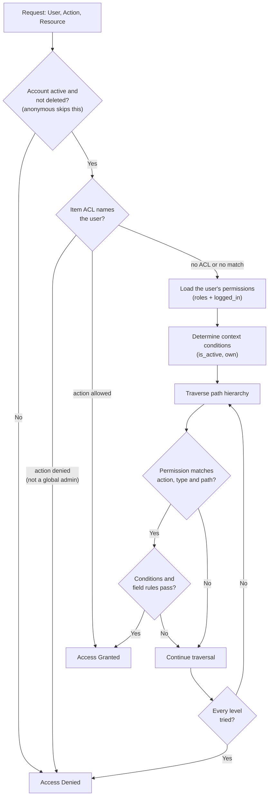

A deep technical overview of the DMART Access Control system. The system implements a hybrid model combining **Role-Based Access Control (RBAC)** for broad permissions and **Access Control Lists (ACLs)** for fine-grained, resource-specific overrides.

## Core Architecture

The access control logic is centralized in the `PermissionService` class. Data models are defined in `Dmart.Models.Core`.

### Key Components

**Permission** The atomic unit of access. Defines _what_ can be done on _which_ resources under _what_ conditions, and optionally which rows of them.

**Role** A named collection of Permission shortnames. Its `grantable_by` lists the roles whose holders may give it to a user.

**Group** A named set of users. Groups carry no roles: they matter for shared ownership (an entry's `owner_group_shortname` satisfies the `own` condition for its members), for query policies, and for a group's own `grantable_by`, which lists the groups whose members may add a user to it.

**User** The actor. Holds Roles directly; every signed-in user also gets the implicit `logged_in` role. Its `type` (`web`, `mobile`, `bot` or `admin`) decides how it signs in, not what it may do (see [Accounts and Sign-in](#accounts-and-sign-in)).

**ACL** Optional list embedded in a Resource that grants specific users specific actions, or denies them, before standard RBAC is consulted.

**Global admin** An account holding an active permission over `__all_spaces__` / `__all_subpaths__` that grants `create` and `update` on every resource type (or at least on users, roles, permissions and groups), with no conditions, field limits or row filter. The bootstrapped `super_manager` permission is one. Several rules below leave a decision to a global admin alone.

## The Authorization Algorithm

The `CanAsync` method is the gatekeeper. It evaluates requests based on the following precedence order:



## Detailed Evaluation Steps

### 1. ACL Evaluation (Short-Circuit)

Before evaluating roles, the system checks if the specific resource instance has an **Access Control List (ACL)** defined. An account that is inactive or deleted is refused before that, whatever an ACL says.

- **Check:** Per-entry `acl` list match. Each entry names a user, with the actions it is allowed and/or denied:

```json
{ "acl": [
  {"user_shortname": "alice", "allowed_actions": ["view", "update"]},
  {"user_shortname": "carol", "denied": ["query", "view"]}
] }
```

- **Logic:** The first entry naming the user that lists the requested action decides. If it lists the action in `denied`, access is **refused at once**, whatever the user's roles allow, owner or not. If it lists it in `allowed_actions`, access is **granted at once**, and no grant's conditions, field limits or row filter apply.

- **Note:** ACLs are checked _before_ Roles, so a `denied` entry overrides any role. Only a global admin is exempt from a deny, so whoever writes an ACL cannot shut one out. A write a deny refuses answers as one of a record that is not there wherever the record's address alone would admit it and the caller cannot read the record; a caller that can read it is refused `NOT_ALLOWED` (see [What a Refusal Says](#what-a-refusal-says)).

- **Listings:** A deny of `query` or `view` also keeps the record out of listings: query pages and totals, counters, tags, aggregations, joins, CSV and ZIP / Parquet exports, live notifications, and the attachments and history that hang off it.

- **Writing an ACL:** An entry's ACL is set when it is created, or later with an `update_acl` request, which needs `update` on the entry. It may hand out only what its writer holds: granting a user an action, or placing or lifting a deny, needs the writer to hold that action on the record through its roles, on a grant with no field limits or row filter. A writer the ACL itself denies an action can neither grant that action nor lift the deny. A global admin may write any ACL.

### 2. Permission Aggregation

If no ACL decides, the system compiles the user's effective permissions.

- **Source:** the user's Roles, plus the implicit `logged_in` role for every signed-in user. Inactive roles and permissions are skipped. The anonymous user also gets the `world` permission, once it holds at least one role.

- **Defaults:** A new install creates an empty `logged_in` role (attach a permission to it to grant it to every signed-in user), and an inactive, credential-less `anonymous` user holding a `world` role. Its `world` permission grants nothing until its `subpaths` are filled in; it then lets anonymous callers `view` and `query` active `content`, `folder`, `media`, `json`, `schema` and `comment` records there. Later starts never change these rows once they exist.

- **The sample seed** (`dmart seed`) fills `logged_in` with grants, three of them on each user's own tree in the `personal` space. `access_personal` reaches the records inside the user's `private`, `protected`, `public`, `messages`, `inbox` and `notifications` folders (`personal:/people/<me>/…`): content, folders, media, tickets, comments and the like, but no users, roles, groups or permissions. `own_personal_folders` gives the user its own folder, `people/<me>`, and every folder beneath it: folders only, `query`, `view`, `create`, `update` and `delete`, nothing in another user's tree. `own_personal_root` lists the user's own folder in `personal:/people`: folders only, `query` and `view` under `own`, read-only so that nobody creates folders beside their own. The folders made for a new account belong to the account, whoever created it (see [resource_folders_creation](/plugins)), so `own_personal_root` lists them. Without `--force`, `dmart seed` leaves a role or permission that already exists as it is, so an install seeded before these grants existed adds them to its `logged_in` role by hand.

- **Storage:** Permissions are stored in the SQL database for fast lookup. Each server caches a user's resolved permissions for `AUTHZ_CACHE_TTL` seconds (60 by default); writing a role, group or permission clears that server's cache at once, and `GET /managed/reload-security-data` clears it by hand.

### 3. Contextual Conditions

The system determines the "state" of the request to match against Permission conditions.

- **`is_active`:** Set if the resource's `is_active` flag is True.

- **`own`:** Set if `resource.owner_shortname == user.shortname` OR `resource.owner_group_shortname` is in `user.groups`. An account never owns its own user record, whatever its `owner_shortname` or owner group says, and the anonymous user owns nothing, though anonymous submissions name it as their owner.

- **Owner groups.** A record's owner group hands it to the group's members wherever `own` applies, so a create may name as `owner_group_shortname` only a group its creator belongs to. Any other group needs `assign` at the record's address, through a grant with no row filter and no condition, since there is no record yet to judge them on (a global admin's carries neither); otherwise the create is refused with `NOT_ALLOWED`. The group judged is the one the record is written with, so the rule holds for an entry created from a CSV row, MCP or a plugin, for a user, role, group or permission created through `/managed/request`, and for an attachment create that names one. A `/public/submit` body field named `owner_group_shortname` is the submission's data, not an owner group.

### 4. Hierarchy Traversal & Global Wildcards

The system checks the record's folder and every folder above it, up to the space root. A permission on a folder therefore covers everything below it, and one on `/` covers the whole space. Listings agree: a grant lists at its own folder and every folder below it, and a grant on `/` lists the whole space, with its conditions and row filter applied in every folder.

`/space/folder/subfolder/resource`

**Traversal Order:** (a match at any level grants, so the order changes nothing)

1. Root: `space:/`

2. `space:/folder`

3. ...

4. The record's own folder: `space:/folder/subfolder`

For a folder record, the folder's own name joins the walk: the `subfolder` record, which sits at `/folder`, is also covered by a permission on `folder/subfolder`.

**Wildcard Checks:**

- `__all_spaces__` — As a `subpaths` key, grants access across all spaces.

- `__all_subpaths__` — As a whole subpath, grants access to any subpath. It also stands for one segment: each step of the walk is also tried with its second-to-last segment replaced by `__all_subpaths__`, so `people/__all_subpaths__/protected` covers `people/<any one name>/protected` and everything below it.

- `__current_user__` — Inside a subpath, stands for the caller's shortname (for example `people/__current_user__/protected`).

- `__current_user__owner__` — Inside a subpath, stands for the shortname of the account that created the caller, its user record's `owner_shortname`. It is one word, never `__current_user__` followed by `owner__`.

The two words are resolved the same way in a subpath and in a [row filter](#naming-the-caller-in-a-filter), for listings, reads and writes by name, and the permissions `/user/profile` reports. A word that stands for no one is not resolved, and a subpath holding one reaches nothing: either word for the anonymous caller, and `__current_user__owner__` for an account no one owns or one whose record names itself as its owner.

A permission's subpaths are compared without their leading and trailing slashes, and with `//` read as `/`, so `/orders/` and `orders` name the same folder. An empty list (`{"sales": []}`) names no subpath and reaches nothing, for listings as for reads; write `"/"` for the space's root.

### 5. Constraint Validation

When a matching Permission key is found, three checks must pass:

1. **Action Check:** Is `action_type` (e.g., `view`, `create`) in the permission's `actions`, and the resource type in its `resource_types`?

2. **Condition Check:** Does the Permission require conditions (e.g., `own`)? If yes, does the current Context satisfy them?

3. **Field Check:** For `create` and `update` only:

   - **Restricted Fields:** Ensures the request writes no field listed in `restricted_fields`, nor any field below one (`payload.body` covers `payload.body.price`). An update also counts every stored field it would delete, such as the fields of a body sent as `[]`. A field of the objects in an array (`payload.body.items.price`) is each element's field (see [Review Statuses](#review-statuses--allowed-field-values)).

   - **Allowed Values:** Checks if the values being assigned to fields match `allowed_fields_values` (see [Review Statuses](#review-statuses--allowed-field-values)).

A permission that fails a check is passed over, and the next one is tried. A permission with a row filter adds one more test when a stored record is read or written by name, and on the record a create or update would leave (see [Row Filters](#row-filters)).

### 6. User Profile Protection

Users edit themselves through `POST /user/profile`, not through their permissions: an account never owns its own user record, and nobody changes their own sign-in or access fields through `/managed/request` (see [Managing User Accounts](#managing-user-accounts)). The profile endpoint changes the display name, description, language and payload, and the password only against the current one; email and phone change through `POST /user/verify-contact`. The `USER_PROFILE_PAYLOAD_PROTECTED_FIELDS` setting names payload fields a user may not set on their own profile, or at self-registration.

## Permission JSON Structure

Permissions are defined as JSON objects. Understanding these keys is critical for configuring access.

| Key | Type | Description |
|---|---|---|
| `subpaths` | `Dictionary<string, List<string>>` | **Target Scope.** Maps Space names to subpaths. A subpath covers that folder and everything below it; `/` covers the whole space. Use `__all_subpaths__` for any subpath, and `__all_spaces__` as the key for every space. An empty list reaches nothing. `/managed/request` refuses a value that is not an object mapping each space to a list of strings (`INVALID_DATA`). |
| `resource_types` | `List<string>` | **Target Resources.** The types of objects this permission applies to — one or more resource types (see [Allowed Values](#allowed-values) below). An empty list applies to _all_ types. |
| `actions` | `List<string>` | **Allowed Operations.** What the user can do — one or more of the 11 action types (see [Allowed Values](#allowed-values) below). An empty list grants nothing. |
| `conditions` | `List<string>` | **Contextual Requirements.** `own` and/or `is_active` (see [Allowed Values](#allowed-values) below). An empty list = no conditions. |
| `restricted_fields` | `List<string>` | **Field Protection.** Fields that _cannot_ be modified in `create` or `update` requests. |
| `allowed_fields_values` | `Dictionary<string, object>` | **Value Constraints.** Enforces that specific fields can only take specific values. |
| `filter_fields_values` | `string` | **Row Filter.** A search, in the [query syntax](/query-search), that limits which records the permission covers, for reads and writes alike, and may name the caller (see [Row Filters](#row-filters)). Empty = every record in scope. |

### Allowed Values

These are the values DMART checks for. Other strings in `actions`, `conditions` or `resource_types` are stored as given, but never match anything.

#### Actions — the 11 operation types

| Action | Authorizes |
|---|---|
| `view` | Read a single entry's metadata and payload. |
| `query` | Search / list entries via the `/query` endpoint. |
| `create` | Create a new entry. |
| `update` | Modify an existing entry's metadata or payload, or set its ACL (`update_acl`). |
| `delete` | Remove an entry. |
| `attach` | Not checked by the server. Adding an attachment (comment, media, reaction, relationship) needs `create` on the attachment's own resource type at the entry's path, and reading one needs `view` or `query` on that type (see [Row Filters](#row-filters)). |
| `assign` | Change an entry's owner (the `assign` request). Also what changing an attachment's owner group takes, and what a create takes to name an owner group its creator is not in. |
| `move` | Not checked by the server. A move needs `update` on the source and `create` at the destination. |
| `progress_ticket` | Advance a ticket through its workflow states. |
| `lock` | Place a lock on an entry to block concurrent edits. `update` allows it too. |
| `unlock` | Release a lock another user holds. A holder releases its own lock without it. |

#### Conditions — the 2 contextual gates

| Condition | Requirement |
|---|---|
| `own` | The requesting user must own the entry — its `owner_shortname` equals the user, or the entry's owning group is one of the user's groups. Never true for the user's own user record, nor for the anonymous user. |
| `is_active` | The entry's `is_active` flag must be `true`. |

Conditions gate access to _existing_ entries, so the `create` and `query` actions are exempt from condition checks. A listing still returns only the rows a grant's conditions admit: active ones under `is_active`, the caller's own under `own`.

Owning a row does not list it on its own. A listing follows the grants as a read by name does: a row is listed only through a grant whose resource types and conditions admit it (an `own` grant lists the caller's rows), or through an ACL that grants the caller `query`. A user's own user record is never listed through an `own` grant alone, and its attachments, a profile picture say, are listed only through a grant on user records that reaches it.

**The spaces listing** (`type: spaces` on `/managed/query` and `/public/query`, MCP's `dmart_spaces` and `dmart://spaces`) lists a space through an active grant that holds `view` or `query` and reaches something there, by the space's name or `__all_spaces__`, unless the space's ACL denies the caller `view` or `query`. A grant to `create` alone, such as a submission form's `world` grant, lists no space. Nor does a grant reach anything under an empty subpaths list, a subpath whose magic word does not resolve for the caller (an anonymous `world` grant on `people/__current_user__`), or a row filter that cannot be resolved. A query at a space's root is let in on the same terms when no grant admits it there directly.

#### Resource types — what the permission targets

Any of the platform's [resource types](/data-model) may be listed. An empty `resource_types` array applies to **all** types. The full set, grouped:

**Identity** `user`, `group`

**Structure** `folder`, `space`

**Content** `content`, `schema`, `data_asset`, `csv`, `jsonl`, `sqlite`, `parquet`

**Workflow** `ticket`

**Social** `comment`, `reply`, `post`, `reaction`, `notification`, `share`

**Attachments** `media`, `log`, `relationship`, `alteration`, `history`, `lock`

**Management** `role`, `permission`, `acl`

**Extensions** `locator`, `json`, `plugin_wrapper`

## Row Filters

A permission's `filter_fields_values` is a search, written in the [query syntax](/query-search), that narrows the records the permission covers, for reads and writes alike:

- **Listings** return, of the grant's types, only the rows that pass it. Several grants on one type widen each other: a row is listed when any one of them lists it, and a grant with no filter or condition over the whole query lists every row.

- **A read by name** (`/managed/entry`, `/public/entry`, `byuuid`, `byslug` and the payload routes) is held to it too. When every grant that admits the `view` carries a filter, the record must pass one of them, or the read is refused as if the record were not there.

- **A write of a stored record** is held to it the same way, by the grants that hold the write's action: update, patch, assign, update_acl, delete, move, progress-ticket, lock and unlock of an entry; update and delete of a user, role, group or permission, and a user's rename; and update, delete and change of owner group of an attachment, judged by the record it hangs off (below). When every grant that admits the write carries a filter, the record must pass one of them, checked with one query against the stored row. This holds on every route: `/managed/request` with one record or many, CSV import, MCP, alterations, the multipart upload, and a hard self-delete, which leaves the records a delete request from the account would be refused.

- **A record the filters hide** from a caller that cannot read it answers exactly as the same write of a record that is not there (see [What a Refusal Says](#what-a-refusal-says)), and nothing in it changes. A lock of it answers as a lock of an empty address, reported taken, and takes no lease, which would hold off writers the caller cannot see; an unlock of it, as one of an address with no lock. A caller that can read the record, through a `view` grant without the filter say, already knows it is there: its write, lock or unlock is refused `NOT_ALLOWED`, and nothing changes. A field limit does not hide a record: one the action's grants reach, their limits aside, is refused `NOT_ALLOWED`, an answer that turns on what the caller sent.

- **A create or update may not leave the filter.** When only filtered grants admit a create, the record as it will be written (its owner, a ticket's initial state and the rest) must pass one of their filters; an update admitted that way must leave the record passing one. A caller held to `@payload.body.region:south` can neither create a `north` record nor turn a `south` one into `north`: either is refused with `NOT_ALLOWED` before anything is written. The record is judged by the same SQL that filters listings, on PostgreSQL and SQLite alike. A move is held to the filters of the `create` grants at its destination, and a user's rename likewise. Assign and progress-ticket are not: handing a record to someone else is what assign is for, and a grant filtered by state must still move a ticket out of that state.

- **Names still say a record exists.** A create under a name that a record hidden from the caller holds answers `SHORTNAME_ALREADY_EXIST`, and a create or update that would break a folder's `unique_fields` with a hidden record's values says so. Names and unique values are unique across the rows a caller cannot see as well, so this cannot be hidden.

- **Cost.** A caller admitted by a grant with no filter, an ACL allow, or global admin rights runs no row-filter query. A caller held to filters runs one per record judged, and one more for what a create or update would leave.

- **Attachments and history** follow the record they hang off: they are listed, and an attachment is read, only where that record would be. A grant's row filter narrows that record, not its attachments. An attachment's update, delete or change of owner group holds that record to the filters of the action's grants in the same way: a record they hide, or one that cannot be found, takes the attachment with it, answered as missing to a caller that cannot read the attachment and refused `NOT_ALLOWED` to one that can. Creating an attachment is judged at its own address.

- **An attachment follows its record's ACL** on every read. Where the record it hangs off denies the caller `view` or `query` in its ACL, the attachment is refused: in listings, in `retrieve_attachments` on `/managed/entry` and `/public/entry`, on the payload routes, in an MCP download, and in WebSocket and MCP event notices. So is an attachment whose record's address two records share (a role created at `/users` under a user's name, say). A global admin is exempt, as from any deny.

- **An attachment also needs a grant of its own**, on top of that rule. Reading one, through `retrieve_attachments`, an `attachments` listing, `attachments_aggregation` or an attachment's history, takes a grant with `view` or `query` on the attachment's own resource type (`comment`, `media`, `reaction` and so on) at its subpath, held to that grant's `own` and `is_active` conditions. An attachment whose own ACL denies the caller is left out. A `world` grant that names only `content` therefore shows visitors a public entry but none of its comments, reactions or media. A global admin reads every attachment.

- **Folders and spaces** are not held to a row filter. A filter narrows the records in a folder, and the folder is their container.

- **An ACL allow** on a record admits it whatever the filters say.

### Naming the Caller in a Filter

A filter may say `__current_user__`, the caller's shortname, and `__current_user__owner__`, the account that created the caller, as a subpath may. Both are resolved per caller wherever the filter applies: listings, reads and writes by name, and the permissions `/user/profile` reports. `@payload.body.parent_shortname:__current_user__` covers the accounts whose parent is whoever asks, and follows a change of parent at once.

A filter with a word that cannot be resolved takes the grant away whole: it lists nothing, a read through it is refused, a write of a stored record through it alone answers as for a record that is not there (or is refused `NOT_ALLOWED`, when another grant lets the caller read the record), a create through it alone is refused, and it is left out of the profile's permissions. A word is not resolved:

- for the anonymous caller, either word;
- for an account no one owns, or one whose record names itself as its owner, `__current_user__owner__`;
- when the name would read as more than one value in the search grammar: one holding a space, `|`, `:`, `*`, `@`, `!`, `<`, `>`, `=`, a bracket, a brace, a quote or a backslash;
- when the name is one of the grammar's words, in any case: `null`, `true`, `false`, `or`, `and`. A user named `Null` would otherwise match every row without the field.

## What a Refusal Says

A write the caller may not make is refused in the same words whether or not its record exists, so a refusal does not tell the caller which records are there that it cannot read.

- **A record that is not there** is judged on its address alone, with no owner, `is_active` or ACL to lend it. A caller the address refuses gets `NOT_ALLOWED` ("no update access", "no move access", "not allowed to update attachment", …), as it would of a record that exists; one it admits hears the record is missing (`OBJECT_NOT_FOUND` or `SHORTNAME_DOES_NOT_EXIST`, or an empty success for a delete). This holds for update, patch, assign, update_acl, move and delete of an entry, update and delete of an attachment, update and delete of a user, role, group, permission or space, a dry-run delete included, and a user's rename. A CSV update row that names a missing entry reports `NOT_ALLOWED` to a caller without `update` there.

- **A record refused for what is stored** answers the same way to a caller that cannot read it. One whose ACL denies the caller the action, one stored with another type than the request names (a ticket where it says `content`), and one the write's row filters hide get what a missing record at that address gets, whenever the address alone would admit the write; only a caller the address refuses too hears `NOT_ALLOWED`. Nothing is written either way.

- **A record the caller can read** is refused `NOT_ALLOWED` instead. "Can read" is the judgement a read of the record by name gets, row filters and ACL included: a caller that can read the record already knows it is there, and answered as missing it would be misled (a delete would report success while the record stayed). It holds for every write above and for lock, unlock and progress-ticket, on `/managed/request`, `/managed/lock`, CSV imports and MCP alike. The read is judged only when a write is refused for what is stored, so an allowed write costs nothing more. A refusal by a condition (`own`, `is_active`) or a field limit stays `NOT_ALLOWED`, since a missing record is refused the same way. A global admin, whom no deny binds, and an ACL allow are unaffected.

- **Users, roles, groups, permissions and spaces are judged where they live.** Each is found by its shortname alone, so an update or delete of one, and a user's rename, is judged at its type's folder in the management space (`management:/users`, `/roles`, `/groups`, `/permissions`), or a space at its own root, whatever space and subpath the request names and whether or not it is there. An account stored outside the management space is judged at `management:/users` too. A space whose ACL refuses the caller its update or delete, where its address admits it, answers as a missing space ("space not found", or an empty success for a delete) only when its ACL also keeps the caller from reading it.

- **Creating a user, role, group or permission** through `/managed/request` is judged there too: it needs `create` at the type's folder in `management`, or global admin rights, whatever space and subpath the request names. The record is still stored where the request names (a pack may keep its permissions in its own space). A `create` grant elsewhere, such as one in the caller's own personal space, creates none of these, and a caller without the right hears `NOT_ALLOWED` whether or not the name is taken. A new account's ACL may hold only actions its creator holds in `management`, and a user's rename is judged as a create of the new name there.

- **Assign** checks `assign` on the record before it looks up the new owner. **Unlock**, past releasing the caller's own lock, needs `lock`, `update` or `unlock` on the entry before it answers, and refuses alike whether the entry is locked, unlocked or missing.

- **A refused attachment payload**, on `/managed/payload` and `/public/payload`, is an empty 404, as a missing one is, and MCP `dmart_download` answers a refused attachment with the "attachment not found" error a missing one gets.

## Permission Examples

### Super Manager — Full Access

```json
{
  "shortname": "super_manager",
  "subpaths": {
    "__all_spaces__": ["__all_subpaths__"]
  },
  "resource_types": [
    "schema", "space", "content", "user", "..."
  ],
  "actions": [
    "delete", "update", "query", "create", "view", "attach",
    "assign", "progress_ticket", "lock", "unlock"
  ],
  "conditions": [],
  "restricted_fields": []
}
```

Grants **unrestricted access** to all resources in all spaces. No ownership requirement, no field restrictions. Every start creates it when it is missing, held by the `super_admin` role that the built-in `dmart` account holds; it lists every action but `move`, which no request checks.

### View Users — Read-Only Scope

```json
{
  "shortname": "view_users",
  "subpaths": {
    "management": ["users"]
  },
  "resource_types": [
    "user", "folder"
  ],
  "actions": ["view", "query"],
  "conditions": []
}
```

Read-only access to the accounts in the `users` subpath of the `management` space (`user`) and to the `users` folder itself (`folder`). A permission that lists only `content`, `ticket` or `folder` there covers no account: accounts are records of type `user`.

### Edit Owned Accounts — Restricted Update

```json
{
  "shortname": "edit_owned_users",
  "subpaths": {
    "management": ["users"]
  },
  "resource_types": ["user"],
  "actions": ["update"],
  "conditions": ["own"],
  "restricted_fields": ["roles", "is_active"],
  "allowed_fields_values": {}
}
```

Can only edit user records it owns. Cannot modify `roles` or `is_active` fields — prevents self-promotion or account manipulation. A permission needs `subpaths`: without them it never matches. An account never owns its own user record, so this does not let anyone edit themselves; users do that through `POST /user/profile`. The sign-in fields of an owned account are further held to [Managing User Accounts](#managing-user-accounts).

### Regional Orders — Row Filter

```json
{
  "shortname": "read_north_orders",
  "subpaths": {
    "sales": ["orders"]
  },
  "resource_types": ["content"],
  "actions": ["view", "query"],
  "conditions": [],
  "filter_fields_values": "@payload.body.region:north"
}
```

Lists and opens only the orders whose body says `region: north`. Another order in the same folder is left out of its holder's listings, and answers `404` when read by name.

### Child Accounts — Row Filter Naming the Caller

```json
{
  "shortname": "manage_child_accounts",
  "subpaths": {
    "management": ["users"]
  },
  "resource_types": ["user"],
  "actions": ["view", "query", "create", "update"],
  "conditions": [],
  "filter_fields_values": "@payload.body.parent_shortname:__current_user__"
}
```

Each holder lists, opens and updates only the accounts whose body names it as `parent_shortname`, and creates only such accounts. A create or update that would name another parent is refused with `NOT_ALLOWED`; an account with another parent answers an update as one that does not exist. The rules of [Managing User Accounts](#managing-user-accounts) apply on top.

### Review Statuses — Allowed Field Values

```json
{
  "shortname": "write_reviews",
  "subpaths": {
    "reviews": ["/"]
  },
  "resource_types": ["content"],
  "actions": ["create", "update"],
  "conditions": [],
  "allowed_fields_values": {
    "payload.body.status": ["draft", "submitted"],
    "tags": [["public"], ["internal", "draft"]]
  }
}
```

Lets its holder write reviews whose status is `draft` or `submitted`, never `approved`, and whose tags are either `public` alone or drawn from `internal` and `draft`.

- **Keys** are field paths, flattened with dots (`payload.body.status`, `is_active`). Each value lists what the field may take.
- **A single value** must equal one in the list. **An array field** passes when every element is in the list. A list of lists allows an array whose elements all fit any one of the sublists.
- **An empty list limits nothing**: the field is not considered, whatever is written. To forbid writing a field, list it in `restricted_fields`.
- **Only what the request writes is checked.** A create or update that leaves `payload.body.status` out passes. A field an update deletes, such as one under a body sent as `[]`, is checked as `null`, so it passes only when the list holds `null`.
- **A field inside an array's objects binds every element.** For `payload.body.items: [{"name": "a", "price": 5}, …]`, the key `payload.body.items.price` is each item's price: `allowed_fields_values` needs an allowed value in every element that has the field (an element without it is not limited), and `restricted_fields` refuses a write that sets it in any element. An array inside an array is read through. An update writes an array whole, so sending it back writes every element's fields again, and dropping a field from every element, or sending `[]`, deletes the stored ones: under `restricted_fields: ["payload.body.items.price"]`, an update that names `items` at all is refused while any item, stored or sent, has a price.
- Like `restricted_fields`, this applies to `create` and `update` only.

## Managing User Accounts

Users, roles, groups and permissions are records in the `management` space, under the subpaths `users`, `roles`, `groups` and `permissions`, and are created, updated and deleted through `/managed/request`. Creating a user:

```json
{
  "space_name": "management",
  "request_type": "create",
  "records": [
    {
      "resource_type": "user",
      "subpath": "/users",
      "shortname": "jdoe",
      "attributes": {
        "displayname": {"en": "Jane Doe"},
        "email": "jane@example.com",
        "is_email_verified": true,
        "password": "Handover-2026",
        "force_password_change": true,
        "roles": ["editor"],
        "groups": ["sales"]
      }
    }
  ]
}
```

A role, group or permission takes the same request, with `resource_type` `role`, `group` or `permission` and its own subpath. Each is found by its shortname, so an update or delete of one, and a user's rename, is judged where it lives, whatever coordinates the request names (see [What a Refusal Says](#what-a-refusal-says)). On a user:

- **A password is set only on `create`**, and must meet the [password rule](#password-rule). An `update` carrying `password` is refused with `INVALID_DATA` ("password cannot be changed via /managed/request; use the OTP password-reset flow or /user/profile"). To get someone back into an account, set `force_password_change` and have them reset the password by code, or run `dmart passwd` on the host.

- **A create without a password** always sets `force_password_change`, and the user sets a first password through a reset by code.

- **A contact `email` is unique, whatever its case.** A create or update whose `email` another account in the same folder holds, in any case, is refused with `DATA_SHOULD_BE_UNIQUE` (415, naming `@email`); one held by an account in another folder, by the database, with `INVALID_DATA` ("… already in use"). An update that keeps the account's own email, in any case, is not checked for it.

- **`is_email_verified` and `is_msisdn_verified` default to `false`.** Until they are set, or the user verifies the contact, a sign-in that names that email or phone is refused with `USER_ISNT_VERIFIED` (11). A sign-in by shortname is not.

User managers are also held to these rules there. A global admin is held to none of them.

- **Giving roles and groups.** A role may be given to a user only by someone holding a role its `grantable_by` lists, and a group only by a member of a group its `grantable_by` lists. A role or group that is inactive, missing (a name with no `role` or `group` record), or has no `grantable_by` is a global admin's to give. Holding a role does not by itself let you give it.

- **What roles and permissions grant.** Setting a role's `permissions` or `grantable_by`, a group's `grantable_by`, or a permission's `subpaths`, `resource_types`, `actions`, `conditions`, `restricted_fields`, `allowed_fields_values` or `filter_fields_values` takes a global admin, as does switching a role, group or permission back on.

- **Nobody changes their own account's sign-in or access fields** there: `email`, `msisdn`, `force_password_change`, `type`, `is_active`, `roles`, `groups`, `is_email_verified`, `is_msisdn_verified`, `locked_to_device` (and `device_id` where it decides the sign-in), the hosted `mailbox` and `mail_aliases`, nor an `unlock`. Posting a record back unchanged is fine.

- **On another account**, the same fields need a global admin when the account holds a role or group the actor could not give. On an admin account they need a global admin, or the admin that owns the account while that owner is an active admin able to give every role and group the account holds.

- **An account an ACL grants an action** (an entry on any record naming it with a non-empty `allowed_actions`) has its sign-in fields, every field above but `is_active`, `roles` and `groups`, changed only by a global admin, since whoever reset it would gain what the ACL opens. A name an ACL grants, a name an account had before, and a directory feed reader's name are given to an account, by a create or a rename, only by a global admin.

## Accounts and Sign-in

### Account Types

| Type | How it signs in |
|---|---|
| `web` | A password, or a one-time code. |
| `mobile` | As `web`. Once it has signed in from a device, a password sign-in from any other device, or with none, is asked for a code (`OTP_NEEDED`, 115). |
| `bot` | For integrations. Never locked by failed attempts and outside the session limit; its token works until it expires or is ended by a sign-out. |
| `admin` | A password **and** a one-time code, both checked. Never through Google, Facebook, Apple, an LDAP bind, or the MCP and OpenID Connect sign-in forms. With `ADMIN_IP_ALLOWLIST` set, served only from those addresses, at sign-in and on every request. |

The type grants no permissions; roles do. An admin account needs a password and a phone or an email for its code, which `/managed/request` enforces, and making an account an admin ends its sessions. An admin resets its password by code only while another admin has set `force_password_change` on the account; the reset clears it. The built-in `dmart` account is held at every start to `ADMIN_USER_TYPE`: `web` (the default) or `admin`.

**Locked to a device.** `locked_to_device` works on an account of any type, and on password, code and Google, Facebook and Apple sign-in alike. The first sign-in that sends a `device_id` claims the device. After that, a sign-in with no `device_id`, or with another one, is refused with `USER_ACCOUNT_LOCKED` (110); unlike a `mobile` account's new device, it is not offered a code. A user who replaces the phone needs an admin to clear the account's `device_id` with a user update.

### Password Rule

Every new password must meet one rule: at registration, on `/user/profile`, at password reset, in an admin's create, and in `dmart passwd`. The built-in rule asks for 8–64 characters with at least one digit and one uppercase letter (Latin or Arabic), from a set of allowed symbols. A deployment sets its own with a `password` pattern and a `password_hint`, the message a refused password gets, in the regex file (`REGEX_CONFIG_PATH`, `~/.dmart/regex.json` by default). Existing passwords are never re-checked.

The same file overrides the `email` and `msisdn` formats. The built-in ones are `^[A-Za-z0-9._%+-]+@[A-Za-z0-9.-]+\.[A-Za-z]{2,}\z` and `^\+?[0-9]{6,15}\z`.

- **End a pattern with `\z`**, not `$`, which also matches before a final newline. The file is JSON, so it writes each backslash twice: `\\z`.
- **A pattern that does not compile** is logged and its default applies. A file that is not valid JSON is ignored whole, so every default stays.
- **A match is cut off after 100 ms**, and counts as a refusal.
- **The file is read at start**, so a change needs a restart.

### Forced Password Change

`force_password_change` marks an account whose password is missing or temporary. It is set on every account created without a password: by an admin's create, by a self-registration with only an email or phone, and by a code sign-in that registers the account (`ENABLE_OTP_IMPLICIT_REGISTRATION`). An admin may also set it. Setting a password on `/user/profile` or through a reset clears it, and `GET /user/profile` returns it.

`/user/login` and the MCP sign-in do not stop on it, so a client reads the flag and asks the user for a new password. The OpenID Connect provider stops such a user with a page asking them to change it first.

### Lockout

Wrong passwords and codes add to one counter per account: at sign-in, at password reset, on a profile password change, at `/user/validate_password`, on an email or phone change at `/user/verify-contact`, at the MCP and OpenID Connect sign-in forms, and on an LDAP bind. At `MAX_FAILED_LOGIN_ATTEMPTS` (5) the account is locked and refuses even the right password, until no attempt has been made for `LOCKOUT_COOLDOWN_SECONDS` (900) or a user update carrying `unlock: true` lifts it.

The lock stops guessing at the password. Anyone who knows a username can keep it in force, so it does not shut the owner out: a one-time code sent to the account's own phone or email still signs it in and still resets its password. While the cool-down has not run out:

| Path | While locked |
|---|---|
| Password sign-in: `/user/login` with a password, the MCP and OpenID Connect sign-in forms | Refused before the password is checked, the right one included (`USER_ACCOUNT_LOCKED`, 110, at `/user/login`). The attempt restarts the cool-down. |
| Code sign-in: `/user/login` with `otp` | A right code signs in and clears the counter. A wrong code answers 110, is not counted again, and restarts the cool-down; the expired code itself answers `OTP_EXPIRED` (308). An admin still needs its password with the code, and a wrong one answers 110. |
| `/user/otp-request` for `login` or `reset` | The code is sent as for any account; a deactivated or deleted one gets none. An admin gets no `login` code here, since only a password sign-in sends it, so a locked admin waits out the cool-down, or resets while another admin has set `force_password_change`. |
| `/user/otp-request` for `verify-contact` | Nothing is sent; the answer is the same 200. |
| `/user/password-reset-confirm` | A right code sets the new password and clears the counter. A wrong code counts and answers `OTP_INVALID` (307); the expired code itself counts and answers `OTP_EXPIRED` (308). |
| A password a session presents: `/user/validate_password`, `old_password` on `/user/profile`, `password` on `/user/verify-contact` | Refused as locked; the password is not checked. |
| LDAP bind | Refused as a wrong password is (`invalidCredentials`); the password is not checked. |
| `/oauth/token`, both grants | `invalid_grant`. |
| A token issued before the lock | Works until it expires. |

Guesses at a code are capped by that code's own `MAX_OTP_VERIFY_ATTEMPTS`, lock or no lock. The one session a lock ends is the one whose own wrong password tripped it, on `/user/validate_password`, `/user/profile` or `/user/verify-contact`. The counter is the server's own: an `attempt_count` sent in an update is ignored. Who may unlock an account follows [Managing User Accounts](#managing-user-accounts), and an unlock that clears the counter writes a history row naming who lifted it. The [settings](/settings) page draws the lock over time.

### Sessions

Each sign-in issues a token valid for `JWT_ACCESS_EXPIRES` (30 days) and records a session, and every request checks that the session is still there. Signing out ends it. An account keeps at most `MAX_SESSIONS_PER_USER` (5) sessions; a sign-in past that ends the oldest, and 0 means no limit. With `SESSION_INACTIVITY_TTL` set, a session unused for that many seconds ends. A bot keeps no session, so neither limit applies to it. A password change or reset ends the account's sessions while `LOGOUT_ON_PWD_CHANGE` is on (the default), and so do deactivating the account, making it an admin, and switching it to or from `bot`.

### Mailbox, Aliases and Services

A user carries three directory fields beside its contact `email`, for the mail, chat and code services that sign in against dmart over [LDAP and OpenID Connect](/settings#directory-ldap-replicas-and-openid-connect):

| Field | Holds |
|---|---|
| `mailbox` | The address this deployment hosts for the user. The contact `email` stays where codes and resets go. |
| `mail_aliases` | Up to 100 further addresses delivered to the mailbox. |
| `services` | Up to 64 services the user may use, such as `mail` or `gitea`. |

- **Addresses** are trimmed, lowercased, and must pass the email format. Each mailbox and alias is unique across all live users, whatever its case. The database enforces it, and a clash is `INVALID_DATA` ("… is already in use"), without naming the holder. With `USER_MAIL_DOMAINS` set, each must be in one of those domains. An address may not be another user's contact `email`, and a contact `email` may not be another user's mailbox or alias. Aliases need a mailbox, and may not repeat it.

- **Services** must match `^[a-z][a-z0-9_-]{0,63}$`, and be listed in `USER_SERVICES` when that is set. Only a change is checked against `USER_SERVICE_GRANTERS`: a user holding the role paired with `mail` can add or remove `mail` on a user who also has `gitea`. A change the actor may not make is refused with `NOT_ALLOWED`. A global admin may change any.

- **Who sets them.** They are set through `/managed/request`, never through `/user/profile`, and nobody changes their own `mailbox` or `mail_aliases` (see [Managing User Accounts](#managing-user-accounts)). An update checks only the fields it changes. A soft delete clears all three, which frees the addresses.

- **Sign-in and reset.** A user signs in with the mailbox in `email` and a password, never with a one-time code. A password reset that names the mailbox sends its code to the account's phone, else its contact email, never to the mailbox.

- **Where they show.** LDAP serves `mail` as the mailbox, else the contact email once it is verified, with `mailAlias` and `authorizedService`. OpenID Connect asserts the mailbox, else the contact email, as `email`.
