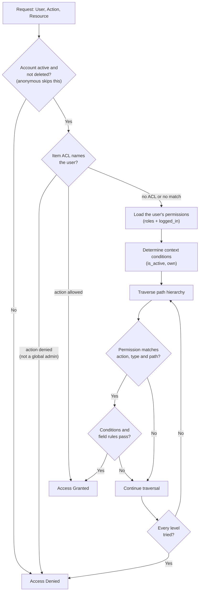

A deep technical overview of the DMART Access Control system. The system implements a hybrid model combining **Role-Based Access Control (RBAC)** for broad permissions and **Access Control Lists (ACLs)** for fine-grained, resource-specific overrides.

## Core Architecture

The access control logic is centralized in the `PermissionService` class. Data models are defined in `Dmart.Models.Core`.

### Key Components

**Permission** The atomic unit of access. Defines _what_ can be done on _which_ resources under _what_ conditions, and optionally which rows of them.

**Role** A named collection of Permission shortnames. Its `grantable_by` lists the roles whose holders may give it to a user.

**Group** A named set of users. Groups carry no roles: they matter for shared ownership (an entry's `owner_group_shortname` satisfies the `own` condition for its members), for query policies, and for a group's own `grantable_by`, which lists the groups whose members may add a user to it.

**User** The actor. Holds Roles directly; every signed-in user also gets the implicit `logged_in` role. Its `type` (`web`, `mobile`, `bot` or `admin`) decides how it signs in, not what it may do (see [Accounts and Sign-in](#accounts-and-sign-in)).

**ACL** Optional list embedded in a Resource that grants specific users specific actions, or denies them, before standard RBAC is consulted.

**Global admin** An account holding an active permission over `__all_spaces__` / `__all_subpaths__` that grants `create` and `update` on every resource type (or at least on users, roles, permissions and groups), with no conditions, field limits or row filter. The bootstrapped `super_manager` permission is one. Several rules below leave a decision to a global admin alone.

## The Authorization Algorithm

The `CanAsync` method is the gatekeeper. It evaluates requests based on the following precedence order:



## Detailed Evaluation Steps

### 1. ACL Evaluation (Short-Circuit)

Before evaluating roles, the system checks if the specific resource instance has an **Access Control List (ACL)** defined. An account that is inactive or deleted is refused before that, whatever an ACL says.

- **Check:** Per-entry `acl` list match. Each entry names a user, with the actions it is allowed and/or denied:

```json
{ "acl": [
  {"user_shortname": "alice", "allowed_actions": ["view", "update"]},
  {"user_shortname": "carol", "denied": ["query", "view"]}
] }
```

- **Logic:** The first entry naming the user that lists the requested action decides. If it lists the action in `denied`, access is **refused at once**, whatever the user's roles allow, owner or not. If it lists it in `allowed_actions`, access is **granted at once**, and no grant's conditions, field limits or row filter apply.

- **Note:** ACLs are checked _before_ Roles, so a `denied` entry overrides any role. Only a global admin is exempt from a deny, so whoever writes an ACL cannot shut one out.

- **Listings:** A deny of `query` or `view` also keeps the record out of listings: query pages and totals, counters, tags, aggregations, joins, CSV and ZIP / Parquet exports, live notifications, and the attachments and history that hang off it.

- **Writing an ACL:** An entry's ACL is set when it is created, or later with an `update_acl` request, which needs `update` on the entry. It may hand out only what its writer holds: granting a user an action, or placing or lifting a deny, needs the writer to hold that action on the record through its roles, on a grant with no field limits or row filter. A writer the ACL itself denies an action can neither grant that action nor lift the deny. A global admin may write any ACL.

### 2. Permission Aggregation

If no ACL decides, the system compiles the user's effective permissions.

- **Source:** the user's Roles, plus the implicit `logged_in` role for every signed-in user. Inactive roles and permissions are skipped. The anonymous user also gets the `world` permission, once it holds at least one role.

- **Defaults:** A new install creates an empty `logged_in` role (attach a permission to it to grant it to every signed-in user), and an inactive, credential-less `anonymous` user holding a `world` role. Its `world` permission grants nothing until its `subpaths` are filled in; it then lets anonymous callers `view` and `query` active `content`, `folder`, `media`, `json`, `schema` and `comment` records there. Later starts never change these rows once they exist.

- **Storage:** Permissions are stored in the SQL database for fast lookup. Each server caches a user's resolved permissions for `AUTHZ_CACHE_TTL` seconds (60 by default); writing a role, group or permission clears that server's cache at once, and `GET /managed/reload-security-data` clears it by hand.

### 3. Contextual Conditions

The system determines the "state" of the request to match against Permission conditions.

- **`is_active`:** Set if the resource's `is_active` flag is True.

- **`own`:** Set if `resource.owner_shortname == user.shortname` OR `resource.owner_group_shortname` is in `user.groups`. An account never owns its own user record, whatever its `owner_shortname` says, and the anonymous user owns nothing, though anonymous submissions name it as their owner.

### 4. Hierarchy Traversal & Global Wildcards

The system checks the record's folder and every folder above it, up to the space root. A permission on a folder therefore covers everything below it, and one on `/` covers the whole space.

`/space/folder/subfolder/resource`

**Traversal Order:** (a match at any level grants, so the order changes nothing)

1. Root: `space:/`

2. `space:/folder`

3. ...

4. The record's own folder: `space:/folder/subfolder`

For a folder record, the folder's own name joins the walk: the `subfolder` record, which sits at `/folder`, is also covered by a permission on `folder/subfolder`.

**Wildcard Checks:**

- `__all_spaces__` — As a `subpaths` key, grants access across all spaces.

- `__all_subpaths__` — Grants access to any subpath.

- `__current_user__` — Inside a subpath, stands for the caller's shortname (for example `people/__current_user__/protected`).

### 5. Constraint Validation

When a matching Permission key is found, three checks must pass:

1. **Action Check:** Is `action_type` (e.g., `view`, `create`) in the permission's `actions`, and the resource type in its `resource_types`?

2. **Condition Check:** Does the Permission require conditions (e.g., `own`)? If yes, does the current Context satisfy them?

3. **Field Check:** For `create` and `update` only:

   - **Restricted Fields:** Ensures the request writes no field listed in `restricted_fields`, nor any field below one (`payload.body` covers `payload.body.price`). An update also counts every stored field it would delete, such as the fields of a body sent as `[]`.

   - **Allowed Values:** Checks if the values being assigned to fields match `allowed_fields_values`.

A permission that fails a check is passed over, and the next one is tried. A permission with a row filter adds one more test when a record is read by name (see [Row Filters](#row-filters)).

### 6. User Profile Protection

Users edit themselves through `POST /user/profile`, not through their permissions: an account never owns its own user record, and nobody changes their own sign-in or access fields through `/managed/request` (see [Managing User Accounts](#managing-user-accounts)). The profile endpoint changes the display name, description, language and payload, and the password only against the current one; email and phone change through `POST /user/verify-contact`. The `USER_PROFILE_PAYLOAD_PROTECTED_FIELDS` setting names payload fields a user may not set on their own profile, or at self-registration.

## Permission JSON Structure

Permissions are defined as JSON objects. Understanding these keys is critical for configuring access.

| Key | Type | Description |
|---|---|---|
| `subpaths` | `Dictionary<string, List<string>>` | **Target Scope.** Maps Space names to subpaths. A subpath covers that folder and everything below it; `/` covers the whole space. Use `__all_subpaths__` for any subpath, and `__all_spaces__` as the key for every space. |
| `resource_types` | `List<string>` | **Target Resources.** The types of objects this permission applies to — one or more resource types (see [Allowed Values](#allowed-values) below). An empty list applies to _all_ types. |
| `actions` | `List<string>` | **Allowed Operations.** What the user can do — one or more of the 11 action types (see [Allowed Values](#allowed-values) below). An empty list grants nothing. |
| `conditions` | `List<string>` | **Contextual Requirements.** `own` and/or `is_active` (see [Allowed Values](#allowed-values) below). An empty list = no conditions. |
| `restricted_fields` | `List<string>` | **Field Protection.** Fields that _cannot_ be modified in `create` or `update` requests. |
| `allowed_fields_values` | `Dictionary<string, object>` | **Value Constraints.** Enforces that specific fields can only take specific values. |
| `filter_fields_values` | `string` | **Row Filter.** A search, in the [query syntax](/query-search), that limits which records the permission covers (see [Row Filters](#row-filters)). Empty = every record in scope. |

### Allowed Values

These are the values DMART checks for. Other strings in `actions`, `conditions` or `resource_types` are stored as given, but never match anything.

#### Actions — the 11 operation types

| Action | Authorizes |
|---|---|
| `view` | Read a single entry's metadata and payload. |
| `query` | Search / list entries via the `/query` endpoint. |
| `create` | Create a new entry. |
| `update` | Modify an existing entry's metadata or payload, or set its ACL (`update_acl`). |
| `delete` | Remove an entry. |
| `attach` | Not checked by the server. Adding an attachment (comment, media, reaction, relationship) needs `create` on the attachment's own resource type at the entry's path. |
| `assign` | Change an entry's ownership (owner or owning group). |
| `move` | Not checked by the server. A move needs `update` on the source and `create` at the destination. |
| `progress_ticket` | Advance a ticket through its workflow states. |
| `lock` | Place a lock on an entry to block concurrent edits. `update` allows it too. |
| `unlock` | Release a lock another user holds. A holder releases its own lock without it. |

#### Conditions — the 2 contextual gates

| Condition | Requirement |
|---|---|
| `own` | The requesting user must own the entry — its `owner_shortname` equals the user, or the entry's owning group is one of the user's groups. Never true for the user's own user record, nor for the anonymous user. |
| `is_active` | The entry's `is_active` flag must be `true`. |

Conditions gate access to _existing_ entries, so the `create` and `query` actions are exempt from condition checks. A listing still returns only the rows a grant's conditions admit: active ones under `is_active`, the caller's own under `own`.

#### Resource types — what the permission targets

Any of the platform's [resource types](/data-model) may be listed. An empty `resource_types` array applies to **all** types. The full set, grouped:

**Identity** `user`, `group`

**Structure** `folder`, `space`

**Content** `content`, `schema`, `data_asset`, `csv`, `jsonl`, `sqlite`, `parquet`

**Workflow** `ticket`

**Social** `comment`, `reply`, `post`, `reaction`, `notification`, `share`

**Attachments** `media`, `log`, `relationship`, `alteration`, `history`, `lock`

**Management** `role`, `permission`, `acl`

**Extensions** `locator`, `json`, `plugin_wrapper`

## Row Filters

A permission's `filter_fields_values` is a search, written in the [query syntax](/query-search), that narrows the records the permission covers:

- **Listings** return, of the grant's types, only the rows that pass it. Several grants on one type widen each other: a row is listed when any one of them lists it, and a grant with no filter or condition over the whole query lists every row.

- **A read by name** (`/managed/entry`, `/public/entry`, `byuuid`, `byslug` and the payload routes) is held to it too. When every grant that admits the `view` carries a filter, the record must pass one of them, or the read is refused as if the record were not there. Progressing a ticket and locking an entry judge the record the same way.

- **Attachments and history** follow the record they hang off: they are listed, and an attachment is read, only where that record would be.

- **Folders and spaces** are not held to a row filter. A filter narrows the records in a folder, and the folder is their container.

- **An ACL allow** on a record admits it whatever the filters say.

## Permission Examples

### Super Manager — Full Access

```json
{
  "shortname": "super_manager",
  "subpaths": {
    "__all_spaces__": ["__all_subpaths__"]
  },
  "resource_types": [
    "schema", "space", "content", "user", "..."
  ],
  "actions": [
    "delete", "update", "query", "create", "view", "attach",
    "assign", "progress_ticket", "lock", "unlock"
  ],
  "conditions": [],
  "restricted_fields": []
}
```

Grants **unrestricted access** to all resources in all spaces. No ownership requirement, no field restrictions. Every start creates it when it is missing, held by the `super_admin` role that the built-in `dmart` account holds; it lists every action but `move`, which no request checks.

### View Users — Read-Only Scope

```json
{
  "shortname": "view_users",
  "subpaths": {
    "management": ["users"]
  },
  "resource_types": [
    "user", "folder"
  ],
  "actions": ["view", "query"],
  "conditions": []
}
```

Read-only access to the accounts in the `users` subpath of the `management` space (`user`) and to the `users` folder itself (`folder`). A permission that lists only `content`, `ticket` or `folder` there covers no account: accounts are records of type `user`.

### Edit Owned Accounts — Restricted Update

```json
{
  "shortname": "edit_owned_users",
  "subpaths": {
    "management": ["users"]
  },
  "resource_types": ["user"],
  "actions": ["update"],
  "conditions": ["own"],
  "restricted_fields": ["roles", "is_active"],
  "allowed_fields_values": {}
}
```

Can only edit user records it owns. Cannot modify `roles` or `is_active` fields — prevents self-promotion or account manipulation. A permission needs `subpaths`: without them it never matches. An account never owns its own user record, so this does not let anyone edit themselves; users do that through `POST /user/profile`. The sign-in fields of an owned account are further held to [Managing User Accounts](#managing-user-accounts).

### Regional Orders — Row Filter

```json
{
  "shortname": "read_north_orders",
  "subpaths": {
    "sales": ["orders"]
  },
  "resource_types": ["content"],
  "actions": ["view", "query"],
  "conditions": [],
  "filter_fields_values": "@payload.body.region:north"
}
```

Lists and opens only the orders whose body says `region: north`. Another order in the same folder is left out of its holder's listings, and answers `404` when read by name.

## Managing User Accounts

User managers work through `/managed/request`, and are held to these rules there. A global admin is held to none of them.

- **Giving roles and groups.** A role may be given to a user only by someone holding a role its `grantable_by` lists, and a group only by a member of a group its `grantable_by` lists. A role or group that is inactive, missing, or has no `grantable_by` is a global admin's to give. Holding a role does not by itself let you give it.

- **What roles and permissions grant.** Setting a role's `permissions` or `grantable_by`, a group's `grantable_by`, or a permission's `subpaths`, `resource_types`, `actions`, `conditions`, `restricted_fields`, `allowed_fields_values` or `filter_fields_values` takes a global admin, as does switching a role, group or permission back on.

- **Nobody changes their own account's sign-in or access fields** there: `email`, `msisdn`, `force_password_change`, `type`, `is_active`, `roles`, `groups`, `is_email_verified`, `is_msisdn_verified`, `locked_to_device` (and `device_id` where it decides the sign-in), the hosted `mailbox` and `mail_aliases`, nor an `unlock`. Posting a record back unchanged is fine.

- **On another account**, the same fields need a global admin when the account holds a role or group the actor could not give. On an admin account they need a global admin, or the admin that owns the account while that owner is an active admin able to give every role and group the account holds.

- **An account an ACL grants an action** (an entry on any record naming it with a non-empty `allowed_actions`) has its sign-in fields, every field above but `is_active`, `roles` and `groups`, changed only by a global admin, since whoever reset it would gain what the ACL opens. A name an ACL grants, a name an account had before, and a directory feed reader's name are given to an account, by a create or a rename, only by a global admin.

## Accounts and Sign-in

### Account Types

| Type | How it signs in |
|---|---|
| `web` | A password, or a one-time code. |
| `mobile` | As `web`. Once it has signed in from a device, a password sign-in from any other device, or with none, is asked for a code. |
| `bot` | For integrations. Never locked by failed attempts and outside the session limit; its token works until it expires or is ended by a sign-out. |
| `admin` | A password **and** a one-time code, both checked. Never through Google, Facebook, Apple, an LDAP bind, or the MCP and OpenID Connect sign-in forms. With `ADMIN_IP_ALLOWLIST` set, served only from those addresses, at sign-in and on every request. |

The type grants no permissions; roles do. An admin account needs a password and a phone or an email for its code, which `/managed/request` enforces, and making an account an admin ends its sessions. An admin resets its password by code only while another admin has set `force_password_change` on the account; the reset clears it. The built-in `dmart` account is held at every start to `ADMIN_USER_TYPE`: `web` (the default) or `admin`.

### Password Rule

Every new password must meet one rule: at registration, on `/user/profile`, at password reset, in an admin's create, and in `dmart passwd`. The built-in rule asks for 8–64 characters with at least one digit and one uppercase letter (Latin or Arabic), from a set of allowed symbols. A deployment sets its own with a `password` pattern and a `password_hint`, the message a refused password gets, in the regex file (`REGEX_CONFIG_PATH`, `~/.dmart/regex.json` by default), which is read at start. Existing passwords are never re-checked.

### Lockout

Wrong passwords and codes add to one counter per account: at sign-in, at password reset, on a profile password change, at `/user/validate_password`, on an email or phone change at `/user/verify-contact`, at the MCP and OpenID Connect sign-in forms, and on an LDAP bind. At `MAX_FAILED_LOGIN_ATTEMPTS` (5) the account is locked and refuses even the right password, until no attempt has been made for `LOCKOUT_COOLDOWN_SECONDS` (900) or a user update carrying `unlock: true` lifts it. A locked account can still sign in with a one-time code, and the tokens it already holds keep working. The counter is the server's own: an `attempt_count` sent in an update is ignored. Who may unlock an account follows [Managing User Accounts](#managing-user-accounts). The [settings](/settings) page draws the lock over time.

### Sessions

Each sign-in issues a token valid for `JWT_ACCESS_EXPIRES` (30 days) and records a session, and every request checks that the session is still there. Signing out ends it. An account keeps at most `MAX_SESSIONS_PER_USER` (5) sessions; a sign-in past that ends the oldest. With `SESSION_INACTIVITY_TTL` set, a session unused for that many seconds ends. A password change or reset ends the account's sessions while `LOGOUT_ON_PWD_CHANGE` is on (the default), and so do deactivating the account and making it an admin.
