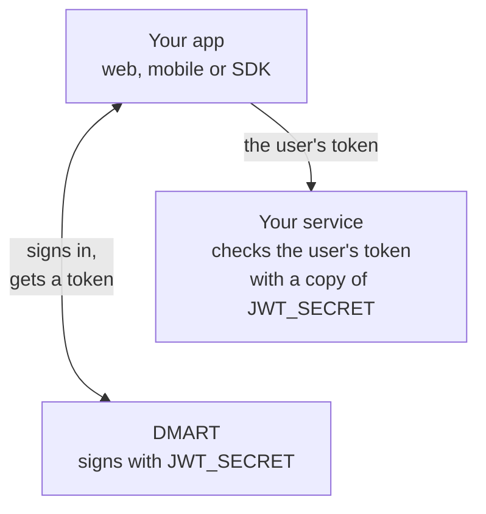
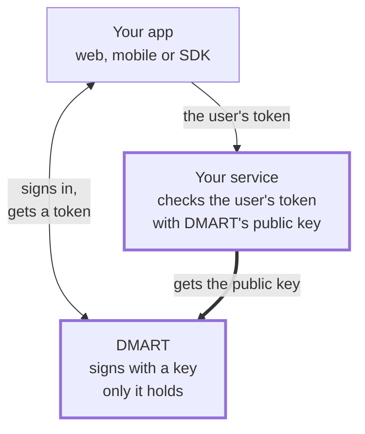
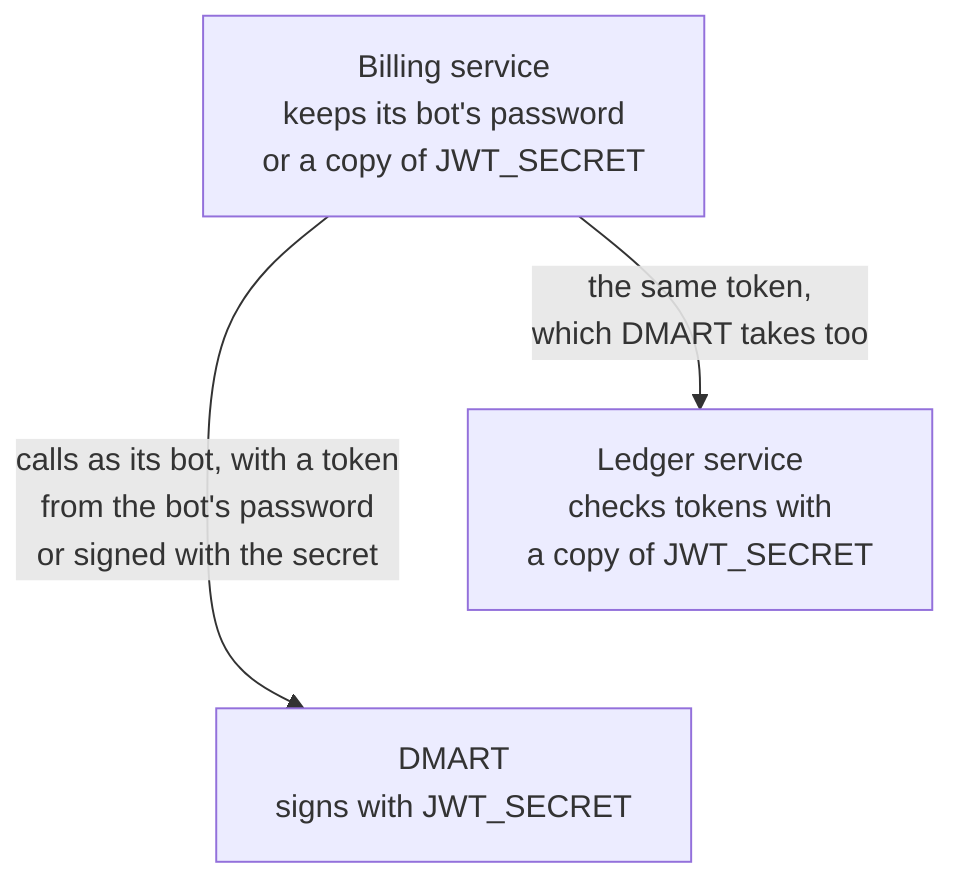
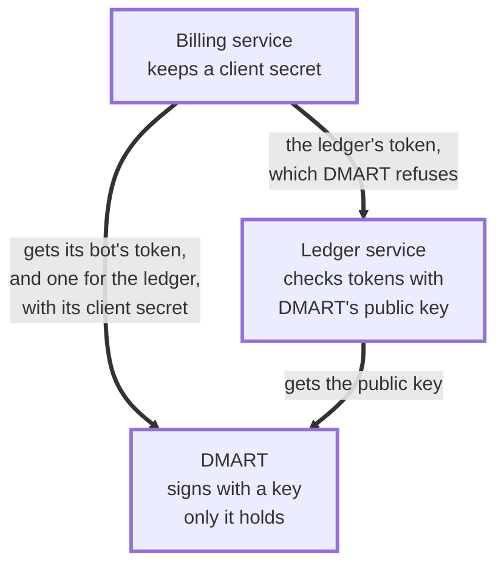

Comprehensive reference for the DMART API. All endpoints, data structures, and usage examples.

## Base URL & Authentication

The API is served by the self-contained DMART binary (.NET 10 Native AOT) on ASP.NET Core / Kestrel. The base URL for all API requests is typically: `http://localhost:8282` (or as configured via `LISTENING_HOST` / `LISTENING_PORT`). `GET /` answers `{"status":"success","message":"DMART-CS API"}`.

Most endpoints require authentication with a JWT bearer token, supplied either as a header or a cookie. DMART signs it RS256 with a key of its own, so that other services can [verify it with the public key](#verifying-dmarts-tokens-in-another-service), or HS256 with `JWT_SECRET` under the deprecated `JWT_SIGNING_ALG=HS256`:

**Header** `Authorization: Bearer <your_token>`

**Cookie** `auth_token=<your_token>` — set by every sign-in as `HttpOnly; SameSite=Lax; Path=/` (plus `Secure` over HTTPS), with a `Max-Age` of `JWT_ACCESS_EXPIRES`. With `WEB_DEVICE_OTP` on, a sign-in by code to a web account also sets `dmart_device`, the browser's trusted-device token, the same way for 400 days (see [Trusted Browser](/access-control#trusted-browser-web_device_otp)). The auth cookie is accepted only on same-site requests (judged by the browser's `Sec-Fetch-Site`) or with an `X-Requested-With` header, unless `CSRF_PROTECT_COOKIE_AUTH=false`.

**A browser front end must be on its backend's site**, the same registrable domain (`cat.example.com` and `api.example.com` are one site; `example.com` and `example.org` are two), because a browser sends a `SameSite=Lax` cookie only there. cxb and catalog authenticate by the cookie alone, so the `backend` in their `config.json` (see [Settings](/settings#loading-order)) must be blank (the page's own origin), a path such as `/dmart` (the API under the page's own origin), or a sibling subdomain, with the page's origin listed in `ALLOWED_CORS_ORIGINS`. A catalog on another site signs in, then is anonymous on every later call. A client on another site sends a bearer token instead.

Tokens are obtained via `/user/login` (password or OTP), `/user/create` (self-registration signs the new user in), or through OAuth social login (Google, Facebook, Apple). A service gets one from the OpenID Connect provider as an [integration client](#a-services-own-token-client_credentials). With `ENABLE_MCP=true`, DMART also runs an **OAuth 2.1 Authorization Server** for automatic onboarding of MCP clients: discovery at `/.well-known/oauth-authorization-server` and `/.well-known/oauth-protected-resource`, Dynamic Client Registration at `/oauth/register`, and `/oauth/authorize` and `/oauth/token`.

Interactive API documentation is available as **Swagger UI** at `/docs`, with the raw OpenAPI schema at `/docs/openapi.json` (both served by ASP.NET Core).

**Limits.** Every request runs under `REQUEST_TIMEOUT` (35 s by default) and is answered `504` when it runs out; WebSockets, `/mcp`, `/managed/import` and `/managed/export` have no such deadline. The sign-in, code and token routes, and the anonymous write routes, are limited per client address by `AUTH_RATE_LIMIT_PER_MINUTE` (10 a minute), every `/public` route by `PUBLIC_RATE_LIMIT_PER_MINUTE` (600 a minute), and token introspection by `INTROSPECT_RATE_LIMIT_PER_MINUTE` (600 a minute); past any of them the answer is HTTP `429`. The routes that take a file accept up to `MAX_UPLOAD_SIZE_MB` (50 MB by default).

## Common Data Structures

### Record

Represents a resource in the system. This is the primary object for creating or updating entities.

```json
{
  "resource_type": "content",
  "shortname": "my_article",
  "subpath": "/blog",
  "uuid": "550e8400-e29b-41d4-a716-446655440000",
  "attributes": {
    "is_active": true,
    "slug": "my-article-slug",
    "displayname": { "en": "My Article" },
    "description": { "en": "A description" },
    "tags": ["news", "tech"],
    "owner_shortname": "jdoe",
    "owner_group_shortname": "editors",
    "created_at": "2023-10-01T12:00:00",
    "updated_at": "2023-10-01T12:00:00",
    "payload": {
      "content_type": "json",
      "schema_shortname": "article",
      "body": { "title": "Hello World", "content": "..." }
    },
    "acl": [
      {
        "user_shortname": "jane",
        "allowed_actions": ["view", "update"]
      },
      {
        "user_shortname": "bob",
        "denied": ["view", "query"]
      }
    ],
    "relationships": [
      {
        "related_to": {
          "space_name": "data",
          "type": "user",
          "subpath": "users",
          "shortname": "jane"
        },
        "attributes": { "role": "editor" }
      }
    ]
  }
}
```

The server sets `owner_shortname`, `created_at` and `updated_at`; a write ignores them. A create makes the caller the owner, an update keeps the owner, and only an `assign` request changes it. `owner_group_shortname` is stored as sent, but a create may name only a group its creator belongs to: any other group needs `assign` at the record's address, through a grant without a row filter, or the create is refused with `NOT_ALLOWED` (see [Access Control](/access-control#3-contextual-conditions)). An update keeps it as stored, and an `assign` request moves the record to another group or out of one, under the same rule for the group it leaves and the one it names.

### Request

Used for batch operations (create, update, delete, etc.).

```json
{
  "space_name": "data",
  "request_type": "create",
  "records": [ ... list of Record objects ... ]
}
```

### Query

Used for searching and filtering resources. Supports full-text search, aggregation, joins, and JQ filters.

```json
{
  "type": "search",
  "space_name": "data",
  "subpath": "/blog",
  "exact_subpath": false,
  "filter_types": ["content"],
  "filter_schema_names": ["article"],
  "filter_shortnames": [],
  "filter_tags": ["tech"],
  "search": "@payload.body.title:Hello*",
  "from_date": "2023-01-01T00:00:00",
  "to_date": "2023-12-31T23:59:59",
  "sort_by": "created_at",
  "sort_type": "descending",
  "retrieve_json_payload": true,
  "retrieve_attachments": false,
  "retrieve_total": true,
  "retrieve_lock_status": false,
  "jq_filter": ". | select(.attributes.is_active == true)",
  "limit": 10,
  "offset": 0,
  "aggregation_data": {
    "group_by": ["@tags"],
    "reducers": [
      { "reducer_name": "count_distinct", "alias": "count", "args": ["@shortname"] }
    ]
  },
  "join": [
    {
      "join_on": "owner_shortname:shortname",
      "alias": "author_details",
      "query": { "...nested Query..." }
    }
  ]
}
```

A query that leaves out `limit` gets `DEFAULT_QUERY_LIMIT` rows (10 by default). `-1` asks for `MAX_QUERY_LIMIT` (10,000 by default), and no query returns more than that.

- **`search`** is an expression in DMART's search syntax (see [Query & Search](/query-search)). To list everything, leave it out: `"*"` is a plain word, and matches only records that contain a literal asterisk.
- **`retrieve_json_payload`** is `false` by default, so entries come back with their `payload` (`content_type`, `schema_shortname`, `checksum`) but without its `body`. Users, roles, groups, permissions, spaces and attachments always carry their body.
- **`retrieve_attachments: true`** adds the attachments the caller may read to each record, as `attachments: {<resource_type>: [records]}`.
- **`retrieve_lock_status: true`** adds `attributes.locked: {"owner_shortname": …}` to each record someone holds a lock on.
- **`include_fields`, `exclude_fields` and `highlight_fields`** are accepted and ignored.
- **`type: history`** returns rows only to a caller with `view` or `query` on the `history` resource type at the query's subpath, through a grant there or on a folder above it. Without one the answer is empty, with no error. The `events` feed still lists a change without that grant, but leaves out its old and new values, and only a global admin sees an event's request headers. See [Query & Search](/query-search#history--events-queries).
- **Secrets in a diff** read `********` on both sides, at any depth, inside arrays and sub-objects, in `history` rows and `events` alike. That covers any field whose name contains `password`, `passcode`, `passphrase`, `secret`, `credential`, `api_key` or `private_key`, however it is written (`smtpPassword`, `apiKey`), and any with `token`, `otp`, `pin`, `jwt`, `pwd` or `authorization` as a word of its name (`access_token`, `otpCode`, `pins`, `token2`). A change whose two sides are only booleans, such as `force_password_change`, keeps its values.

## Enums & Possible Values

| Enum | Values |
|---|---|
| **ResourceType** (31) | `user`, `group`, `folder`, `schema`, `content`, `log`, `acl`, `comment`, `media`, `data_asset`, `locator`, `relationship`, `alteration`, `history`, `space`, `permission`, `role`, `ticket`, `json`, `lock`, `post`, `reaction`, `reply`, `share`, `plugin_wrapper`, `notification`, `csv`, `jsonl`, `sqlite`, `parquet`, `integration` |
| **RequestType** (7) | `create`, `update`, `patch`, `update_acl`, `assign`, `delete`, `move` |
| **ContentType** (22) | `text`, `comment`, `reaction`, `markdown`, `html`, `json`, `image`, `image_jpeg`, `image_png`, `image_svg`, `image_gif`, `image_webp`, `python`, `pdf`, `audio`, `video`, `csv`, `parquet`, `jsonl`, `apk`, `sqlite`, `binary` |
| **ActionType** (11) | `query`, `view`, `update`, `create`, `delete`, `attach`, `assign`, `move`, `progress_ticket`, `lock`, `unlock` |
| **QueryType** (12) | `search`, `subpath`, `events`, `history`, `tags`, `random`, `spaces`, `counters`, `reports`, `aggregation`, `attachments`, `attachments_aggregation` |
| **Language** (5) | `arabic`, `english`, `kurdish`, `french`, `turkish` These full spellings are the persisted enum wire values (e.g. `space.languages`). The `displayname` / `description` translation maps are keyed by 2-letter codes, and keep only `en`, `ar` and `ku`: any other key is dropped on write, and a plain string is stored as `en`. Those keys are not Language enum values. |
| **SortType** (2) | `ascending`, `descending` |
| **UserType** (4) | `web`, `mobile`, `bot`, `admin` |
| **PluginType** (2) | `hook`, `api` |
| **EventListenTime** (2) | `before`, `after` |
| **JoinType** (4) | `left`, `right`, `inner`, `outer` |
| **PublicSubmitResourceType** (2) | `content`, `ticket` The only two resource types accepted by `/public/submit`. |
| **Status** (2) | `success`, `failed` The response-envelope `status` field (see below). |
| **TaskType** (1) | `query` |

### String conventions (NOT typed enums)

The following values are string **conventions** — they are validated/handled as plain strings and have _no_ backing C# enum. Only the three permission condition constants (`own`, `own_group`, `is_active`) are real string constants; reaction kinds, the lock action string, and notification type/priority are inherited Python-era conventions.

| Convention | Values |
|---|---|
| **Permission conditions** (real string constants) | `own`, `own_group`, `is_active`; a permission naming any other, or both `own` and `own_group`, is refused with `INVALID_DATA` |
| **Reaction kinds** (convention) | `like`, `dislike`, `love`, `care`, `laughing`, `sad` |
| **Lock action** (convention) | `lock`, `unlock` (acquire/release via the `/managed/lock` routes) |
| **Notification type** (convention) | `admin`, `system` |
| **Notification priority** (convention) | `high`, `medium`, `low` |

### Response envelope

The `/managed`, `/public`, and `/user` endpoints return the same envelope, except where they hand back a record or a file itself: a read of one record (`/entry`, `byuuid`, `byslug`) returns that record's own JSON, and the payload, CSV and export routes return the file. A success carries `records` and an `attributes` block (with `total` / `returned` counts on queries); a failure carries a single `error` object, sometimes with an `info` list of details. `error.code` is DMART's own error code, not the HTTP status (see [Error codes](#error-codes)).

**Empty values are left out.** In a JSON response of 1 MB or less, every object property whose value is `null`, `""`, `[]` or `{}` is removed, at any depth: in a payload's body, its relationships and a history row's `diff` as in the metadata. A `payload` or `relationships` key itself stays even when empty. What a `failed` field holds is left as it is, and elements of a list are never removed. A larger response is sent as built and can carry empty values. On the payload routes, an entry's body loses its empty values the same way, while an attachment's file is sent as it was uploaded. A client treats an absent field and an empty one as the same.

**Headers.** Every response carries `x-server-time`, the server's local time in ISO 8601, which a browser client on another origin may read. `X-Correlation-ID` echoes the request's own, or is a new id when the request sent none; the access log records it, and a `500` names it in its message as `Reference: <id>`.

On queries, `total` is `-1` when the count was skipped (`retrieve_total: false`; `/public/query` skips it unless asked). Above `QUERY_TOTAL_CAP`, `total` is the cap and `total_is_lower_bound` is `true`.

```
// success
{
  "status": "success",
  "records": [ /* ...Record objects... */ ],
  "attributes": { "total": 128, "returned": 10 }
}

// failure
{
  "status": "failed",
  "error": {
    "type": "jwtauth",
    "code": 49,
    "message": "Not authenticated [1]"
  }
}
```

As a rule the HTTP status follows `error.code`: `401` for authentication and permission refusals, `404` for a record that is not there, `409` for a name or unique value already taken or a record that changed under the request, `403` for a refused password change, `423` for an entry someone else has locked, `503` while the password-hashing budget is full, too many SQL queries over datasets are running, or `jq` is busy or missing, and `400` for anything else. The tables below give each code's status. `/user/login` and the social sign-in routes answer every refusal with HTTP `401`, whatever its code. `POST /managed/query` and `POST /public/query` answer some failures, such as a missing `space_name` or a malformed `join`, with HTTP `200` and the `failed` envelope, so a client reads `status` there. A failed `jq_filter` on them answers `400`, or `503` when jq is busy or missing.

**A refused write answers as a missing record would, to a caller that cannot read the record.** Update, patch, assign, update_acl, move, delete, lock and unlock are judged first on the address, as if nothing were stored there. A caller the address refuses gets `NOT_ALLOWED`, whether or not the record exists. A caller the address admits, but refused for what is stored (the record's ACL denies it the action, an entry is stored as another type than the request names, or a [row filter](/access-control#row-filters) of its grants leaves the record out), gets what a missing record at that address gets (`OBJECT_NOT_FOUND`, `SHORTNAME_DOES_NOT_EXIST`, or a success that removes nothing) when it cannot read the record, and `NOT_ALLOWED` when it can; nothing is written either way. A user, role, group or permission is judged in its folder of the management space (`management:/users`, `/roles`, `/groups`, `/permissions`), its create included, and a space at its own root, whatever coordinates the request names. A refusal by a condition (`own`, `own_group`, `is_active`) or a field limit stays `NOT_ALLOWED`, as it is for a missing record. Reads by name work the same way: a record the caller may not read answers `404`.

### Error codes

Some codes look like HTTP statuses and are not: `400` is a name already taken (HTTP `409`), `404` a missing shortname, and `401` a refused permission.

| `code` | Name | HTTP | When |
|---|---|---|---|
| 402 | `INVALID_DATA` | 400 | A body, field, file or route value fails validation: a schema, a shortname or subpath pattern, a search the parser refuses. Also a relationship target that is missing or that the caller may not read ("relationship target not found"), and a user's mailbox or alias that another account holds, or email or phone that an account in another folder holds ("already in use"). |
| 202 | `MISSING_DATA` | 400 | A required field or file is missing. |
| 220 | `OBJECT_NOT_FOUND` | 404 | The record, schema or folder named is not there, or is hidden from the caller (see above). |
| 400 | `SHORTNAME_ALREADY_EXIST` | 409 | A record already holds the name, or another unique column (the message names the column). |
| 404 | `SHORTNAME_DOES_NOT_EXIST` | 404 | The ticket, attachment, user, role, group, permission, space or saved query named is not there, or is hidden from the caller. |
| 415 | `DATA_SHOULD_BE_UNIQUE` | 409 | A folder's `unique_fields` is taken, or a user's email (in any case) or phone is another account's in the same folder. The message names the field, as `@email:<value>`. |
| 401 | `NOT_ALLOWED` | 401 | The caller's permissions refuse the action, whether or not the record exists. Also an admin signing in from outside `ADMIN_IP_ALLOWLIST`. |
| 204 | `CANNT_DELETE` | 400 | A non-empty folder without `force`, a record other records relate to, the management space, or a user who owns it. |
| 31 | `LOCKED_ENTRY` | 423 | Another user holds the entry's lock. |
| 30 | `LOCK_UNAVAILABLE` | 423 | The embeddings re-index worker is busy. |
| 217 | `NOT_SUPPORTED_TYPE` | 400 | A resource or query type the route does not take (a space, user, role, group or permission sent to a route that writes entries, say), or semantic search that is not configured. |
| 206 | `NOT_ALLOWED_LOCATION` | 400 | An anonymous write to a `space.schema` pair `ALLOWED_SUBMIT_MODELS` does not list. |
| 203 | `INVALID_SPACE_NAME` | 400 | A missing or malformed space name. |
| 205 | `ALREADY_EXIST_SPACE_NAME` | 409 | Creating a space that exists. |
| 213 | `MISSING_DESTINATION_OR_SHORTNAME` | 400 | A `move` without `dest_subpath` and `dest_shortname`. |
| 409 | `CONFLICT` | 409 | An update, move or delete found the entry changed since it was read and authorized, or the folder whose rules a write is checked against changed; or a user account changed while the request ran. Nothing is written: read the record again and resend. In `/managed/request` it is the failed record's `error_code`. |
| 430 | `SOMETHING_WRONG` | 400 / 500 | `400`: a `/managed/request` batch in which some records failed, or a check the server could not complete (uniqueness, the embedding provider). `500`: a server or database fault. |
| 120 | `JQ_TIMEOUT` | 400 / 503 | `400`: a `jq_filter` ran too long. `503`: every jq slot was busy. |
| 121 | `JQ_ERROR` | 400 / 503 | `400`: a `jq_filter` that is invalid or fails. `503`: no `jq` on the server. |
| 122 | `SQL_TIMEOUT` | 400 | A [SQL query over datasets](#sql-over-sqlite-datasets) ran past `DATA_ASSET_SQL_TIMEOUT_MS`, or was cancelled. |
| 123 | `SQL_BUSY` | 503 | `DATA_ASSET_SQL_MAX_CONCURRENT` SQL queries over datasets are running, or `DATA_ASSET_SQL_MAX_CONCURRENT_PER_USER` of the caller's. |
| 230 | `INVALID_ROUTE` | 422 / 405 / 400 | No such route, or a method the route does not take. `400`: SQL over datasets while `DATA_ASSET_SQL` is off. |
| 504 | `REQUEST_TIMEOUT` | 504 | The request ran past `REQUEST_TIMEOUT`. |

Sign-in and tokens:

| `code` | Name | HTTP | When |
|---|---|---|---|
| 10 | `INVALID_USERNAME_AND_PASS` | 401 | Unknown user, wrong password, or a soft-deleted account. Also a wrong code at a code sign-in that would register the address (`ENABLE_OTP_IMPLICIT_REGISTRATION`). |
| 11 | `USER_ISNT_VERIFIED` | 401 | A password sign-in by an email or phone that is not verified (a code sign-in verifies it instead). With `WEB_DEVICE_OTP` on, a password or provider sign-in to a web account with neither email nor phone verified. |
| 13 | `PASSWORD_NOT_VALIDATED` | 401 | A code sign-in with a wrong password, or an admin's code without the right one (the code is then not checked, so not spent). |
| 100 | `OTP_ISSUE` | 401 | A code sign-in naming no identifier or more than one, or a shortname while `OTP_SHORTNAME_CHANNELS=none`; an admin with no phone or email to send a code to. |
| 110 | `USER_ACCOUNT_LOCKED` | 401 | The account is deactivated, locked by failed attempts, or locked to another device (`locked_to_device`). |
| 115 | `OTP_NEEDED` | 401 | The sign-in needs a one-time code: an admin's right password (the code is sent), a `mobile` account on a device it does not trust yet (its first included), a web account outside its trusted browser under `WEB_DEVICE_OTP`, or an admin through a social provider. |
| 307 | `OTP_INVALID` | 401 / 400 | A wrong or spent code, one a newer code has replaced, or one out of guesses. `400` outside `/user/login`. |
| 308 | `OTP_EXPIRED` | 401 / 400 | The code issued, sent after it expired. `400` outside `/user/login`. |
| 50 | `SESSION` | 401 | `/user/create` refused: registration is off, a field is missing or invalid, or the code is wrong. |
| 47 | `INVALID_TOKEN` | 401 | A token that fails to verify, or whose session has ended, whose account is inactive, or (an admin's) used from outside `ADMIN_IP_ALLOWLIST`. |
| 48 | `EXPIRED_TOKEN` | 401 | A token past its `exp`. |
| 49 | `NOT_AUTHENTICATED` | 401 | No token on a route that needs one. |
| 17 | `INVALID_PASSWORD_RULES` | 400 | A new password that fails the password rule. |
| 102 | `PASSWORD_RESET_ERROR` | 403 | A `/user/profile` password change without `old_password`, or a first password set there. |
| 19 | `UNMATCHED_DATA` | 401 | A wrong current password at `/user/profile` or `/user/verify-contact`. |
| 503 | `PASSWORD_HASHING_BUSY` | 503 | The password-hashing budget stayed full past `PASSWORD_HASH_QUEUE_TIMEOUT_SECONDS`; retry after `Retry-After`. |

`OTP_EXPIRED` (308) answers only the code that was issued, sent after it expired: at a code sign-in on `/user/login` (one that registers under `ENABLE_OTP_IMPLICIT_REGISTRATION` included), at `/user/password-reset-confirm` and `/user/create`, and at `/user/verify-contact` for its `code` and its `current_code`. Every other failed code keeps its own answer, so the reply tells nothing to someone who does not hold the code: `OTP_INVALID`, or `INVALID_USERNAME_AND_PASS` at a sign-in that would register, `SESSION` at `/user/create`, and `USER_ACCOUNT_LOCKED` at a sign-in on an account that failed attempts have locked. A wrong code sent while an expired one is outstanding is a wrong code. An expired code is never redeemed, and counts as a failed attempt wherever a wrong code does. Each code takes `MAX_OTP_VERIFY_ATTEMPTS` guesses (5), whether or not it has expired; past them it answers as a wrong code, the right one included.

`error.type` is one of `auth` (sign-in and accounts), `jwtauth` (tokens), `request` (bad input, the most common), `db` (storage conflicts and missing rows), `create` (registration), `exception` (an unhandled error), `server` (the request deadline or the hashing budget), `restriction` (a protected profile field), `internal`, `media`, `attachment`, `qr`, and `channel_auth` (`ENABLE_CHANNEL_AUTH` refused the request).

## User Management `/user`

GET `/user/check-existing`

Checks if a user with specific fields already exists. Open without a session, and rate-limited per address. Answers `attributes.unique`, and when something is taken, `attributes.field` names the first one found. A `shortname` that the username rule refuses (see `/user/create`) answers `unique: false` with `field: "shortname"` and a `message`, the rule's `username_hint` when one is set, so a sign-up form can say so before a code is sent.

**Query Params:** `shortname`, `msisdn`, `email` (all optional)

POST `/user/create`

Registers a new user and signs them in: the answer carries an `access_token` and sets the `auth_token` cookie. Self-registration is off unless `IS_REGISTRABLE=true`, and takes only the channels in `REGISTRATION_ENABLED_CHANNELS`. The server ignores roles and groups in the body (`USER_CREATE_DEFAULT_ROLE` / `USER_CREATE_DEFAULT_GROUP` apply instead). The account's payload gets `USER_PAYLOAD_SCHEMA` when it is set, and a payload that names any other schema is refused with `PROTECTED_FIELD` (see [User Profile Protection](/access-control#6-user-profile-protection)). Each address is proved by a code (`IS_OTP_FOR_CREATE_REQUIRED`, which the server does not start without while registration is open): first request one with `/user/otp-request` and `purpose: "register"`, and send it as `email_otp` (or `msisdn_otp`); a wrong code answers `SESSION` (50), and the issued one sent after it expired `OTP_EXPIRED` (308). A password must meet the password rule (see [Access Control](/access-control)).

- **Username.** A top-level `shortname` is the username the registrant chooses. Without one, or with `"auto"`, the server makes an 8-character one. A chosen name must be free and meet the shortname rule (letters, digits and `_`, up to 64 characters) and, when the regex file (`REGEX_CONFIG_PATH`) sets one, its `username` rule, which can only narrow it. A name the rule refuses answers `SESSION`, with the file's `username_hint` as the message when it sets one, and a taken one `SHORTNAME_ALREADY_EXIST` (HTTP `409`, "This username is taken"), both before the code is spent. An admin's create through `/managed/request` is held to the same rule (`INVALID_DATA`); a name the server makes is not.
- **Email domain.** With `REGISTRATION_EMAIL_DOMAINS` set, the email must be at one of those domains, subdomains not included; any other answers `SESSION` with the list (see [Email Domains and Contact-Only Emails](#email-domains-and-contact-only-emails)).

```json
{
  "shortname": "jdoe",
  "attributes": {
    "email": "jdoe@example.com",
    "email_otp": "482913",
    "password": "StrongPassword123!",
    "displayname": { "en": "John Doe" }
  }
}
```

POST `/user/login`

Authenticates a user and returns a token. The identifier is one of `shortname`, `email` or `msisdn`. A password sign-in by email or phone needs that address verified; a code sign-in does not, and marks the address its code went to verified. With a password, `email` may also be the account's hosted `mailbox`, which needs no verification; a one-time code never signs in by mailbox. The answer's record carries `access_token`, `type`, `roles` and `groups`, `displayname` when the account has one, and `"created": true` when this sign-in created the account (`ENABLE_OTP_IMPLICIT_REGISTRATION`, while registration is open for the channel and, under `REGISTRATION_EMAIL_DOMAINS`, for the email's domain). The server also sets the `auth_token` cookie. A refused sign-in answers HTTP `401`.

```json
{
  "shortname": "jdoe",
  "password": "StrongPassword123!"
}
```

Or via OTP (requested with `purpose: "login"`):

```json
{
  "msisdn": "1234567890",
  "otp": "482913"
}
```

A `mobile` account sends its device's `device_id` on every sign-in, by password, code or provider. On any account, a body without `device_id` may carry it in an `X-DeviceId` header instead; the body's wins when both are sent. One that sends none is refused with `INVALID_DATA` (402): after the password checks out, and on a sign-in by code before the code is checked, so the code is not spent. A password or provider sign-in from a device other than the trusted one, or while none is trusted (the account's very first sign-in included), answers `OTP_NEEDED` (115); the sign-in by code with the same `device_id` then trusts that device. With `WEB_DEVICE_OTP` on, a `web` account's trusted device is its browser, named by the `dmart_device` cookie rather than a `device_id` (see [Trusted Browser](/access-control#trusted-browser-web_device_otp)). An account with `locked_to_device` set signs in, by password or code, only from its stored device, and is refused elsewhere with `USER_ACCOUNT_LOCKED` (110); see [Access Control](/access-control#account-types). Mobile clients may also send a `firebase_token` for the session. It is cleared from the user's other sessions, and with a `device_id` so are that device's older tokens, so a device gets each push once.

Accounts of type `admin` sign in with their password **and** a one-time code. The password alone, once it checks out, sends the code and answers `OTP_NEEDED` (115); the sign-in then completes with `password` and `otp` sent together. The password is checked first: without the right one the answer is `PASSWORD_NOT_VALIDATED` (13) and the code is not checked, so whoever knows only the username cannot spend it on guesses. For a shortname the code goes to the account's verified phone, else its verified email, else its phone, else its email, whatever `OTP_SHORTNAME_CHANNELS` says. `/user/otp-request` sends an admin no login code. Wrong passwords and codes count toward the account lockout (see [Access Control](/access-control#lockout)). An account that failed attempts have locked still signs in with a right code; a wrong one answers `USER_ACCOUNT_LOCKED` (110), and the issued code sent after it expired `OTP_EXPIRED` (308).

The access token has no `kid` header. Its claims are `sub` (the shortname), `iss` (`JWT_ISSUER`), `aud` (`JWT_AUDIENCE`), `iat`, `exp`, `token_use` (`access`), `jti`, `roles`, `data` (`shortname`, `type`) and `expires`. `/user/login` issues no refresh token.

GET `/user/profile`

Retrieves the profile of the currently logged-in user: contact details, `type`, `roles`, `groups`, `payload`, and the avatar attachment when there is one. The profile's `attributes.permissions` is deprecated; read the map from `/user/permissions`, whose keys it shares.

GET `/user/permissions`

Returns the caller's permission map as `attributes.permissions`, keyed `space:subpath:resource_type`, with `allowed_actions`, `conditions`, `restricted_fields`, `allowed_fields_values` and `filter_fields_values` for each key. A grant that names no resource types covers them all, and is keyed with `*` as its resource type (`data:news:*`). It includes the grants of the implicit `logged_in` role. It follows the limits of [the management space](/access-control#the-management-space), as every check does: a key there is what the server allows the account, a grant on its own record and the core schemas it reads included. A row filter comes back with the caller's own names in place of `__current_user__` and `__current_user__owner__`. A grant whose filter names one that does not resolve for the caller (`__current_user__owner__` for an account no one created, say) is left out, and so is a space whose subpaths list is empty. The answer carries an `ETag` and `Cache-Control: private, no-cache`, so a client that sends `If-None-Match` gets `304` with no body while the map is unchanged.

POST `/user/profile`

Updates the profile of the currently logged-in user: `displayname`, `description`, `language` and `payload`. A new `password` needs the current one in `old_password`, also under `force_password_change`: without it the answer is `PASSWORD_RESET_ERROR` (HTTP `403`), and a wrong one answers `UNMATCHED_DATA` (HTTP `401`) and counts toward the lockout. An account with no password cannot set one here (`PASSWORD_RESET_ERROR` too); it gets its first one through a password reset. Email and phone change only through `/user/verify-contact`, the device only by signing in from it, and payload fields listed in `USER_PROFILE_PAYLOAD_PROTECTED_FIELDS` not at all. The payload keeps the record's `schema_shortname` and `content_type`: a request that changes or clears either is refused with `PROTECTED_FIELD`, and a record with none may take only `USER_PAYLOAD_SCHEMA`. The `payload` is checked against its schema only when the update changes it, so a request that sends none, or sends the stored one back, is not refused because the schema has since tightened; a user update through `/managed/request` is checked the same way.

POST `/user/logout`

Ends the session of the token the request carries (the header's and the cookie's) and clears the `auth_token` cookie.

POST `/user/delete`

Deletes the current user's account as `USER_DELETION_MODE` says (`soft` by default; see [Settings](/settings)). Under `hard` it deletes only the entries and attachments the account owns that a delete request from it could delete, and removes the account when nothing it owns is left. When records stay, the account is soft-deleted instead, and the answer carries `attributes.soft_deleted: true`, `attributes.records_kept` (how many stayed) and a `message`. A user who owns the management space cannot be hard-deleted (`CANNT_DELETE`). See [Deleting a user](/entity-lifecycle#deleting-a-user).

POST `/user/otp-request`

Sends a one-time code. Body: one of `email`, `msisdn` or `shortname`, and a `purpose`: `login`, `reset`, `register` (for `/user/create`) or `verify-contact` (signed in only). A code works only for the purpose it was issued for. A code asked for by shortname goes to the account's first verified contact among the channels `OTP_SHORTNAME_CHANNELS` lists, else its first contact among them: by default its verified phone, else its verified email, else its phone, else its email. With `OTP_SHORTNAME_CHANNELS=none` a shortname is refused with `EMAIL_OR_MSISDN_REQUIRED` (207), and the caller names the phone or email. A `reset` may also name the account by its hosted mailbox in `email`; that code goes where a shortname's goes (in the default order under `none`), never to the mailbox, and `/user/password-reset-confirm` takes the same mailbox. Every well-formed request answers `200`, whether or not a code went out, so the answer says nothing about which addresses have accounts; a resend within `ALLOW_OTP_RESEND_AFTER`, or past `MAX_OTP_REQUESTS_PER_DAY`, sends nothing. The one exception turns on the address alone: a `register` code, or a `verify-contact` code for a new address, to an email outside `REGISTRATION_EMAIL_DOMAINS` answers `INVALID_DATA` with the allowed domains. An admin gets a `reset` code only while a global admin, or the admin that created the account, has set `force_password_change` on it; otherwise its own phone or email gets a notice saying so, and to ask one of them.

POST `/user/password-reset-confirm`

Sets a new password with a `reset` code. Body: the same identifier, `otp` and `password`, which must meet the password rule. A shortname while `OTP_SHORTNAME_CHANNELS=none` answers `MISSING_DATA`. The reset marks the address the code went to verified. A right code works on an account that failed attempts have locked, and clears its count. A wrong code answers `OTP_INVALID` and counts toward the lockout; the issued code sent after it expired answers `OTP_EXPIRED`, and counts too. With `LOGOUT_ON_PWD_CHANGE` (on by default) the reset ends the account's sessions.

POST `/user/verify-contact`

Signed in: proves the caller controls an email or phone with a `verify-contact` code, and makes it theirs, verified. Body: `code` and `email` or `msisdn`. Confirming the address already on the account needs nothing more. Changing to a new one also needs the current `password` (a wrong one counts toward the lockout), or, on an account without a password, `current_code`: a `verify-contact` code sent to the phone or email the account already has. A wrong `code` or `current_code` answers `OTP_INVALID`, and the issued one sent after it expired `OTP_EXPIRED`. A new email outside `REGISTRATION_EMAIL_DOMAINS` is refused with `INVALID_DATA` before any code is spent.

POST `/user/validate_password`

Checks if the provided password is correct for the current user, answering `attributes.valid`. A wrong one counts toward the lockout.

### Email Domains and Contact-Only Emails

Two settings narrow what an email does on a user's own account (see [Settings](/settings#registration-otp--profiles)).

- **`REGISTRATION_EMAIL_DOMAINS`** (`a.com,b.org`) takes a user's own email only at those domains, subdomains not included: at `/user/create` (`SESSION`, naming the domains), at a sign-in by code that would create the account (refused as an unknown account is, and `/user/otp-request` sends no `login` code for it), and when `/user/verify-contact` changes it (`INVALID_DATA`). An email an account already has keeps working everywhere, and an admin creating or editing users is not limited. Empty allows any domain.
- **`EMAIL_CONTACT_ONLY_ROLES`** makes the email only for contact on an account that is not an admin, holds a listed role, has a phone and has no password. No sign-in or reset code goes to that email: a request naming it answers `200` and sends nothing, and one by shortname goes to the phone. No social sign-in links through it. `/user/verify-contact` adds or changes it with the new address's code alone, and a code sent to it never proves a change of the phone.

### Social Login

GET `/user/google/login`, GET `/user/facebook/login`

Start a web sign-in with the provider: they set an `oauth_state` cookie (10 minutes) and redirect to the provider with a matching `state`. `GOOGLE_OAUTH_CALLBACK` / `FACEBOOK_OAUTH_CALLBACK` must be the absolute URL of `/user/google/callback` / `/user/facebook/callback`, registered with the provider as a redirect URI; without it, `/login` answers with an error that names the missing setting.

GET `/user/google/callback`, GET `/user/facebook/callback`

Google and Facebook OAuth callbacks. A web sign-in must start at `/login`: a callback with a missing or mismatched `state` is refused. A sign-in sets the `auth_token` cookie and answers with the sign-in record (`access_token`, `type`, `roles`).

POST `/user/apple/callback`

Apple OAuth callback (Apple posts the form). Takes a `code`, which DMART exchanges with Apple, or an `id_token`. A sign-in sets the `auth_token` cookie and redirects to `APPLE_OAUTH_CALLBACK`, with no token in the URL.

POST `/user/google/mobile-login`, `/user/facebook/mobile-login`, `/user/apple/mobile-login`

Sign in from a mobile app with a token the app got from the provider. Body: `token` (the ID token for Google and Apple, the access token for Facebook) and `device_id`, which a `mobile` account must send, in the body or an `X-DeviceId` header, as on `/user/login`.

A provider sign-in only finds an existing account, by the provider's id or a verified email. It never creates one, and answers `401` when none matches. Accounts of type `admin` cannot sign in this way.

## Managed Content `/managed`

Endpoints for authenticated management of content and resources.

In a route that ends `{subpath}/{shortname}`, an entry at the root of a space is addressed by leaving the subpath out (`/managed/entry/content/data/my_entry`) or with `__root__` (`/managed/entry/content/data/__root__/my_entry`).

POST `/managed/request`

Performs batch operations (create, update, delete, etc.). A `shortname` of `auto` has the server pick one. Update and patch answer with no records; the other request types return the records written. When any record fails, the others are still applied and the request answers `SOMETHING_WRONG` (430). Its `error.info[0]` lists the records that succeeded under the key `successfull` (spelled so), and those that failed under `failed`, each as its `record` (the shortname), `error_code` and `error` (the message). An entry update, move or delete that finds the entry changed since the request read and authorized it fails with `CONFLICT` (409) and writes nothing; read it again and resend.

A `payload` sent as a JSON string is read as the object it holds, before any check, so it is stored and judged like one; a string holding no object fails with `INVALID_DATA`. An update's `payload` on a user, role, group, permission or space is deep-merged into the stored one, as an entry's is (a `null` removes its key), and the result is checked against its schema before it is written.

A user record takes no `password`, on `create` or `update` (`INVALID_DATA`), and its `is_email_verified` and `is_msisdn_verified` are ignored: the user sets a password with a reset code (a bot's is set on the host with `dmart passwd`), and a code verifies an address (see [Managing User Accounts](/access-control#managing-user-accounts)).

```json
{
  "space_name": "data",
  "request_type": "create",
  "records": [
    {
      "resource_type": "content",
      "shortname": "new_item",
      "subpath": "/items",
      "attributes": {
        "displayname": {"en": "New Item"},
        "payload": {
          "content_type": "json",
          "body": {"key": "value"}
        }
      }
    }
  ]
}
```

**Delete with `force` / `dry_run`:** a `delete` request accepts two top-level flags. `force: true` cascade-deletes a non-empty folder (and all its contents); a plain delete of a non-empty folder is rejected. `dry_run: true` projects the full cascade and returns an affected-count report _without removing anything_.

```json
{
  "space_name": "data",
  "request_type": "delete",
  "force": true,
  "dry_run": true,
  "records": [
    { "resource_type": "folder", "shortname": "archive", "subpath": "/" }
  ]
}
// -> success envelope; each record's attributes carry a per-category
//    "report" of what WOULD be deleted, plus "dry_run": true (nothing removed).
```

POST `/managed/query`

Executes a query against the database.

```json
{
  "type": "search",
  "space_name": "data",
  "subpath": "/content",
  "limit": 5
}
```

Without a `search`, it lists the records under the subpath (and below it, unless `exact_subpath` is true).

`type: spaces`, with `space_name` `management` and `subpath` `/`, lists the spaces in which the caller holds an active grant with `view` or `query`, leaving out a space whose ACL denies the caller either. A grant to `create` alone lists no space, and neither does one that reaches nothing there: one with an empty subpaths list, with only subpaths naming `__current_user__` for the anonymous caller, or with a row filter that does not resolve for the caller.

POST `/managed/semantic-search`

Natural-language (vector) search — embeds the query and returns the top-N most similar entries by cosine distance over `entries.embedding`. Requires the pgvector extension _and_ a configured embedding provider (`EMBEDDING_API_URL`); when either is missing it returns a clean `400` failure envelope. Each hit is checked as a read of that entry, and only the hits the caller may read are returned and counted in `matched`; a `space_name` the caller cannot read returns no matches. `limit` is clamped to a max of 100. Candidates are read nearest first, in at most three reads (three times the page, at least 100, then four times the last read) and 2,000 candidates in all, so a page can come back short when most of the nearest entries are hidden from the caller, and `matched` is a lower bound. A hit carries the entry's `displayname`, so a client can show it without reading the entry; its description and payload stay out.

**`"mode": "hybrid"`** also finds misspellings, parts of words and exact codes such as `8GB`, which a vector alone can miss. Besides the vector match, it runs the [plain-text search](/query-search#plain-text-search) of `/managed/query` as the caller, once for each typed word of three or more characters, or two with a digit, up to six words. Each side reads twice the `limit`, at least 20 and at most 100, and the rankings are merged by reciprocal rank fusion, so an entry found by both, or for more of the words, ranks higher. Each hit lists in `found_by` which side found it (`semantic`, `words`); one only the words found has no `similarity`. `matched` then counts the entries either side found. Hybrid needs `space_name` (`MISSING_DATA` without it). The default mode is `"vector"`, and any other value is refused with `INVALID_DATA`.

An entry is embedded by its shortname, its English and Arabic displayname, its tags, its English and Arabic description, and its JSON body, in that order. HTML in a displayname or description is reduced to its text. The embedding model reads only the start of that text, about 512 tokens, so the short fields come first.

```
// request
{
  "query": "how do refunds work",
  "space_name": "data",        // optional; required in hybrid mode
  "subpath": "/articles",       // optional prefix
  "resource_types": ["content"],// optional
  "limit": 10,                   // optional (default 10, max 100)
  "mode": "vector"               // optional: "vector" (default) or "hybrid"
}

// success -> each record's attributes carry space_name, similarity (0..1), uri, displayname
{
  "status": "success",
  "records": [
    {
      "resource_type": "content",
      "shortname": "refund_policy",
      "subpath": "/articles",
      "attributes": { "space_name": "data", "similarity": 0.83,
                      "uri": "dmart://data/articles/refund_policy",
                      "displayname": { "en": "Refund policy" } }
    }
  ],
  "attributes": { "returned": 1, "matched": 3 }
}

// not configured
{ "status": "failed",
  "error": { "type": "request", "code": 217,
             "message": "semantic search not configured — set EMBEDDING_API_URL ..." } }
```

POST `/managed/reindex-embeddings`

Admin tool that (re)embeds entries into the pgvector column — used to backfill or rebuild the semantic-search index. Runs as a background job. Global admins only. It embeds what the `semantic_indexer` plugin embeds on a write: the spaces and entries its filters (`plugins/semantic_indexer/config.json`) match. Optional body: `space_name` (default: every space the filters cover), `subpath` (that subpath and below), `resource_types` and `schema_shortnames`, which narrow the filters and never widen them, `only_missing` (default `true`) and `max_per_space`. `{"space_name":"store","schema_shortnames":["product"]}` embeds that space's products and nothing else. An unknown key is refused with `INVALID_DATA`, which names the accepted ones, and so is a `space_name` outside the filters; while the plugin is not active, the answer is `NOT_SUPPORTED_TYPE`.

GET `/managed/reindex-embeddings/status`

Global admins only. Returns the live progress of the current or last re-index run.

POST `/managed/import`

Imports data from a ZIP file. Body: `multipart/form-data` with `zip_file`, or the ZIP itself as the body. Global admins only. It is not cut off at `REQUEST_TIMEOUT`: it runs as long as the archive takes, and stops if the client hangs up. The answer counts what was inserted (`entries_inserted`, `users_inserted`, …), `skipped` and `failed_count`, and lists each failed row in `failed`. Rows of a space the instance does not have, and the archive does not create, are refused and reported with `"kind": "space-missing"`. Rows that already exist are replaced from the archive, and every record keeps the owner the archive names. A user, role, group or permission it replaces gets a history row of what changed, by the caller. The server's own `dmart import` command instead skips existing rows unless given `-r` (see [CLI](/cli)).

POST `/managed/export`

Exports data based on a `Query` object, as a ZIP. Global admins only, and not cut off at `REQUEST_TIMEOUT`. Send `"limit": -1` to export everything the query matches; without a `limit` the export holds the page a query would return. Only an export of the whole space (subpath `/`, with no type, shortname, tag, date or search filter) carries the space's own record, so a folder's archive imports only into a space that already exists.

POST `/managed/csv`, POST `/managed/csv/{space}`

Exports query results as CSV, at most `MAX_QUERY_LIMIT` rows to a file. With `?preview=1` it answers, instead of the file, what the CSV for the same body would hold: `exported`, `total`, `limit`, `truncated`, the `reason` when it was cut short, and a `message`. `/managed/csv/{space}` also takes a saved query's record as its body. A [saved SQL query](#sql-over-sqlite-datasets) exports its own columns, with no preview, and any failure of one answers HTTP `400`.

PUT `/managed/progress-ticket/{space}/{subpath}/{shortname}/{action}`

Moves a ticket along its workflow: `{action}` names one of the transitions its workflow allows from the ticket's current state, for the caller's roles. Needs `progress_ticket` on the ticket. The body is optional, except on a transition that requires a `resolution`.

```json
{
  "resolution": "Fixed",
  "comment": "Done"
}
```

GET `/managed/payload/{resource_type}/{space}/{subpath}/{shortname}.{ext}`

Gets the raw payload of a resource: an entry's payload body as JSON, or an attachment's file. JPEG, PNG, GIF and WebP images, PDF, MP3 and MP4, and plain text, Markdown and CSV are shown inline, and JSON is sent with no disposition. Any other type, SVG and HTML included, is sent as a download, and `?download=1` downloads any of them. Range requests are supported. The file name may also be `{shortname}.{schema}.{ext}`; the schema part is ignored. A payload that is not there and one the caller may not read both answer an empty `404`. Fetching an attachment needs `view` on the attachment and `view` on the record it hangs off, under that grant's conditions and row filters; it is refused too when that record's ACL denies the caller `view` or `query`. A reader with `query` on the record and `view` on the attachment sees the attachment listed, and cannot fetch it.

An inline response carries `X-Frame-Options: SAMEORIGIN`; every other response of the API carries `X-Frame-Options: DENY`. Every payload but a PDF also carries a sandboxing `Content-Security-Policy`. So only a page on the API's own origin can frame a payload: a front end on another origin cannot show a PDF or a video from this route in an `<iframe>`.

POST `/managed/resource_with_payload`

Uploads a file as payload. Body: `multipart/form-data` with `payload_file`, `request_record` (the record, as a JSON file part), `space_name`, and an optional `sha`.

- **Attachments** (`media`, `data_asset`, `comment`, `reply`, `reaction`, `json`, `share`, `relationship`, `alteration`, `lock`) store the file's bytes. `payload.body` becomes `<shortname>.<ext>`, and `content_type` comes from the part's MIME type, else the file's extension, else `binary`. Uploading to an existing attachment of the same type overwrites it in place: that needs `update` on it, and keeps its owner, owner group and ACL. An attachment of another type at that address answers `SHORTNAME_ALREADY_EXIST`.
- **Every other type** (`content`, `ticket`, `schema`, and also `csv`, `jsonl`, `sqlite` and `parquet`) takes a JSON file, which becomes `payload.body`; any other file answers `INVALID_DATA`.
- **Not** `space`, `user`, `role`, `group` or `permission`: those are written through `/managed/request`, and this route answers them `NOT_SUPPORTED_TYPE` (217) before it reads the file.
- **Checksum.** `payload.checksum` is the file's SHA-256. A `sha` that does not match it answers `INVALID_DATA`; one that matches is stored as `payload.client_checksum`.

POST `/managed/resources_from_csv/{resource_type}/{space}/{subpath}/{schema}`

Creates resources from a CSV file. Body: `multipart/form-data` with `resources_file`. `{resource_type}` must be an entry type: an attachment type, `space`, `user`, `role`, `group` or `permission` answers `NOT_SUPPORTED_TYPE` (217) once, for the whole file. The schema in the URL must exist (`OBJECT_NOT_FOUND`), and each row's body is validated against it. `?is_update=true` updates the existing records instead: each row's body is merged into the entry's, and the merged body is validated. A row naming an entry that is not there fails with `OBJECT_NOT_FOUND` when the caller may update there, and `NOT_ALLOWED` when it may not. A row that fails is listed in `failed` and the rest import. The answer carries `inserted`, `failed_count` and `failed`, each failure with its `row`, `shortname`, `error` and `code`, and for a body that fails its schema, the first failing field as `key` and `value`.

- **A hand-made file** names each row in its `shortname` column (header in any case), and every other column is a body field. A blank or `auto` shortname gets the first 8 hex digits of a new UUID, which is also the record's uuid; under `is_update` a blank shortname fails the row with `MISSING_DATA`. A shortname `/managed/request` would refuse fails the row with `INVALID_DATA`.
- **A file `/managed/csv` exported** is recognised by a `resource_type`, `uuid` or `payload` header. Each row's body comes from its `payload` column, and the entry's own columns (`uuid`, `created_at`, `tags`, `displayname.en`, `is_active`, …) are not applied. Any other column, and any column the schema declares, is a body field.
- **A folder with `csv_columns`** (see [Folders](/folders)): a header that is one of its columns is read through the column's key, so `payload.body.a.b` fills that body path.
- **Cells** follow RFC 4180: a quoted cell may hold commas, doubled quotes (`""`) and line breaks. A cell that starts with `[` or `{` is parsed as JSON. A column the schema types as `number`, `integer` or `boolean` is converted (booleans: `true`/`false` in any case, `yes`/`no`, `1`/`0`), and a blank cell there is left out. Blank lines are skipped, and a row whose field count differs from the header's fails.
- **Limits.** A file holds at most 100,000 rows. Row numbers count rows, not lines, as a spreadsheet numbers them.
- **Resuming.** An upload cut off at `REQUEST_TIMEOUT` answers `504`, with `inserted`, `failed_count`, `failed` (at most 1,000, with `failed_truncated: true` past that) and `resume_row` in `error.info`. Send the same file again with `?start_row=<resume_row>`, or send only the header and the rows still to do with `?first_row=<resume_row>`, which keeps row numbers counting in the original file.

GET `/managed/entry/{resource_type}/{space}/{subpath}/{shortname}`

Gets the metadata of a resource: the record's own JSON, not wrapped in the envelope. `?retrieve_json_payload=true` adds the payload body, `?retrieve_attachments=true` the attachments the caller may read (none when the record's ACL denies the caller `query`), and `?retrieve_lock_status=true` the lock holder. `resource_type` may also be `space`, `user`, `role` or `permission`. A record that is missing, or that the caller may not read, answers `404`. A user read this way leaves out `last_login`, `last_failed_login`, `is_deleted` and `deleted_at`, as a listing does, and a soft-deleted account answers `404`. This route, `byuuid` and `byslug` read entries, not attachments: read an attachment through its parent's `retrieve_attachments`, a query of `type` `attachments`, or the payload route.

GET `/managed/byuuid/{uuid}`

Gets an entry by UUID, as its own JSON, or `404`. It answers as `/managed/entry` does, and also carries `space_name`, `subpath` and `resource_type`; the payload body comes only with `?retrieve_json_payload=true`.

GET `/managed/byslug/{slug}`

Gets an entry by slug, answered as `byuuid` answers, or `404`. Slugs are neither unique nor checked for format. The route reads the first entry with that slug in any space, in no set order, and answers `404` when the caller may not read that one, even if another entry it may read has the same slug. A folder's `unique_fields` can hold `slug` unique within the folder (see [Folders](/folders#uniqueness)).

GET `/managed/health/{health_type}/{space}`

Runs the health checks on a space and answers `total_issues` and, for each check, its `name` and `count`; `hard` adds `samples` of the records found. Types: `soft`, `hard`. Global admins only.

PUT `/managed/lock/{resource_type}/{space}/{subpath}/{shortname}`

**Acquires** an entry lock for the caller, held for `LOCK_PERIOD` seconds (300 by default), and answers `locked_by` and `lock_period`. It needs `lock` or `update` on the entry. An address with no entry can be locked too. Where the address alone would admit the lock but the entry's ACL, or a row filter of the caller's grants, refuses it, the answer is the one a lock of an empty address gets, and no lease is taken; a caller that can read the entry is refused `NOT_ALLOWED` instead. While a lock is held, `update` and `delete` from any user other than the lock holder are rejected; the holder may re-lock (extend) their own lock. An entry someone else has locked answers `LOCKED_ENTRY` (HTTP `423`). Query results can surface the current holder via `retrieve_lock_status` (see the `Query` shape above).

DELETE `/managed/lock/{space}/{subpath}/{shortname}`

**Releases** a lock. The caller's own lock is released with no further check. Otherwise the caller needs `lock`, `update` or `unlock` on the entry before anything is answered, and without one is refused (`NOT_ALLOWED`) alike whether the entry is locked, unlocked or missing. With one, an entry that holds no live lock answers success, and releasing a lock another user holds needs `unlock`.

GET `/managed/reload-security-data`

Reloads the in-process permissions and roles cache from the database, and drops the compiled schemas. Global admins only.

POST `/managed/execute/{task_type}/{space}`

Runs a **saved query** task. The only defined `task_type` is `query`: DMART loads a saved query entry by `shortname`, parses its `payload.body` as a `Query`, and executes it. `query_overrides` merge into the loaded query, and any `$param` placeholders inside the query's `search` string (e.g. `@status:$state`) are substituted from the overrides; unresolved `@field:$param` fragments are stripped before execution. A [saved SQL query](#sql-over-sqlite-datasets) runs here too.

The misspelled legacy path `/managed/excute/{task_type}/{space}` is also mapped for client compatibility.

```json
{
  "shortname": "open_tickets",
  "subpath": "/tasks",
  "query_overrides": { "state": "open", "limit": 20 }
}
```

POST `/managed/apply-alteration/{space}/{alteration_name}`

Runs a saved alteration: the entry `{alteration_name}` in the space's `/alterations` folder, whose body holds a `target_query` (on the same space) and a `patch`. Every entry the query returns (10, unless the query sets a `limit`) is updated with the patch, under the caller's own permissions. The answer counts `matched` and `updated`, and lists each entry that failed.

GET `/managed/shortening/{space}/{**rest}`

**Creates** a short link to an entry and returns a random `token` and its `short_url`. The caller must be able to read the entry, its ACL and the grant's conditions included: one that is missing or hidden answers `OBJECT_NOT_FOUND` (404). The link points at the entry's `/managed/entry/content/…` URL under `APP_URL` (a path on the API's own host when `APP_URL` is empty), and the token expires after `URL_SHORTER_EXPIRES` seconds (an hour by default).

```
// -> attributes: { "token": "<token>",
//                  "short_url": "https://app.example.com/managed/s/<token>" }
```

GET `/managed/directory-feed`

On a directory primary: the user and group feed a replica pulls, password hashes included. Readable only by active bot accounts listed in `DIRECTORY_FEED_READERS`; anyone else, a global admin included, gets `403`. Off when that setting is empty.

GET `/managed/s/{token}`

Resolves a short token and issues a `302` redirect to its original URL (anonymous-accessible, rate-limited). It redirects only to a `/managed/entry/` URL under `APP_URL`, which then judges whoever follows it as any read is judged; an unknown or expired token answers `404`.

### SQL over SQLite datasets

A SQLite database stored as a `data_asset` attachment, with content type `sqlite` (an upload ending in `.sqlite` or `.db`, or sent as `application/vnd.sqlite3`), can be queried with SQL. Anyone who may download it may run one read-only `SELECT` over it, alone or joined with other datasets and with a folder's live entries. It is off unless `DATA_ASSET_SQL=true` (see [Settings](/settings#sql-over-sqlite-datasets-opt-in)); while off, these routes answer `INVALID_ROUTE` (HTTP 400). While it is on, an upload of a `sqlite` dataset that is not a sound SQLite database (SQLite's header, and `PRAGMA quick_check`) is refused with `INVALID_DATA`.

POST `/managed/data-asset/query`

Runs one read-only statement over the datasets and folders the body names.

```
// request
{
  "space_name": "acme",
  "assets": {
    "sales":   { "subpath": "/reports", "shortname": "sales" },
    "regions": { "subpath": "/reference", "shortname": "regions" }
  },
  "sql": "SELECT r.label, sum(s.amount) AS total FROM sales.orders s JOIN regions.areas r ON r.code = s.region WHERE s.year = :year GROUP BY 1 ORDER BY 2 DESC",
  "params": { "year": 2026 },   // optional
  "limit": 100,                  // optional; default and most DATA_ASSET_SQL_MAX_ROWS
  "format": "json"               // optional: "json" (default) or "csv"
}

// success
{
  "status": "success",
  "attributes": {
    "columns": [{ "name": "label", "type": "TEXT" }, { "name": "total" }],
    "rows": [["North", 13.5], ["South", 7.25]],
    "truncated": false,
    "elapsed_ms": 3
  }
}
```

- **`assets`** attaches each dataset under its key, and the SQL names its tables `key.table`. A dataset is named by the subpath it is stored under, its entry's subpath plus the entry's shortname, and its own shortname: `sales` attached to the folder `reports` at the root of the space is `{"subpath": "/reports", "shortname": "sales"}`. The datasets are in `space_name`. A key is letters, digits and `_`, not starting with a digit, and not `main` or `temp`. A key can instead name a folder's entries, as the table of that name (see below). A query names at most 10 datasets and folders.
- **`sql`** is one statement, in SQLite's dialect, that only reads: `SELECT`, with `WITH` and `VALUES`. The pragmas that describe a table or an index work too, as functions or statements: `pragma_table_info('orders', 'sales')`, and `table_xinfo`, `table_list`, `index_list`, `index_info`, `index_xinfo` and `foreign_key_list`. Anything else is refused with `INVALID_DATA` (HTTP 400): a write, `ATTACH`, `DETACH`, a transaction, any other pragma, and a second statement. So is SQL that SQLite does not accept, with SQLite's message.
- **`params`** fill the statement's named parameters (`:year`, `$year` or `@year`). Every value is bound, never pasted into the SQL. Strings, numbers and `null` bind as themselves, `true` and `false` as 1 and 0, and an object or array as its JSON text, for SQLite's JSON functions. A parameter with no value in `params`, or a bare `?`, is refused with `INVALID_DATA`.
- **The answer.** `columns` gives each column's name, and its declared `type` when it is read straight from a table. A value is a number, a string or `null`; a blob comes as base64. `truncated` is true when the row cap, or the 16 MB cap on a result, cut the rows, and `truncated_tables` names each folder table that was cut. A query that returns no rows has no `rows` key, as any empty value is left out (see [the response envelope](#response-envelope)). With `"format": "csv"` the rows come as a `text/csv` file with a header row.
- **Who may query what.** A caller may name a dataset only if it may download it, as `/managed/payload` decides: the attachment's own type, the entry it hangs off, that entry's ACL and its row filters. A dataset the caller may not download answers as one that is not there (`OBJECT_NOT_FOUND`, 404), and one that is not a `sqlite` data asset answers `INVALID_DATA`. SQL has no permission of its own, since it shows nothing a download does not, and a folder's entries reach the SQL as `/managed/query` would return them to the caller. Free-form SQL needs a session: there is no public route for it.
- **Limits.** A query is stopped after `DATA_ASSET_SQL_TIMEOUT_MS` (2 seconds by default) with `SQL_TIMEOUT` (122). At most `DATA_ASSET_SQL_MAX_CONCURRENT` queries run at once, and `DATA_ASSET_SQL_MAX_CONCURRENT_PER_USER` of one caller's; past either the answer is `SQL_BUSY` (123, HTTP 503). The SQL may be up to 100,000 characters, with up to 100 parameters.
- **How a query is kept to reading.** The SQL runs inside DMART, on a SQLite connection of its own that sees only the datasets named and the folder tables written into it, never DMART's own database. Each dataset is attached read-only and immutable, from a copy checked against the checksum stored at upload, and no further `ATTACH` is possible. Defensive mode is on, the datasets' schemas are not trusted, an authorizer allows reading and nothing else, SQLite's limits on lengths, expression depth and compound selects are lowered, and extension loading stays off. What running in-process cannot do is cap one query's memory or contain a crash in SQLite, so datasets come only from those who may upload a `data_asset`.
- **The log.** Every query is logged at Information: the caller, the datasets, a hash of the SQL, and the rows returned and time taken, or the error.

**A folder's entries as a table.** A key of `assets` can name a folder instead of a dataset, and the SQL then reads the folder's entries as the table of that name, so live data joins datasets:

```
"assets": {
  "prices":  { "subpath": "/reference", "shortname": "prices" },
  "tickets": { "folder": "/support/tickets", "search": "@status:open",
               "fields": ["shortname", "payload.body.sku", "payload.body.qty", "created_at"] }
},
"sql": "SELECT t.sku, sum(t.qty * p.price) AS value FROM tickets t JOIN prices.items p ON p.sku = t.sku GROUP BY 1"
```

- **`folder`** is the folder's subpath, and the table holds the entries directly in it, not those in its subfolders. A key gives `folder`, or a dataset's `subpath` and `shortname`, never both, and a folder's key cannot start with `sqlite_`, which SQLite keeps for itself; either is refused with `INVALID_DATA`. **`search`** narrows them, in the [search syntax](/query-search) of `/managed/query`.
- **`fields`** are the columns, up to 50, each read as a folder's `csv_columns` key is (see [Folders](/folders#8-index_attributes-in-depth)): a dotted key is a path (`payload.body.sku`), and a bare one is looked up in the payload body first. A column is named after its key's last part (`sku`), and two fields that would share a name are refused. Without `fields`, the columns are `shortname`, `resource_type`, `schema`, `owner_shortname`, `created_at`, `updated_at` and `body`, the payload body as JSON for SQLite's JSON functions (`json_extract(body, '$.sku')`).
- **A value** is a number, a string (dates too), 1 or 0 for true and false, an object or array as its JSON text, or `null`, and the columns have no declared type.
- **The entries are the caller's.** DMART reads them with its own query engine, as the caller, so every permission and row filter applies, and writes them into the query's own in-memory database: SQLite never reads DMART's database. A table holds at most `MAX_QUERY_LIMIT` entries (10,000 by default) and 16 MB of values; a folder with more is cut, and the answer's `truncated_tables` names each table that was.

GET `/managed/data-asset/schema/{space}/{subpath}/{shortname}`

Describes one dataset, named and checked as in a query: `attributes.tables` lists each table and view with its `type` (`table` or `view`), its `columns` (each a `name`, and the declared `type` when it has one), and for a table its row count in `rows`.

**Saved SQL queries.** A `content` entry whose payload schema is `sql_query` is a saved SQL query. Its body holds `sql` and `assets`, datasets or folders as above, and optionally `params`, default values, and `limit`, a default row cap; its datasets are in its own space.

```json
{
  "sql": "SELECT count(*) AS n, sum(amount) AS total FROM sales.orders WHERE region = :region",
  "assets": { "sales": { "subpath": "/reports", "shortname": "sales" } },
  "params": { "region": "south" },
  "limit": 100
}
```

It runs where saved queries run, `/managed/execute/query/{space}`, [`/public/excute/query/{space}`](#public-access-public) and `/managed/csv/{space}`, sent as `{"resource_type": "content", "subpath": "/queries", "shortname": "by_region", "attributes": {"region": "north"}}` or as `{"shortname", "subpath", "query_overrides"}`. The request's attributes fill the parameters over the body's `params`, and a numeric `limit` among them caps the rows. Every value is bound, so a caller, anonymous included, only fills in values: a value that reads like SQL is just text the query compares. It runs as its caller, who needs read access to the saved query and to every dataset it names, and answers as `/managed/data-asset/query` does. DMART needs no `sql_query` schema: a name with no schema in the space's `/schema` folder is saved unchecked, so a space adds one only to check its saved queries.

## Public Access `/public`

Endpoints for unauthenticated or public access (if configured).

POST `/public/query`

Executes a query publicly, as the anonymous user: it sees what the `world` permission grants (see [Access Control](/access-control)). The `events` feed is not served here.

GET `/public/query/{type}/{space}/{subpath}`

Public query via URL params: `limit`, `offset` and `search`.

GET `/public/entry/{resource_type}/{space}/{subpath}/{shortname}`

Retrieves a public entry, as `/managed/entry` returns it (without the lock status).

GET `/public/payload/{resource_type}/{space}/{subpath}/{shortname}.{ext}`

Retrieves a public payload, served as `/managed/payload` serves it.

POST `/public/submit/{space}/{**rest}`

Submits data to a public endpoint (e.g. a form). The path takes three forms: `/public/submit/{space}/{schema}/{subpath}`, `/public/submit/{space}/{resource_type}/{schema}/{subpath}`, and, for tickets, `/public/submit/{space}/ticket/{workflow}/{schema}/{subpath}`. The segment after the space is the resource type only when it is `content` or `ticket`; otherwise it is the schema and the type is `content`. The `space.schema` pair must be listed in `ALLOWED_SUBMIT_MODELS`, which is empty — closed — by default, and is matched exactly, case included. The anonymous user still needs a `create` grant there. The entry is created inactive, owned by `anonymous`, under a name the server picks, and the answer carries its `uuid` and `shortname`. The body becomes the entry's `payload.body` and sets nothing else: a field in it named `shortname` or `owner_group_shortname` is data like any other.

POST `/public/attach/{space}`

Attaches an attachment (a comment, media, a reaction, …) to a record anonymously, in a space `ALLOWED_SUBMIT_MODELS` names. Body: `multipart/form-data` with `record` (the attachment's record, as JSON) and an optional `payload_file`. A schema it names must form a listed `space.schema` pair. What it creates is inactive, owned by `anonymous`, under a name the server picks.

POST `/public/resource_with_payload`

Anonymous variant of `/managed/resource_with_payload`. Like `/public/submit`, it writes only to `space.schema` pairs listed in `ALLOWED_SUBMIT_MODELS`: an entry must be content or a ticket, and its body is validated against the schema. Whatever it creates is inactive.

POST `/public/excute/{task_type}/{space}`

Runs a saved query task (see `/managed/execute`) as the anonymous user, who only fills in the stored search's values:

- **A `$parameter` value** may hold only letters, digits, `_`, `-` and `.`, with `|` between several values (`open|closed`). Any other character, such as a space, `@`, `:`, `*` or a bracket, is refused, since it could add search terms or widen the match.
- **A stored search with parameters** is refused when dropping the ones left unfilled, or filled with an empty value, would leave it with no search at all, which would list the whole folder. A stored search with no parameters runs as it is.
- **A refused call** answers as a saved query that is not there: `SHORTNAME_DOES_NOT_EXIST` (404), "task not found", as does every other failure to load the task here.

A [saved SQL query](#sql-over-sqlite-datasets) runs here as the anonymous user, over the datasets anonymous may download, and binds the caller's values, so the `$parameter` rules above do not apply to it. A saved query that cannot be loaded still answers "task not found"; a failure of its SQL answers as on `/managed/data-asset/query`. Publishing one means granting anonymous read on it and on its datasets.

This narrows only the saved query. `/public/query` still lists and searches any folder where the anonymous user holds `query`, so a saved query does not limit what anonymous callers can read.

GET `/public/client-config`

The server's values a frontend needs, for one that DMART does not serve itself: `otp_length`, `otp_resend_after`, `otp_token_ttl`, `max_upload_size_mb`, `default_query_limit`, `max_query_limit`, `ui_list_limit`, `password_rule_custom` and, when one is set, `password_hint`, `username_rule_custom` and, when one is set, `username_hint`, plus `backend_timeout` in milliseconds (`REQUEST_TIMEOUT` plus 5 s), a floor for the client's own timeout.

GET `/public/byuuid/{uuid}`

Gets a public entry by UUID, answered as `/managed/byuuid` answers.

GET `/public/byslug/{slug}`

Gets a public entry by slug, answered as `/managed/byslug` answers.

## QR Codes `/qr`

Note: both `/qr` endpoints are mapped but not implemented; they answer `501 Not Implemented`.

GET `/qr/generate/{resource_type}/{space}/{subpath}/{shortname}`

Generates a QR code for a resource.

POST `/qr/validate`

Validates a scanned QR code.

```json
{
  "resource_type": "user",
  "space_name": "data",
  "subpath": "/users",
  "shortname": "jdoe",
  "qr_data": ""
}
```

## System Info `/info`

Every `/info` route except `/info/me` is for global admins only (see [Access Control](/access-control): an active permission over all spaces and subpaths with create and update, covering users, roles, permissions and groups, with no conditions, field limits or row filter). A grant on users, roles, permissions and groups counts only for an account of type `admin`, the built-in `dmart` or an exemption (see [The Management Space](/access-control#the-management-space)), so no other account is a global admin.

GET `/info/me`

Returns the caller's `shortname`. Open to any signed-in user.

GET `/info/settings`

Gets the effective settings, secrets redacted.

GET `/info/access`

Returns the access report as the running server sees it, as the response's `attributes`: the same JSON `dmart access report` prints, from this node's own settings, so two nodes behind one balancer can be compared by asking each. See [Checking What an Instance Grants](/access-control#checking-what-an-instance-grants).

GET `/info/manifest`

Returns the server's name, version and API version, and the active plugins.

GET `/info/plugins`

Lists the loaded plugins with their version, type and status; a plugin that failed to load is listed with status `failed`.

GET `/info/metrics`

Returns process and runtime metrics; `?format=prometheus` answers in the Prometheus text format. `gc_heap_hard_limit_bytes` is `0` unless a heap limit is set (`DOTNET_GCHeapHardLimit`), and `gc_total_available_bytes` is the memory the runtime may use: that limit, else the machine's or container's memory. Comparing `gc_heap_bytes` with `process_working_set_bytes` separates managed growth from native growth (password hashing, database drivers, `jq`).

## Health `/health`

GET `/health/live`, GET `/health/ready`

Liveness and readiness probes, open without authentication. `ready` checks the database, and on a directory replica that it has synced; when the server is not ready it answers `503`, with the reason in `error.message`.

## OpenID Connect

With `OIDC_ISSUER` set, DMART is an OpenID Connect provider, and the OAuth 2 server of the services that deal with it: discovery at `{issuer}/.well-known/openid-configuration`, and `/oidc/authorize`, `/oidc/token`, `/oidc/userinfo`, `/oidc/introspect` and `/oidc/jwks`, all under `OIDC_ISSUER`. Its relying parties are the clients listed in `OIDC_CLIENTS_FILE` (see [LDAP and OpenID Connect](/settings#directory-ldap-replicas-and-openid-connect)) and the [integration records](#integration-records) allowed `authorization_code`, and it issues them RS256 tokens of its own, never a DMART session token. It runs the authorization code flow, with PKCE for a client that has no secret. A service gets a token of its own with [`client_credentials`](#a-services-own-token-client_credentials), or one acting for a user with [token exchange](#acting-for-a-user-token-exchange).

| Scope | Claims |
|---|---|
| `openid` (required) | `sub`: the user's uuid, stable across renames |
| `profile` | `name` (the display name, else the shortname), `preferred_username` (the shortname), `locale`, `updated_at` |
| `email` | `email`: the hosted mailbox, else the contact email; `email_verified` |
| `phone` | `phone_number`, `phone_number_verified` |
| `groups` | `groups`: the user's DMART groups |

The claims are in the ID token as well as at `/oidc/userinfo`, which releases only those of the token's scopes. It answers only while the account is active and not deleted, still holds one of the client's `services`, and has no `force_password_change`, and never for a bot; otherwise it answers `invalid_token` (HTTP `401`). `/oidc/token` is rate-limited per client address, as the sign-in routes are (`AUTH_RATE_LIMIT_PER_MINUTE`, 10 a minute by default), and `/oidc/introspect` on its own (`INTROSPECT_RATE_LIMIT_PER_MINUTE`, 600 a minute).

- **Single sign-on.** A browser with a live DMART session (the `auth_token` cookie) is not asked again, and a sign-in through the form opens that session. `prompt=login` and `max_age` force a fresh sign-in; `prompt=none` without a session answers `login_required`.
- **The form** takes a shortname, contact email or hosted mailbox with the password. Under it, "Forgot password?" links to the catalog's reset page (`CAT_URL/reset-password`), and "Create account" to its sign-up page (`CAT_URL/register`), shown only while sign-up is open (`IS_REGISTRABLE` with a channel in `REGISTRATION_ENABLED_CHANNELS`). After either, the person goes back to the application and signs in.
- **Who may sign in.** A client that lists `services` admits only users who hold one of them. An account with `force_password_change` set gets a page asking it to change its password in DMART first. Bots never sign in, and an admin only by single sign-on, from inside `ADMIN_IP_ALLOWLIST`, since the form takes no code.
- **One instance.** Authorization codes live 60 seconds in the process's memory, so run the provider on one instance, or route `/oidc/*` to one.
- **Not supported:** refresh tokens and a logout endpoint (`end_session_endpoint`).

### Apps and services: from a shared secret to OAuth 2

DMART signs its session tokens with a key only it holds and publishes the public half, and a service gets its own tokens from DMART through OAuth 2. Under the deprecated `JWT_SIGNING_ALG=HS256`, which 1.9.0 removes, it signs them with one shared secret, `JWT_SECRET`, and a service that checks them keeps a copy, which can also sign a token DMART takes for any bot. [Moving off HS256](/settings#moving-off-hs256) has the steps.

**An app, and a service it calls.** Nothing changes for the app. The service checks the user's token with DMART's public key instead of a copy of the secret.

Before, with a shared secret (`JWT_SIGNING_ALG=HS256`, deprecated):



After, with a public key and OAuth 2 (`RS256`, the default); the thick lines are what changes:



**Service to service.** A billing service calls DMART as its own bot, and calls a ledger service. It gets both tokens from DMART with a client secret, instead of the bot's password or a token it signs itself, and the ledger's token works nowhere else.

Before:



After:



What changes for whom:

| Who | Shared secret | Public key and OAuth 2 |
|---|---|---|
| **An app** (web, mobile, the SDKs) | Signs in and sends its token | The same; only the token's signature differs |
| **A service that checks a user's token** | With a copy of `JWT_SECRET`, which can also sign a token for any bot | With DMART's [public key](#verifying-dmarts-tokens-in-another-service), which signs nothing; [introspection](#introspection) sees a logout before `exp` |
| **A service that calls DMART** | As its bot, with the bot's password or a token it signs with the secret | Is an [integration record](#integration-records), and gets its bot's token with [`client_credentials`](#a-services-own-token-client_credentials), from a client secret or a key pair |
| **A service that calls DMART for a user** | Passes the user's token on | Exchanges it for a token naming the service ([token exchange](#acting-for-a-user-token-exchange)) |
| **A service that calls another service** | Sends a token DMART and every other service take | Sends a [token for that service alone](#tokens-for-one-service) |

Under the default `JWT_ACCEPT_HS256=sessions` a copy of the secret signs nothing DMART takes: an HS256 token counts only with its session row, as a person's sign-in has.

### Integration records

Each service that deals with DMART can be a record in `management/integrations`, of type `integration`: an OAuth client, a resource that takes DMART's tokens, or both. Only an account of type `admin` that is also a global admin reads, lists or writes them (see [The Management Space](/access-control#the-management-space)). The record's shortname is the `client_id`, its `displayname` the name a relying party is shown by, and its payload is JSON under the built-in `integration` schema:

| Field | Meaning |
|---|---|
| `user` | A client's account: a bot that holds no global admin's grant. Its tokens are that bot's, so its roles are what the service may do. |
| `grant_types` | Any of `client_credentials`, `authorization_code` and `token_exchange`. |
| `token_seconds` | Lifetime of the client's tokens, 60–86400; 600 when not set. |
| `redirect_uris`, `services`, `public_client` | A relying party's, as in the [clients file](/settings#openid-connect-clients). `public_client: true` holds no secret and must use PKCE. |
| `jwks` | Public keys, for a client that signs in with a [key pair](#signing-in-with-a-key-pair-private_key_jwt). |
| `audience` | A resource's URI, which a [token for it](#tokens-for-one-service) carries in `aud`. |
| `audiences` | The resources the client may ask tokens for. |
| `act_for_roles` | With `token_exchange`: the roles a web user holds for the client to [act for them by name](#acting-for-a-user-token-exchange). |
| `credentials` | DMART's own: the client's secrets as SHA-256 hashes, written by the [secrets endpoint](#client-secrets) alone. An update keeps them as stored, and a create naming them is refused. |

```json
{
  "space_name": "management",
  "request_type": "create",
  "records": [{
    "resource_type": "integration", "subpath": "/integrations", "shortname": "billing",
    "attributes": {
      "is_active": true,
      "displayname": { "en": "Billing" },
      "payload": {
        "content_type": "json", "schema_shortname": "integration",
        "body": { "user": "billing_bot", "grant_types": ["client_credentials"], "token_seconds": 600 }
      }
    }
  }]
}
```

A record is refused when its `user` is not a bot or holds a global admin's grant, when a public client is allowed `client_credentials` or `token_exchange`, when `act_for_roles` comes without `token_exchange`, and when one allowed `authorization_code` has no `redirect_uris`, or a redirect URI or service name the clients file would refuse. An inactive record issues no token, signs nobody in and may not introspect. In cxb, the create dialog of `management/integrations` offers the `integration` type with its schema.

### Client secrets

POST `/oidc/clients/{client_id}/secrets`

Makes a secret for an integration client. The answer's `attributes` carry `client_id`, `secret_id` and `client_secret`, the secret itself, shown this once: DMART keeps only its SHA-256. A client holds two at most, so a service moves to a new secret before the old one goes; a third is refused with `INVALID_DATA`.

DELETE `/oidc/clients/{client_id}/secrets/{secret_id}`

Takes a secret away. Both routes need an account of type `admin` that is also a global admin (`NOT_ALLOWED` otherwise), and answer `OBJECT_NOT_FOUND` for a record or secret that is not there. They write the record through an ordinary update, so each change is in its history. In cxb, an integration record's **Secrets** tab does the same: it makes a secret, shown once with a copy button, lists those kept by id and date, and deletes one.

### A service's own token (`client_credentials`)

A service that calls DMART gets a token of its own instead of signing in with a password:

```bash
curl -s -u "billing:$CLIENT_SECRET" -d grant_type=client_credentials https://id.example.com/oidc/token
# {"access_token": "<token>", "token_type": "Bearer", "expires_in": 600}
```

- **The client authenticates** with HTTP Basic, or with `client_id` and `client_secret` in the form, never both, or with a [key pair](#signing-in-with-a-key-pair-private_key_jwt). A failure answers `invalid_client` (HTTP `401`).
- **The token** is an RS256 access token for the record's bot, typed `at+jwt` and naming the client in `client_id`, for the record's `token_seconds`. There is no refresh token: the service asks again. It is refused with `unauthorized_client` when the record is inactive, does not allow `client_credentials`, or names no usable bot, and when the bot has gained a global admin's grant since the record was saved.
- **When it stops.** The token counts at DMART while the bot is usable and its sessions have not been ended, and while the record is active, still names the bot and still allows `client_credentials`, checked on every request (within `AUTH_CACHE_TTL`).

### Tokens for one service

A service that takes DMART's tokens can be a resource: a record naming its URI in `audience`. A client whose `audiences` lists that URI asks with `resource=<the URI>` beside `grant_type=client_credentials`, and the token's `aud` is the URI. DMART's own API refuses that token, since it requires `JWT_AUDIENCE`, and so does every other service that checks `aud`. One `resource` per token; one the client's `audiences` does not list, or that no active record, or more than one record, names answers `invalid_target`. Without `resource` the token is for DMART.

### Signing in with a key pair (`private_key_jwt`)

A client can hold no secret at all. Its record lists its public RSA keys in `jwks` (`{"keys": [{"kty": "RSA", "kid": "…", "n": "…", "e": "…"}]}`, 2048 bits at least), and at `/oidc/token` and `/oidc/introspect` it sends `client_assertion_type=urn:ietf:params:oauth:client-assertion-type:jwt-bearer` and `client_assertion`, a JWT it signed RS256 with the private key:

- `iss` and `sub` are its `client_id`, and `aud` is `OIDC_ISSUER` or the URL of `/oidc/token` or `/oidc/introspect`;
- `exp` is no more than five minutes ahead, and an `nbf` is honoured;
- `jti` is new each time: an assertion is taken once. The server that took it remembers it, so on several servers one assertion could be taken once on each within its five minutes;
- a `kid` in its header, when a key in `jwks` names one too, picks that key.

A secret and an assertion together are refused (`invalid_request`). A relying party (`authorization_code`) authenticates with its secret, or with PKCE alone.

### Acting for a user (token exchange)

A client allowed `token_exchange` gets a token for one of its users:

```
POST /oidc/token
grant_type=urn:ietf:params:oauth:grant-type:token-exchange
subject_token=<the user's DMART access token>
subject_token_type=urn:ietf:params:oauth:token-type:access_token
```

It authenticates as for its own token, and sends no `actor_token`. The answer is an access token for the user, with the user's permissions, naming the client in `act` (`{"sub": "<client_id>"}`) and `client_id`, with `issued_token_type` `urn:ietf:params:oauth:token-type:access_token`. The subject is one of:

- **The user's own token** (`urn:ietf:params:oauth:token-type:access_token`): a DMART access token, for DMART itself, that still counts and is not itself acting for someone. The new token lives no longer than it.
- **The user's name** (`urn:dmart:params:oauth:token-type:shortname`, the shortname as `subject_token`), for a service that signs its users in itself. Only when the record lists `act_for_roles`, and only for a usable account of type `web` that holds one of those roles and no grant that reaches the management space (by name or `__all_spaces__`) or makes a global admin: never an admin-type account or a bot. The token lives ten minutes at most.

Neither lives longer than the record's `token_seconds`. A refusal answers `invalid_grant`, or `unauthorized_client` for a record that does not allow `token_exchange`. Each token issued is logged (`OIDC: client <client_id> acts for <user>`). Such a token needs no session row: it counts while the user's sessions have not all been ended, and while the record stays active and allows `token_exchange`.

### Introspection

POST `/oidc/introspect`

For a service that verifies DMART's tokens with the public key and must see a logout, a deactivation or a client turned off sooner than the token's `exp` (RFC 7662). The caller is an active integration client, authenticating as at `/oidc/token`, and sends `token` in a form. The answer is `{"active": false}`, or:

```json
{ "active": true, "token_type": "Bearer", "sub": "billing_bot", "username": "billing_bot",
  "client_id": "billing", "iss": "dmart", "aud": "dmart", "exp": 1795000000 }
```

`sub` and `username` are the account's shortname, `client_id` is there for a token issued to a client or acting for a user, and `iss` is `JWT_ISSUER`. A token is active as it would be on a request to DMART: valid, of a usable account, and live, with its session row for a person's own token, or, for a bot's token or one acting for a user, the account's sessions not ended and its client active. A token for a resource is judged by that resource's audience while the record is active. The address an admin account is held to (`ADMIN_IP_ALLOWLIST`) is not judged: the token's holder is not the service asking. The route has its own limit per client address, `INTROSPECT_RATE_LIMIT_PER_MINUTE` (600 a minute by default, `429` past it), apart from the sign-in limit `/oidc/token` keeps, so a service may introspect on every request it serves.

### Verifying DMART's tokens in another service

DMART signs its session tokens with each node's own key (see [Keys](/settings#keys)), and a service verifies them from DMART's `/oidc/jwks`, served whether or not the OpenID Connect provider is on, holding nothing that signs. A service checks:

- the signature, with the key the header's `kid` names in the JWKS (cache the set; fetch it again on an unknown `kid`, as a new node's key appears there);
- `alg` is `RS256` and `typ` is `at+jwt`;
- `iss` is `JWT_ISSUER`, and `aud` is `JWT_AUDIENCE`, or the service's own URI for a [token for one service](#tokens-for-one-service);
- `exp` is in the future, and `token_use` is `access`;
- `sub` is the account.

The usual libraries read a JWKS URL: `Microsoft.IdentityModel` in .NET, `PyJWT`'s `PyJWKClient` in Python, `jose`'s `createRemoteJWKSet` in Node. A token checked by its signature alone stays good until `exp`, after a logout too; [introspection](#introspection) sees one sooner. The provider signs its ID tokens and userinfo tokens with the same key, but DMART takes an RS256 token as a session token only when it is typed `at+jwt` and says `"token_use": "access"`, so neither opens its API. Tokens issued to integration clients, and tokens acting for a user, are RS256 whatever `JWT_SIGNING_ALG` says.

## Plugin Routes

Each API plugin mounts its own routes under `/{plugin_shortname}`. They require authentication. The built-in `db_size_info` plugin answers `GET /db_size_info/` with each table's size, to global admins only.

## Realtime & WebSockets `/ws`

DMART pushes live updates over WebSocket connections. A built-in notifier plugin broadcasts entry changes to subscribed clients.

GET `/ws`

Opens an authenticated WebSocket connection for realtime notifications. The JWT is passed as a query param (`ws://host/ws?token=JWT`) or via the `auth_token` cookie, which is not taken from a cross-site browser handshake (one whose `Origin` is neither this host nor listed in `ALLOWED_CORS_ORIGINS`). The handshake is refused with HTTP `401` if the token is invalid, the user is inactive, or the session has been revoked, and an open socket is closed when its session ends. A socket is not cut at `REQUEST_TIMEOUT`. A server that starts to stop ends every open socket at once, so a restart does not wait for WebSocket clients; a client reconnects to reach the new process.

After connecting, the client subscribes by sending a `notification_subscription` message with at least `space_name` and `subpath`. Subscribing needs `view` there, and the server answers with a `notification_subscription` message whose `status` is `success` or `failed`; a `notification_unsubscribe` message drops every subscription. DMART builds a channel name of the form `space:subpath:schema:action:state`, defaulting any omitted segment to the `__ALL__` wildcard. The realtime notifier plugin then broadcasts every matching CRUD event to subscribed clients, each judged when the event is sent: a subscriber hears only of the records it may read, and of an attachment only when it may also read the record the attachment hangs off.

```
// client -> server: subscribe (omit fields to wildcard them)
{
  "type": "notification_subscription",
  "space_name": "data",
  "subpath": "/tickets",
  "schema_shortname": "ticket",   // optional -> __ALL__
  "action_type": "update",         // optional -> __ALL__
  "ticket_state": "open"           // optional -> __ALL__
}
// -> channel "data:/tickets:ticket:update:open"

// server -> client on connect
{ "type": "connection_response", "message": { "status": "success" } }

// server -> client on a change
{ "type": "notification_subscription",
  "message": { "title": "updated", "space": "data", "subpath": "/tickets",
               "shortname": "t_1001", "action_type": "update",
               "owner_shortname": "jdoe" } }
```

`title` is always `updated`; `action_type` says what happened, and `owner_shortname` names the user who made the change.

- **Subpaths.** A subscription's `subpath` is used exactly as sent, and events are published on subpaths with a leading slash and no trailing one: subscribe to `"/tickets"`, since `"tickets"` and `"/tickets/"` hear nothing. An event is published on every folder above it too, so `"/a"` hears changes anywhere under `/a`.
- **The space root is never published.** A subscription to `"/"` hears nothing, and a change to an entry at the root of a space notifies no one.
- **One socket, one subscription.** A user holds one socket: a new connection closes the old one. A new `notification_subscription` replaces the previous one.
- **One instance.** Notifications reach only the clients connected to the instance that handled the write.

POST `/send-message/{user}`

Sends a message to a specific connected user. Global admins only.

POST `/broadcast-to-channels`

Broadcasts a message to subscribers of one or more channels. Global admins only.

GET `/ws-info`

Returns information about active WebSocket connections. Global admins only.

## Model Context Protocol `/mcp`

DMART ships a built-in **MCP server** (Streamable HTTP transport, spec `2025-03-26`) so AI agents can query and mutate entries as tools. It is **off by default** — set `ENABLE_MCP=true` to expose it; otherwise `/mcp` and the OAuth 2.1 endpoints are unmapped and answer `INVALID_ROUTE` (HTTP 422). All requests are authenticated — the caller's JWT flows through to each tool handler. Sessions are tracked via the `Mcp-Session-Id` header. Pair it with the OAuth 2.1 Authorization Server for automatic client onboarding. Its sign-in form takes a password only, so it refuses accounts of type `admin`; an integration signs in as a `bot` account.

- **Discovery.** A request to `/mcp` without a valid token answers `401` with `WWW-Authenticate: Bearer realm="dmart-mcp", resource_metadata="<base>/.well-known/oauth-protected-resource"`, which starts a client's OAuth discovery.
- **`JWT_ISSUER`.** When it is an absolute `http(s)` URL, it is the base of the `/.well-known/oauth-*` and `/oauth/*` URLs; otherwise they are built from the request's host. Under a path prefix, set it to the public base URL (e.g. `https://host.example/dmart`). DMART then answers the discovery documents both at their bare names and where RFC 8414 and RFC 9728 put them for an issuer with a path, and where MCP clients look: `/.well-known/oauth-authorization-server/dmart`, and `/.well-known/oauth-protected-resource/dmart/mcp` (or `/dmart`). Any other path after the name is a 404. Every token carries it as `iss`, so changing it invalidates every token already issued.
- **Registered clients** (`/oauth/register`) are kept in memory: they are lost on restart and dropped 24 hours after registering, and each may register at most 8 redirect URIs. A redirect URI uses `https`, or `http` on a loopback host (`localhost`, `127.0.0.1`, `::1`). At most 4,096 clients are kept; past that `/oauth/register` answers `503` (`temporarily_unavailable`).
- **The sign-in form** (`/oauth/authorize`) carries a one-time token that must match a `SameSite=Strict` cookie it sets, so a page on another site cannot post it; a form left open past 15 minutes asks to sign in again. An account with `force_password_change` set is refused there with a page asking it to choose its own password in DMART first, and `/oauth/token` refuses its code and its refresh token alike (`invalid_grant`, "password change required").
- **Refresh tokens** come only from `/oauth/token`; `/user/login` issues none. Each is single-use: a refresh answers a new access token and a new refresh token. It lasts `JWT_REFRESH_DAYS`, and with `SESSION_MAX_LIFETIME_SECONDS` set the chain ends that many seconds after the first sign-in. An admin account's refresh is refused.
- **Sessions** live in the process's memory, at most 32 per user and 1,024 in all: an `initialize` past either limit ends the session idle longest, preferring one with no open stream. A session with no open stream and no request for 2 hours is ended too.
- **One stream per session.** A second `GET /mcp` on a session takes over from its open stream: the newer stream receives everything still queued, including a message the older one had not finished sending, and the older one ends. Ending a session (`DELETE /mcp`, eviction, the idle sweep) ends its stream at once, so the session limits bound the open streams too. A stream whose write is stuck for 10 seconds is ended; what it had not sent waits for the next one. A server that starts to stop ends every open stream at once, so a restart does not wait for MCP clients; since sessions live in memory, a client starts a new session with the new process.
- **Change notices.** Each session gets, on its SSE stream, `notifications/resources/updated` for every create, update, delete and progress-ticket, with the record's `dmart://` URI, the `action`, the `owner` (the user who made the change) and the `resource_type`. A session hears only of the records its user may read when the notice is sent, and of an attachment only when the user may also read the record the attachment hangs off.
- **Behind a proxy**, `/.well-known/*` must reach DMART as well as its prefix, and the SSE stream must not be buffered. DMART sends `X-Accel-Buffering: no`, which nginx honours; Caddy needs `flush_interval -1`.

POST `/mcp`

Sends a JSON-RPC MCP request (initialize, list/call tools, etc.).

GET `/mcp`

Opens the server-sent-events (SSE) stream for the MCP session, replacing the one already open. It takes the `Mcp-Session-Id` that `initialize` returned. Without one it answers `405`, the MCP spec's "no stream here", and the client carries on over POST. An id the server does not hold for the caller (unknown, ended, lost in a restart, or another user's) answers `404`, and the client initializes again.

DELETE `/mcp`

Terminates the current MCP session.

### Available tools (13)

The MCP server exposes these tools to agents. Every tool runs under the caller's JWT, so DMART's permission model is enforced identically to the HTTP API — there is no admin escape hatch.

| Tool | Purpose |
|---|---|
| `dmart_me` | Return the authenticated caller's profile. |
| `dmart_spaces` | List the spaces in which the caller holds a `view` or `query` grant, as `type: spaces` does on `/managed/query`. |
| `dmart_query` | Search / list entries. Results are hard-capped at **50** records per call; without a `limit` it returns `DEFAULT_QUERY_LIMIT`. Page past them with `offset` (the next page starts at `offset` + `limit`), giving a `sort_by` and `sort_type` so pages don't overlap. `retrieve_json_payload: true` adds each entry's payload body (off by default; bodies can be large), and `exact_subpath: true` leaves out the subpath's subfolders. |
| `dmart_read` | Read a single entry (metadata + payload). |
| `dmart_schema` | Fetch a schema definition for a space/subpath. |
| `dmart_create` | Create a new entry. `resource_type` must be an entry type: a space, user, role, group, permission or attachment type is refused. |
| `dmart_update` | Update / patch an existing entry, of an entry type as for `dmart_create`. |
| `dmart_delete` | Delete an entry. With `confirm: true` it deletes without asking; without it, a client that supports **elicitation** is asked to confirm, and any other client is refused. Folders take an optional `force` flag to cascade-delete non-empty contents. |
| `dmart_history` | Retrieve the change history of an entry. It needs `view` or `query` on `history` at the entry's folder, as a `history` query does; without it the tool returns no changes. |
| `dmart_download` | Download the raw payload / attachment of an entry. An attachment the caller may not read answers the tool error `attachment not found`, as a missing one does. |
| `dmart_semantic_search` | Natural-language vector search (requires pgvector + an embedding provider, same as `/managed/semantic-search`). Takes the same `mode`: `"hybrid"`, with `space_name`, adds the word search. |
| `dmart_sql` | One read-only SQL `SELECT` over SQLite datasets, taking `space_name`, `assets` (datasets or folders), `sql`, `params` and `limit` as [`/managed/data-asset/query`](#sql-over-sqlite-datasets) does, and answering its columns and rows as JSON. Needs `DATA_ASSET_SQL`; without it the tool answers an error. |
| `dmart_dataset_schema` | A dataset's tables and views, their columns and types, and each table's row count, from `space_name`, `subpath` and `shortname`. Needs `DATA_ASSET_SQL`. |

**Limits.** `dmart_download` refuses a payload over 5 MB, and returns text (`text/*` and JSON) as UTF-8 and anything else as base64. `dmart_history` returns the newest changes first, at most 50 (`DEFAULT_QUERY_LIMIT` unless `limit` says otherwise). A delete confirmation waits up to 2 minutes for the client's answer. A session's SSE outbox holds 256 messages, and past that drops the oldest.

### Resources

`resources/read` takes `dmart://` URIs:

| URI | Reads |
|---|---|
| `dmart://spaces` | Up to 50 spaces in which the caller holds a `view` or `query` grant. |
| `dmart://<space>` | Up to 50 entries at the space's root. |
| `dmart://<space>/<subpath>/` | Up to 50 entries under the subpath. The trailing slash marks a listing. |
| `dmart://<space>/<subpath>/<shortname>` | The entry of that shortname, of any type, at exactly that subpath, with its body; never one of the same name in a folder below. A `?…` suffix is part of the shortname. |

`resources/list` returns `dmart://spaces` and the agent skill's pages.

**The agent skill.** A client learns how to use DMART from the server itself, with nothing to install:

- **`instructions`** in the `initialize` answer: a short text with the rules that trip a model most often (how records are addressed, paging, the search syntax, shortnames, the management space, partial failures) and where the full guide is. Clients that support it put it in the model's context.
- **The skill as resources:** `dmart://skill/SKILL.md` (rules and recipes) and `dmart://skill/references/<page>.md` (these documentation pages), read with `resources/read` as `text/markdown` by any signed-in caller. They are the [agent skill](https://dmart.cc/skill/dmart.zip) built for the release that serves them and kept inside the binary, so they need no network. Its build note names the release it describes.
- Only a URI under `dmart://skill/` ending in `.md` names the skill; one that names no page answers a JSON-RPC error. No record's path ends in `.md`, so a space called `skill` is reached as any other, `dmart://skill/<subpath>/<shortname>`.
