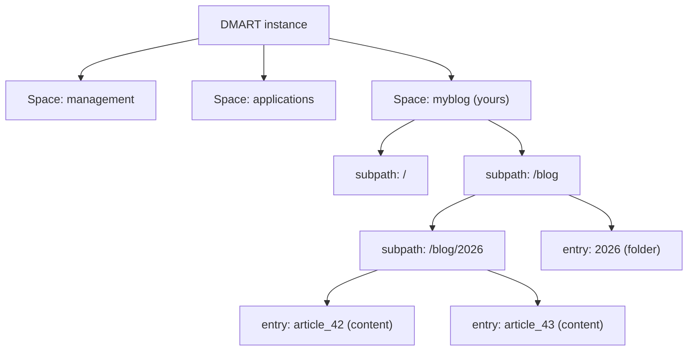
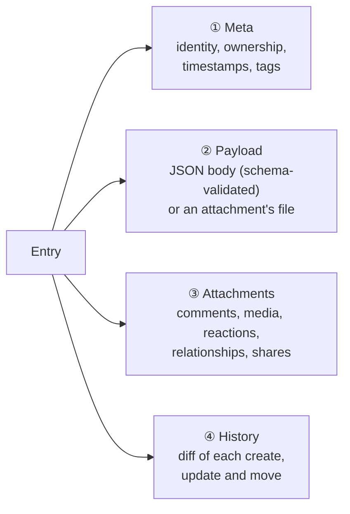

Everything in DMART is an **Entry** — a single, uniformly addressed unit of information. There are no bespoke tables per feature, no separate "users API" versus "documents API": a user, a folder, a blog post, a support ticket, an uploaded PDF and a system log are all the same shape of object, distinguished only by a `resource_type`. Understand the Entry and its address, and you understand the whole platform.

## 1. The Locator — how everything is addressed

Every entry is uniquely identified by a **four-tuple** called the _Locator_. Think of it as the full postal address of a piece of data. If you know these four values, you can read, update, or delete the entry — no numeric primary key required.

```
Locator = ( resource_type , space_name , subpath , shortname )
              │             │           │          │
              │             │           │          └ "article_42"   name, unique in the folder
              │             │           └─────────── "/blog/2026"   folder path in the space
              │             └─────────────────────── "myblog"       the space (tenant)
              └───────────────────────────────────── "content"      what kind of entry it is
```

| Part | Analogy | Rules |
|---|---|---|
| `resource_type` | File type / class | One of the 30 resource types (see §6). Discriminates the entry's shape and which table/validation applies. |
| `space_name` | Drive / tenant | Top-level container. Every entry belongs to exactly one space. The shortname characters, 1–32 chars. |
| `subpath` | Folder path | Hierarchical, slash-separated (e.g. `/users/employees`). The shortname characters plus `/`, 1–128 chars. Stored with a leading slash internally; the leading slash is stripped on the wire. |
| `shortname` | Filename | Unique within `(space, subpath)`. Allowed characters: `a–z A–Z 0–9 _` plus Arabic letters, Arabic-Indic digits and Arabic diacritics, 1–64 chars. |

`/managed/request` refuses a name that breaks these rules with `INVALID_DATA`.

The Locator is a first-class object, not just a convention. Two entries can share a shortname only in different folders or spaces: the resource type is not part of the uniqueness, so a `content` and a `folder` named `x` cannot sit in the same folder. Users, groups, roles and permissions are unique across the whole instance.

## 2. Spaces & Subpaths



### Space — the tenant boundary

A **Space** is the top-level organizational unit and the unit of isolation. It is itself an entry (`resource_type=space`) and carries configuration: which languages it supports, whether indexing is enabled, whether it is hidden, its display ordinal, and which subfolders to hide. Which plugins run on a space is set by each plugin's own `filters`, not on the space.

**management** Always present. Holds users, groups, roles, permissions and the base schemas (`meta_schema`, `folder_rendering`). Every start creates it, its `users`, `roles`, `permissions`, `groups` and `schema` folders and the two base schemas when they are missing.

**applications** A sample space `dmart seed` brings: app definitions, saved queries, configurations and translations.

**personal** Also from `dmart seed`: per-user private folders under `/people/<user>`, created along with each new user.

**your spaces** Any number of custom spaces you create for your own domains. A new space gets its own `/schema` folder.

**Creating a space** is a `create` on `/managed/request` with `resource_type: space` and the space's name as `shortname`. The request's own `space_name` must still be a valid name, and is usually the same one. A name already in use fails with `ALREADY_EXIST_SPACE_NAME` (205, HTTP 409).

```json
{
  "space_name": "myblog",
  "request_type": "create",
  "records": [
    {
      "resource_type": "space",
      "shortname": "myblog",
      "subpath": "/",
      "attributes": { "displayname": { "en": "My blog" } }
    }
  ]
}
```

A create takes the space's `displayname`, `description`, `tags`, `slug`, `is_active`, `payload`, `hide_space` and `indexing_enabled`. It sets `languages` to `["english"]`, whatever the request sends. `languages`, `ordinal`, `hide_folders`, `icon`, `mirrors` and `primary_website` take effect only through a later `update`, and an update never changes a space's `payload`.

### Subpath — the folder hierarchy

A **Subpath** is a slash-separated path inside a space, exactly like a directory path in a filesystem. `/` is the root of the space. Subpaths are normalized (leading/trailing slashes handled consistently) so `blog/2026`, `/blog/2026` and `/blog/2026/` all resolve to the same folder.

A subpath only "exists" as a browsable, configurable thing when a **folder entry** represents it. That folder is what carries display and behavior configuration for its contents — covered in depth on the [Folders & Rendering](/folders) page. `dmart check` reports a subpath, or a parent of one, that has no folder entry (`missing_folder`).

## 3. The Entry — four layers

Every entry is composed of up to four layers. Only **Meta** is mandatory; the rest are optional and added as needed.



**① Meta** System-level identity: uuid, shortname, ownership, ACLs, tags, display names, timestamps. Always present.

**② Payload** The actual content — a JSON object validated against a schema, or, on an attachment, the name of its file. Optional.

**③ Attachments** Secondary entries bound to this one: comments, media, reactions, relationships. Optional, unbounded.

**④ History** Diff log. Every create, update and move of an entry writes a row; a delete writes none (see §8).

## 4. Meta — the fields every entry shares

Regardless of resource type, every entry inherits this common set of fields (the `Meta` base). Type-specific fields are layered on top (see §5).

| Field | Type | Purpose |
|---|---|---|
| `shortname` | string | Identifier, unique within `(space, subpath)`. |
| `uuid` | UUID | Permanent primary key. Never changes, even on rename or move. |
| `is_active` | bool | Soft-active flag. The `is_active` permission condition checks it. |
| `slug` | string | Optional URL-friendly alias. Neither unique nor checked against a pattern: `byslug` returns the first match from any space, and `404` when the caller may not read that one. To make slugs unique in a folder, give it `unique_fields: [["slug"]]` (see [Folders](/folders#uniqueness)). |
| `displayname` | Translation | Per-language labels (`en`, `ar`, `ku`), e.g. `{ "en": "Articles", "ar": "مقالات" }`. |
| `description` | Translation | Per-language descriptions. |
| `tags` | string[] | Free-form labels. Queryable with `@tags:foo`. |
| `owner_shortname` | string | The user who owns the entry. |
| `owner_group_shortname` | string | Owning group. Used by the `own` permission condition. A create may name a group its creator belongs to; any other needs `assign` at the record's address (see [Access Control](/access-control#3-contextual-conditions)). |
| `created_at` | timestamp | Set on insert. |
| `updated_at` | timestamp | Refreshed on every write. |
| `payload` | Payload | Content type, schema reference, and body (see §5). |
| `acl` | Acl[] | Per-entry access-control overrides: `{user_shortname, allowed_actions, denied}`. A `query` or `view` deny also hides the entry from that user's listings. |
| `relationships` | Relationship[] | Typed links to other records, each naming its target in `related_to` (see below). |
| `query_policies` | string[] | Precomputed ACL policy strings for fast read-time filtering. |

**Relationships** point at their targets by `related_to`: `type`, `space_name`, `subpath` and `shortname`. On an entry's create, and for each link an update adds, the target must exist and the writer must be able to read it. A target that is missing, and one the writer may not read, are both refused with `INVALID_DATA` and "relationship target not found", so the answer does not say which. An entry target is looked up at its address. A `user`, `role`, `group`, `permission` or `space` target is looked up by its shortname in its own table (a deleted account is not there) and read where it lives, as a read by name reads it. Links the record already had are not checked again. An entry another entry points at cannot be deleted (`CANNT_DELETE`; see [Entity Lifecycle](/entity-lifecycle#cascade-delete-force--dry_run)), so only a caller who can read a record can hold it in place.

**Timestamps** are the server's local wall clock, with no time zone. The API returns them without an offset, such as `2026-07-06T10:00:00`, with fractional seconds when there are any. An imported timestamp that carries `Z` or an offset is converted to the server's local time, which lines it up with the times dmart stamps itself; one without is stored as written. So where a value lands decides what is stored: `2026-01-01T00:00:00Z` becomes `2026-01-01T03:00:00` on a server in Asia/Baghdad (UTC+3) and stays `2026-01-01T00:00:00` on one that runs in UTC. Code that writes to the database directly must write local wall-clock times. On PostgreSQL, dmart sets each session's time zone to the host's unless the connection string names one (see [Settings](/settings)).

## 5. Payload & type-specific fields

The **Payload** is where an entry's real content lives. What `body` holds depends on whether the record is an entry or an attachment:

- **An entry's body is inline** — a JSON object, or text for a `markdown`, `html` or `text` content type. If `schema_shortname` is set, the body is validated against that JSON Schema on every create and update. Schemas are read from the space's `/schema` folder only (`folder_rendering` from management's); a name with no schema there is saved unchecked, and `schema_shortname` itself must be a valid shortname. `dmart migrate` moves a schema kept anywhere else into `/schema`, and until it runs, every start warns about it. An entry holds no file bytes. A file uploaded for an entry through `/managed/resource_with_payload` must be JSON, and becomes its body; this holds for every entry type, `csv`, `jsonl`, `sqlite` and `parquet` included. Anything else is refused with `INVALID_DATA`.

- **An attachment can hold a file.** A `media`, `data_asset` or other attachment uploaded through `/managed/resource_with_payload` keeps the file's bytes, and its `payload.body` becomes the file name `<shortname>.<ext>`. `content_type` comes from the upload's MIME type or extension (`binary` when neither is known), and `checksum` holds the file's SHA-256. The bytes are read back through the payload route (see §7).

```
"payload": {
  "content_type": "json",          // json | markdown | html | image | pdf | csv | parquet | ...
  "schema_shortname": "article",   // optional — enables JSON-Schema validation
  "body": {                        // an entry: inline object or text; an attachment's file: "<shortname>.<ext>"
    "title": "Hello World",
    "body":  "First post."
  }
}
```

**A body is stored as sent.** Keys are never rewritten: `myKey` stays `myKey`. snake_case is the convention for payload fields, and a schema can enforce it; the server does not. Numbers keep their form, so `10240.0` comes back as `10240.0`. JSON Schema counts a number with a zero fraction as an integer, so a schema's `"type": "integer"` accepts `10240.0`.

### Payload schemas

A schema is an entry of type `schema` in the space's `/schema` folder, and its body is a JSON Schema document in the draft-07 style. dmart checks a schema when it is written and refuses one it cannot evaluate. Keywords the validator does not know are ignored, so a schema can carry hints of its own. Only local `$ref`s (`#/$defs/…`) are followed, so one schema cannot reference another schema entry or a URL.

- **A body that fails** is refused with `INVALID_DATA` (402), and an update is checked on the merged body. The message lists every failure: `payload failed schema validation: <pointer>: <keyword>: <message>; …`, the pointer empty for the body as a whole. Through `/managed/request` the request answers `SOMETHING_WRONG` (430), and the record's 402 and that message are in `error.info[0].failed`, as its `error_code` and `error` (see [API](/api-docs#managed-content-managed)). A CSV import's failed row also names the first failing field, as `key` (the dotted path, such as `address.city`) and `value`.
- **Defaults are not applied.** The server stores the body as sent, and a field the writer leaves out stays absent. cxb's new-entry form starts each field from its `default`, else its `const`, else its first `enum` value, else an empty value of its type.

#### Folder lookups: `x-dmart-lookup`

A string field, or the items of an array, can hold the shortnames of entries in a folder, much like a foreign key:

```json
"permissions": {
  "type": "array",
  "items": {
    "type": "string",
    "x-dmart-lookup": { "subpath": "/ccp_agent_permissions", "strict": true }
  }
}
```

| Key | Meaning |
|---|---|
| `subpath` | Required. The folder whose entries' shortnames are the allowed values: the entries directly in it, its subfolders among them. |
| `subfolders` | `true`: the values are the entries anywhere beneath `subpath`, as a permission's subpath covers its subtree, and a folder is never one. `"/products"` then takes every seller's products in `/products/<seller>`, not the sellers' folders, and `"/"` takes the whole space. |
| `space_name` | The folder's space. Defaults to the space of the entry being written. |
| `strict` | `true`: a create or update is refused when a value is not the shortname of one of those entries. Without it, the keyword only shapes the form in cxb. |

- **The error names the field:** `/permissions/1: x-dmart-lookup: 'view_usr' is not an entry in acme/ccp_agent_permissions`, and with `subfolders`, `… is not an entry in acme/products or beneath it`. The check runs only on a body the rest of the schema accepts, so a value of the wrong type is reported once, by the schema.
- **An empty string is no value,** and is not checked. Use `required` or `minLength` to demand one.
- **A value is a shortname, not a path.** With `subfolders`, two entries in different folders may share a shortname, and either one satisfies the check. Where a value must name a single entry, keep shortnames unique within the subtree.
- **In cxb** the field becomes a search-and-pick list of the folder's entries, single or multiple; with `subfolders`, of the entries beneath it, folders left out and each shortname listed once. More than 100 choices are searched on the server as you type.
- **`$ref`:** the keyword can sit in `$defs`. A local `$ref` to it is followed, by the server and by cxb.
- **What the check reveals:** it reads the folder as the server, not as the writer, so it tells the writer only whether a shortname exists there.
- **Management folders are not checked.** dmart's own users, roles, groups and permissions are not stored as entries. A lookup into management's `/users`, `/roles`, `/groups` or `/permissions` gets the picker in cxb, but the server does not check it.

### Type-specific extensions

Selected resource types add their own fields on top of Meta:

| Type | Adds |
|---|---|
| `user` | `password` (hashed, never serialized), `type` (`web`, `mobile`, `bot`, `admin`), `language`, `roles`, `groups`, `email`, `msisdn`, OAuth ids, `locked_to_device`, verification & login state, and the hosted `mailbox`, `mail_aliases` and `services`. |
| `role` | `permissions` — list of permission shortnames. |
| `permission` | `subpaths`, `resource_types`, `actions`, `conditions`, `restricted_fields`, `allowed_fields_values`, `filter_fields_values` (a row filter: a search the records must match). |
| `ticket` | `state`, `is_open`, `workflow_shortname`, `reporter`, `resolution_reason`, and `collaborators`: a map of names to user shortnames that any entry may carry, to which locking a ticket adds `processed_by`, the user who locked it. It grants no access of its own. |
| `space` | `languages`, `indexing_enabled`, `hide_folders`, `hide_space`, `ordinal`, `icon`, `mirrors`. |
| `folder` | A payload naming the `folder_rendering` schema — how its contents are displayed and what may live in it. See [Folders & Rendering](/folders). |

## 6. Resource-type catalog

There are 30 resource types. They all share the Meta base; the type only changes which extra fields exist, which table stores the entry, and which validation runs.

**Identity** `user`, `group`

**Structure** `folder`, `space`

**Content** `content`, `schema`, `csv`, `jsonl`, `sqlite`, `parquet`

**Workflow** `ticket`

**Social** `comment`, `reply`, `post`, `reaction`, `notification`, `share`

**Attachments** `media`, `json`, `data_asset`, `relationship`, `alteration`, `lock`

**Logs** `log`, `history`

**Management** `role`, `permission`, `acl`

**Extensions** `locator`, `plugin_wrapper`

On the wire, resource types are lowercase snake_case strings (`plugin_wrapper`, `data_asset`).

Ten of them are stored as attachments of another record, in the `attachments` table: `comment`, `reply`, `reaction`, `media`, `json`, `share`, `relationship`, `alteration`, `lock` and `data_asset`. Users, groups, roles, permissions and spaces have tables of their own; every other type is a row in `entries`.

Only `/managed/request` writes a user, group, role, permission or space, each to its own table. The routes that write entries (MCP's `dmart_create` and `dmart_update`, the CSV import, and the file upload for anything but an attachment) refuse those types, and the CSV import and MCP the attachment types too, with `NOT_SUPPORTED_TYPE` (217). A row in `entries` whose stored type is one of them cannot be updated or moved there either, only deleted.

## 7. Attachments — sub-entries bound to a parent

Attachments are themselves entries, stored in a dedicated table, that point back at a parent entry: an attachment's subpath is its parent's subpath followed by the parent's shortname. They keep related information physically together without polluting the parent's payload. The parent is usually an entry, but users, roles, permissions, groups and spaces carry attachments too (a user's live under management `/users/<shortname>`).

| Attachment | What it is |
|---|---|
| `media` | An uploaded file (image, PDF, video, document) bound to the entry. |
| `comment` / `reply` | Threaded discussion on the entry. |
| `reaction` | An emoji / like reaction. |
| `relationship` | A typed link to another entry (see also the Meta `relationships` field). |
| `share` | A share grant exposing the entry to another party. |
| `alteration` | A proposed/tracked change record. |
| `json` | A JSON fragment bound to the entry. |

Every attachment carries the same meta as an entry (its owner is whoever created it), plus optional `media` bytes, a text `body`, and a `state`. Its payload is not validated against a schema. The bytes arrive only through `/managed/resource_with_payload` (see §5).

**Creating one** is a `create` on `/managed/request` with the attachment's type and, as its subpath, the parent's subpath followed by the parent's shortname. `body` and `state` are attributes of their own, beside `payload`:

```json
{
  "space_name": "myblog",
  "request_type": "create",
  "records": [
    {
      "resource_type": "comment",
      "shortname": "auto",
      "subpath": "/blog/2026/article_42",
      "attributes": { "body": "Looks good.", "is_active": true }
    }
  ]
}
```

**An address already in use.** An entry create refuses any address that is taken. An attachment create depends on what holds it:

- **An attachment of the same type** is replaced in place. That needs `update` permission on it. It keeps its owner and owner group, and its ACL unless the request gives one.
- **An attachment of a different type** makes the create fail with `SHORTNAME_ALREADY_EXIST`.

**Reading one.** `/managed/entry`, `byuuid` and `byslug` read entries only. An attachment comes back with its parent under `retrieve_attachments=true`, from a query of `type: "attachments"`, or, for its file, from `/managed/payload/<type>/<space>/<subpath>/<shortname>.<ext>` (see [API](/api-docs)).

An attachment is listed only to a caller who may read the record it hangs off and whose grants cover the attachment's own type (`comment`, `media`, …); one whose ACL denies the caller is left out. A read of one attachment (its payload, a download, `retrieve_attachments` on a record read by name, a live notice) is held the same way: where the record's ACL denies the caller `view` or `query`, its attachments are refused too, and a refused payload answers an empty `404`, as a missing one does.

A lock taken on an entry (`PUT /managed/lock`) is not an attachment: it lives in a table of its own, lasts `LOCK_PERIOD` seconds (300 by default), and blocks other users' `update`, `delete` and `move` of the entry (see [Tickets & Workflows](/tickets)).

## 8. History & alterations

Every create, update and move of an entry writes a diff to the history log, recording which fields changed, from what to what; so do locking and unlocking it. A CSV upload's creates write none. Users, roles, groups, permissions, spaces and attachments get a row on update only (and a user on a rename or a soft delete). A move takes the entry's history with it. A delete writes no history row, and removes the history of what it deletes: of an entry and the attachments it takes, of everything beneath a folder or in a space, of an attachment on its own. A record created later at the same address starts with no history. A user's hard delete keeps the history the user wrote on records that stay. It is a change log, not a tamper-evident chain: rows are not linked by checksums.

- Query an entry's history via the `history` query type. A caller sees only the history of records it could list.

- The diff captures exactly which fields changed, from what to what.

## 9. On-disk layout (the `.dm` convention)

DMART's live data lives in the database (PostgreSQL or SQLite), but it can be exported to — and seeded from — a human-readable folder tree, and the sample/fixture data ships as that tree. This `.dm` layout is the export, seed and backup representation of the model, not a runtime store. Understanding it demystifies the whole model, because the directory structure _is_ the data model made visible.

```
spaces/
└── myblog/                              ← a Space
    ├── .dm/
    │   └── meta.space.json              ← space meta (languages, ordinal…)
    │
    ├── blog.json                        ← the FOLDER BODY for /blog  (rendering config)
    ├── blog/                            ← the /blog subpath
    │   ├── article_42.json              ← a content entry's payload body
    │   └── .dm/
    │       ├── meta.folder.json         ← folder meta (points at ../blog.json as its body)
    │       └── article_42/
    │           ├── meta.content.json    ← the entry's meta
    │           ├── history.jsonl        ← the entry's history
    │           └── attachments.comment/ ← attachments live beside the entry
    │
    └── schema/
        ├── article.json                 ← a JSON Schema, referenced by payload.schema_shortname
        └── .dm/
            ├── meta.folder.json         ← the /schema folder's meta
            └── article/
                └── meta.schema.json     ← the schema entry's meta
```

Key idea: a folder's **meta** lives at `<subpath>/.dm/meta.folder.json`, while its **body** (the rendering config) is a sibling file named `<shortname>.json` in the parent directory. This split is exactly what the [Folders & Rendering](/folders) page dissects.

| File | Holds |
|---|---|
| `.dm/meta.space.json` | Space metadata. |
| `<subpath>/.dm/meta.folder.json` | Folder metadata for that subpath. |
| `<subpath>/.dm/<name>/meta.<type>.json` | An entry's meta. |
| `<subpath>/.dm/<name>/history.jsonl` | An entry's history, one change per line. |
| `<subpath>/.dm/<name>/attachments.<type>/` | The entry's attachments of that type, each with its `meta.<shortname>.json`. |
| `<subpath>/<name>.json` | An entry's (or folder's) JSON payload body; an HTML, Markdown or text body is written as `.html`, `.md` or `.txt`. |
| `schema/<name>.json` | A JSON Schema definition; schemas are read from `/schema` only. |

## 10. One source of truth, always exportable

DMART keeps a single, authoritative store — and guarantees you can always get your data back out as plain files. Those are two different things, not two competing storage modes.

**The database — the sole source of truth** Every live read and write goes to one SQL database: PostgreSQL (via Npgsql) or SQLite. Narrow per-type tables (`users`, `groups`, `roles`, `permissions`, `spaces`) plus a generic `entries` table, with `attachments`, `histories` and `locks` alongside. ACID and relational integrity on both. On PostgreSQL, trigram (`pg_trgm` + GIN jsonb) and full-text search, plus optional pgvector semantic search; on SQLite, an FTS5 full-text index. There is no filesystem runtime store and no Redis; in-process caches only.

**The `.dm` tree — the export & backup format** The human-readable folder tree shown above is how a space is _exported, seeded and backed up_, not how it is served. `dmart export` writes a space, or one folder of it with `--subpath`, to a zip in this on-disk layout; `import` and `seed` read it back. Human-readable, diff-friendly, and trivially archived with `git` or `tar`. For large installations, `dmart export --parquet` writes a columnar archive instead, and `dmart export --all --parquet` is a full backup (see [Entity Lifecycle](/entity-lifecycle)).

The wire format is the same in both directions: clients always send and receive the same `Record` envelope, whether it is being persisted to the database or round-tripped through a `.dm` archive. This is what lets DMART promise **data longevity with zero vendor lock-in**: your data sits in a standard PostgreSQL or SQLite database _and_ can be exported to plain JSON files on disk at any time.
