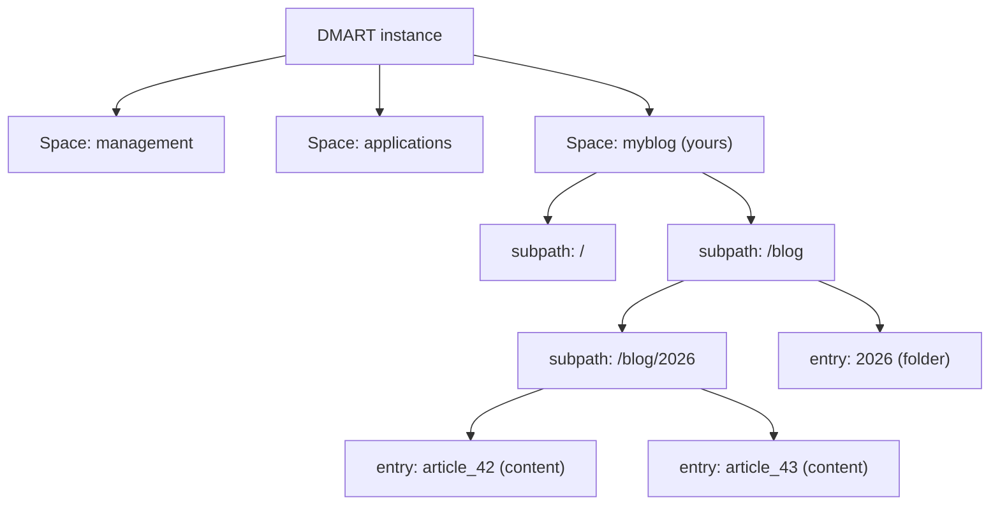
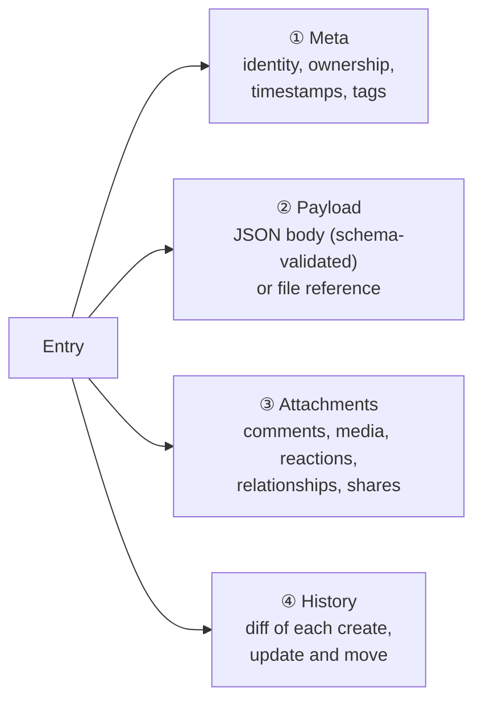

Everything in DMART is an **Entry** — a single, uniformly addressed unit of information. There are no bespoke tables per feature, no separate "users API" versus "documents API": a user, a folder, a blog post, a support ticket, an uploaded PDF and a system log are all the same shape of object, distinguished only by a `resource_type`. Understand the Entry and its address, and you understand the whole platform.

## 1. The Locator — how everything is addressed

Every entry is uniquely identified by a **four-tuple** called the _Locator_. Think of it as the full postal address of a piece of data. If you know these four values, you can read, update, or delete the entry — no numeric primary key required.

```
Locator = ( resource_type , space_name , subpath , shortname )
              │             │           │          │
              │             │           │          └ "article_42"   name, unique in the folder
              │             │           └─────────── "/blog/2026"   folder path in the space
              │             └─────────────────────── "myblog"       the space (tenant)
              └───────────────────────────────────── "content"      what kind of entry it is
```

| Part | Analogy | Rules |
|---|---|---|
| `resource_type` | File type / class | One of the 30 resource types (see §6). Discriminates the entry's shape and which table/validation applies. |
| `space_name` | Drive / tenant | Top-level container. Every entry belongs to exactly one space. |
| `subpath` | Folder path | Hierarchical, slash-separated (e.g. `/users/employees`). Stored with a leading slash internally; the leading slash is stripped on the wire. |
| `shortname` | Filename | Unique within `(space, subpath)`. Allowed characters: `a–z A–Z 0–9 _` plus Arabic letters, Arabic-Indic digits and Arabic diacritics, 1–64 chars. |

The Locator is a first-class object, not just a convention. Two entries can share a shortname only in different folders or spaces: the resource type is not part of the uniqueness, so a `content` and a `folder` named `x` cannot sit in the same folder. Users, groups, roles and permissions are unique across the whole instance.

## 2. Spaces & Subpaths



### Space — the tenant boundary

A **Space** is the top-level organizational unit and the unit of isolation. It is itself an entry (`resource_type=space`) and carries configuration: which languages it supports, whether indexing is enabled, whether it is hidden, its display ordinal, and which subfolders to hide. Which plugins run on a space is set by each plugin's own `filters`, not on the space.

**management** Always present. Holds users, groups, roles, permissions and the base schemas (`meta_schema`, `folder_rendering`). Every start creates it, its `users`, `roles`, `permissions` and `schema` folders and the two base schemas when they are missing.

**applications** A sample space `dmart seed` brings: app definitions, saved queries, configurations and translations.

**personal** Also from `dmart seed`: per-user private folders under `/people/<user>`, created along with each new user.

**your spaces** Any number of custom spaces you create for your own domains. A new space gets its own `/schema` folder.

### Subpath — the folder hierarchy

A **Subpath** is a slash-separated path inside a space, exactly like a directory path in a filesystem. `/` is the root of the space. Subpaths are normalized (leading/trailing slashes handled consistently) so `blog/2026`, `/blog/2026` and `/blog/2026/` all resolve to the same folder.

A subpath only "exists" as a browsable, configurable thing when a **folder entry** represents it. That folder is what carries display and behavior configuration for its contents — covered in depth on the [Folders & Rendering](/folders) page. `dmart check` reports a subpath, or a parent of one, that has no folder entry (`missing_folder`).

## 3. The Entry — four layers

Every entry is composed of up to four layers. Only **Meta** is mandatory; the rest are optional and added as needed.



**① Meta** System-level identity: uuid, shortname, ownership, ACLs, tags, display names, timestamps. Always present.

**② Payload** The actual content — a JSON object validated against a schema, or a pointer to an attached file. Optional.

**③ Attachments** Secondary entries bound to this one: comments, media, reactions, relationships. Optional, unbounded.

**④ History** Diff log. Every create, update and move of an entry writes a row; a delete writes none (see §8).

## 4. Meta — the fields every entry shares

Regardless of resource type, every entry inherits this common set of fields (the `Meta` base). Type-specific fields are layered on top (see §5).

| Field | Type | Purpose |
|---|---|---|
| `shortname` | string | Identifier, unique within `(space, subpath)`. |
| `uuid` | UUID | Permanent primary key. Never changes, even on rename or move. |
| `is_active` | bool | Soft-active flag. The `is_active` permission condition checks it. |
| `slug` | string | Optional URL-friendly alias. |
| `displayname` | Translation | Per-language labels (`en`, `ar`, `ku`), e.g. `{ "en": "Articles", "ar": "مقالات" }`. |
| `description` | Translation | Per-language descriptions. |
| `tags` | string[] | Free-form labels. Queryable with `@tags:foo`. |
| `owner_shortname` | string | The user who owns the entry. |
| `owner_group_shortname` | string | Owning group. Used by the `own` permission condition. |
| `created_at` | timestamp | Set on insert. |
| `updated_at` | timestamp | Refreshed on every write. |
| `payload` | Payload | Content type, schema reference, and body (see §5). |
| `acl` | Acl[] | Per-entry access-control overrides: `{user_shortname, allowed_actions, denied}`. A `query` or `view` deny also hides the entry from that user's listings. |
| `relationships` | Relationship[] | Typed links to other entries. |
| `query_policies` | string[] | Precomputed ACL policy strings for fast read-time filtering. |

## 5. Payload & type-specific fields

The **Payload** is where an entry's real content lives. It is one of two things:

- **Inline JSON** — a structured object. If `schema_shortname` is set, the body is validated against that JSON Schema on every create and update (attachments excepted). Schemas are read from the space's `/schema` folder only (`folder_rendering` from management's); a name with no schema there is saved unchecked, and `schema_shortname` itself must be a valid shortname. `dmart migrate` moves a schema kept anywhere else into `/schema`, and until it runs, every start warns about it.

- **A file reference** — `body` holds a filename and the bytes are fetched separately (images, PDFs, CSV, Parquet, …).

```
"payload": {
  "content_type": "json",          // json | markdown | html | image | pdf | csv | parquet | ...
  "schema_shortname": "article",   // optional — enables JSON-Schema validation
  "body": {                        // inline object, OR a filename string for file payloads
    "title": "Hello World",
    "body":  "First post."
  }
}
```

### Type-specific extensions

Selected resource types add their own fields on top of Meta:

| Type | Adds |
|---|---|
| `user` | `password` (hashed, never serialized), `type` (`web`, `mobile`, `bot`, `admin`), `language`, `roles`, `groups`, `email`, `msisdn`, OAuth ids, `locked_to_device`, verification & login state, and the hosted `mailbox`, `mail_aliases` and `services`. |
| `role` | `permissions` — list of permission shortnames. |
| `permission` | `subpaths`, `resource_types`, `actions`, `conditions`, `restricted_fields`, `allowed_fields_values`, `filter_fields_values` (a row filter: a search the records must match). |
| `ticket` | `state`, `is_open`, `workflow_shortname`, `reporter`, `collaborators`, `resolution_reason`. |
| `space` | `languages`, `indexing_enabled`, `hide_folders`, `hide_space`, `ordinal`, `icon`, `mirrors`. |
| `folder` | A payload naming the `folder_rendering` schema — how its contents are displayed and what may live in it. See [Folders & Rendering](/folders). |

## 6. Resource-type catalog

There are 30 resource types. They all share the Meta base; the type only changes which extra fields exist, which table stores the entry, and which validation runs.

**Identity** `user`, `group`

**Structure** `folder`, `space`

**Content** `content`, `schema`, `csv`, `jsonl`, `sqlite`, `parquet`

**Workflow** `ticket`

**Social** `comment`, `reply`, `post`, `reaction`, `notification`, `share`

**Attachments** `media`, `json`, `data_asset`, `relationship`, `alteration`, `lock`

**Logs** `log`, `history`

**Management** `role`, `permission`, `acl`

**Extensions** `locator`, `plugin_wrapper`

On the wire, resource types are lowercase snake_case strings (`plugin_wrapper`, `data_asset`).

Ten of them are stored as attachments of another record, in the `attachments` table: `comment`, `reply`, `reaction`, `media`, `json`, `share`, `relationship`, `alteration`, `lock` and `data_asset`. Users, groups, roles, permissions and spaces have tables of their own; every other type is a row in `entries`.

## 7. Attachments — sub-entries bound to a parent

Attachments are themselves entries, stored in a dedicated table, that point back at a parent entry: an attachment's subpath is its parent's subpath followed by the parent's shortname. They keep related information physically together without polluting the parent's payload. The parent is usually an entry, but users, roles, permissions, groups and spaces carry attachments too (a user's live under management `/users/<shortname>`).

| Attachment | What it is |
|---|---|
| `media` | An uploaded file (image, PDF, video, document) bound to the entry. |
| `comment` / `reply` | Threaded discussion on the entry. |
| `reaction` | An emoji / like reaction. |
| `relationship` | A typed link to another entry (see also the Meta `relationships` field). |
| `share` | A share grant exposing the entry to another party. |
| `alteration` | A proposed/tracked change record. |
| `json` | A JSON fragment bound to the entry. |

Every attachment carries the same meta as an entry (its owner is whoever created it), plus optional `media` bytes, a text `body`, and a `state`. Its payload is not validated against a schema.

An attachment is listed only to a caller who may read the record it hangs off and whose grants cover the attachment's own type (`comment`, `media`, …); one whose ACL denies the caller is left out.

A lock taken on an entry (`PUT /managed/lock`) is not an attachment: it lives in a table of its own, lasts `LOCK_PERIOD` seconds (300 by default), and blocks other users' `update`, `delete` and `move` of the entry (see [Tickets & Workflows](/tickets)).

## 8. History & alterations

Every create, update and move of an entry writes a diff to the history log, recording which fields changed, from what to what; so do locking and unlocking it. A CSV upload's creates write none. Users, roles, groups, permissions, spaces and attachments get a row on update only (and a user on a rename or a soft delete). A move takes the entry's history with it. It is a change log, not a tamper-evident chain: rows are not linked by checksums, a delete writes no history row, and a cascading delete (a folder, a space, a user in hard mode) removes the history of what it deletes.

- Query an entry's history via the `history` query type. A caller sees only the history of records it could list.

- The diff captures exactly which fields changed, from what to what.

## 9. On-disk layout (the `.dm` convention)

DMART's live data lives in the database (PostgreSQL or SQLite), but it can be exported to — and seeded from — a human-readable folder tree, and the sample/fixture data ships as that tree. This `.dm` layout is the export, seed and backup representation of the model, not a runtime store. Understanding it demystifies the whole model, because the directory structure _is_ the data model made visible.

```
spaces/
└── myblog/                              ← a Space
    ├── .dm/
    │   └── meta.space.json              ← space meta (languages, ordinal…)
    │
    ├── blog.json                        ← the FOLDER BODY for /blog  (rendering config)
    ├── blog/                            ← the /blog subpath
    │   ├── article_42.json              ← a content entry's payload body
    │   └── .dm/
    │       ├── meta.folder.json         ← folder meta (points at ../blog.json as its body)
    │       └── article_42/
    │           ├── meta.content.json    ← the entry's meta
    │           ├── history.jsonl        ← the entry's history
    │           └── attachments.comment/ ← attachments live beside the entry
    │
    └── schema/
        ├── article.json                 ← a JSON Schema, referenced by payload.schema_shortname
        └── .dm/
            ├── meta.folder.json         ← the /schema folder's meta
            └── article/
                └── meta.schema.json     ← the schema entry's meta
```

Key idea: a folder's **meta** lives at `<subpath>/.dm/meta.folder.json`, while its **body** (the rendering config) is a sibling file named `<shortname>.json` in the parent directory. This split is exactly what the [Folders & Rendering](/folders) page dissects.

| File | Holds |
|---|---|
| `.dm/meta.space.json` | Space metadata. |
| `<subpath>/.dm/meta.folder.json` | Folder metadata for that subpath. |
| `<subpath>/.dm/<name>/meta.<type>.json` | An entry's meta. |
| `<subpath>/.dm/<name>/history.jsonl` | An entry's history, one change per line. |
| `<subpath>/.dm/<name>/attachments.<type>/` | The entry's attachments of that type, each with its `meta.<shortname>.json`. |
| `<subpath>/<name>.json` | An entry's (or folder's) JSON payload body; an HTML, Markdown or text body is written as `.html`, `.md` or `.txt`. |
| `schema/<name>.json` | A JSON Schema definition; schemas are read from `/schema` only. |

## 10. One source of truth, always exportable

DMART keeps a single, authoritative store — and guarantees you can always get your data back out as plain files. Those are two different things, not two competing storage modes.

**The database — the sole source of truth** Every live read and write goes to one SQL database: PostgreSQL (via Npgsql) or SQLite. Narrow per-type tables (`users`, `groups`, `roles`, `permissions`, `spaces`) plus a generic `entries` table, with `attachments`, `histories` and `locks` alongside. ACID and relational integrity on both. On PostgreSQL, trigram (`pg_trgm` + GIN jsonb) and full-text search, plus optional pgvector semantic search; on SQLite, an FTS5 full-text index. There is no filesystem runtime store and no Redis; in-process caches only.

**The `.dm` tree — the export & backup format** The human-readable folder tree shown above is how a space is _exported, seeded and backed up_, not how it is served. `dmart export` writes a space, or one folder of it with `--subpath`, to a zip in this on-disk layout; `import` and `seed` read it back. Human-readable, diff-friendly, and trivially archived with `git` or `tar`. For large installations, `dmart export --parquet` writes a columnar archive instead, and `dmart export --all --parquet` is a full backup (see [Entity Lifecycle](/entity-lifecycle)).

The wire format is the same in both directions: clients always send and receive the same `Record` envelope, whether it is being persisted to the database or round-tripped through a `.dm` archive. This is what lets DMART promise **data longevity with zero vendor lock-in**: your data sits in a standard PostgreSQL or SQLite database _and_ can be exported to plain JSON files on disk at any time.
