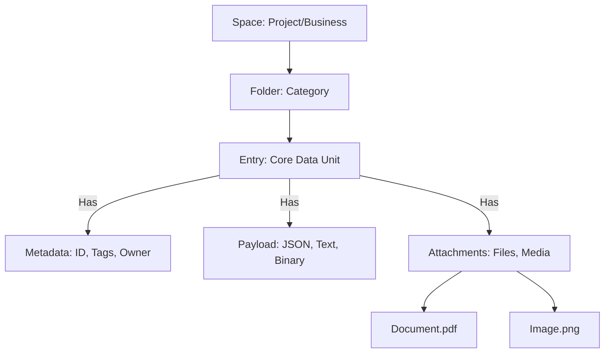
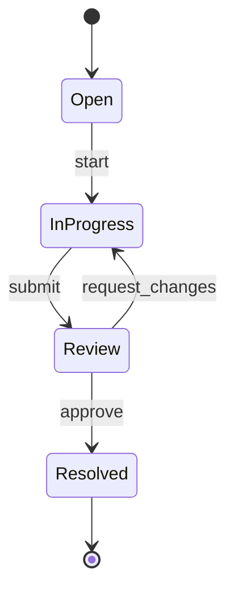
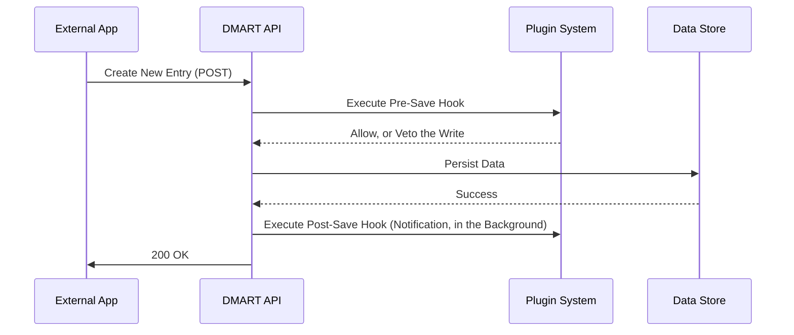

DMART is a versatile Data-as-a-Service (DaaS) platform designed to simplify data management for modern applications. It acts as a central repository for structured data, documents, and media, providing a unified interface for storage, retrieval, and collaboration.

## 1. Unified Data Management

DMART treats data as a first-class citizen, moving beyond traditional database constraints.

**Flexible "Entries"** The core unit of data — can represent anything from a simple record to a complex document.

**Structured & Unstructured** Seamlessly handle JSON data alongside text, markdown, and binary files (images, PDFs, videos).

**Diagrams in Markdown** A fenced code block marked `mermaid` in Markdown content is drawn as a diagram in CXB and the catalog.

**Attachments** Associate any number of files (documents, media) directly with an entry, keeping related information together.

**Hierarchical** Organize data into intuitive Spaces and Subpaths, similar to a file system.

**Multilingual** Display names and descriptions are kept in English, Arabic and Kurdish side by side.

## 2. Powerful Search & Discovery

Finding information is effortless with DMART's robust search engine.

- **Full-Text Search:** Search across all data, including structured fields and text content. Plain words find whole and partial words in any of their forms, correct misspellings, and come back best match first — in Arabic too, even when typed on an English keyboard layout.

- **Advanced Filtering:** Filter results by tags, creation dates, authors, and specific data attributes.

- **Native SQL Search:** Search runs inside the database — full-text and trigram indexes on PostgreSQL, FTS5 on SQLite — with no separate search cluster. Semantic search is available on PostgreSQL with pgvector and an embedding API.

## 3. Collaboration & Workflow Automation

Built-in tools to manage processes and teamwork.

- **Ticketing System:** Track work as tickets that move through states (e.g., "Open," "In Progress," "Resolved"). Each arrow above is a workflow action, and a ticket changes state when one is applied with `progress-ticket` (see [Tickets & Workflows](/tickets)).

- **Custom Workflows:** Define custom state transitions and rules to match your specific business processes. Each transition can be limited to roles or require a resolution, and a state can be closed yet keep a reopen transition, so a delivered ticket reads closed until someone with the right role reopens it.

- **Assignments:** Hand an entry or ticket over to another user, who becomes its owner. Assigning changes only the owner, and leaves a ticket's state as it is.

- **Collaborators & Locks:** Name the people working on an entry in its collaborators, and lock a ticket while you work it, which records you as its `processed_by` and holds off other editors.

- **Comments & Reactions:** Collaborate directly on data entries with threaded comments and emoji reactions.

## 4. Comprehensive Access Control

Security is granular and configurable to match organizational needs.

- **Spaces:** Distinct workspaces to isolate data and projects.

- **Role-Based Access Control (RBAC):** Define roles (e.g., Admin, Editor, Viewer) with specific permissions.

- **Granular Permissions:** Control access at the folder or even individual entry level (Create, Read, Update, Delete), down to individual fields, and limit what a role reads and writes to the records that match a filter.

- **Protected Administrator Sign-In:** Administrator accounts sign in with a password and a one-time code, and self-registration stays off until an instance turns it on.

## 5. Integration & Extensibility

Designed to integrate seamlessly with your existing ecosystem.

- **RESTful API:** A comprehensive, documented API for interacting with every aspect of the platform.

- **Plugin Architecture:** Extend functionality with custom plugins for logic, validation, or external integrations.

- **Solution Packs:** csdmart's source repository carries ready-made applications defined as data, in `packs/`: `org`, `catalogue`, `assets`, `servicedesk`, `approvals`, `kb`, `datamart` and the optional `comms`. Each is a space with its folders and schemas, plus the roles and permissions that make it usable. `packs/install.sh` installs every pack but `comms`, or `--packs a,b` with their dependencies; `--public` opens a pack's public roles to anonymous users, `--plugins` deploys its plugins, `--dry-run` prints the plan, and `--force` allows a downgrade. `packs/reset.sh` removes a pack. Each install leaves a receipt at `management/packs/<name>`, so a later update never overwrites or deletes an entry you changed; a pack's spaces, roles and permissions always follow the pack.

- **AI Agents (MCP):** An optional MCP server lets AI agents query, read and write entries as a signed-in DMART user, within that user's permissions.

- **Single Sign-On & Directory:** DMART can be the OpenID Connect provider for your other applications, and serve its users and groups over LDAP to mail servers and other directory clients. A directory replica on another host keeps answering LDAP sign-ins while the primary is down.

- **Realtime Notifications:** The live notification path today is realtime WebSocket broadcast. The `realtime_updates_notifier` plugin runs on data changes and workflow events and pushes update messages to connected WebSocket clients subscribed to the relevant space/subpath channels — no polling required. Each listener hears only of records it may read.

- **Email/SMS Delivery:** One-time codes are sent over SMTP (`MAIL_HOST`) and an SMS gateway (`SEND_SMS_OTP_API`), each with its own on/off switch. General notification delivery is not built yet: the notification plugins (`system_notification_sender`, `admin_notification_sender`, `local_notification`) are registered _no-op stubs_ pending a push/SMS/SMTP gateway pipeline. A subprocess plugin can already send email through DMART's mail settings.

## 6. Deployment & Operations

Built for flexibility and reliability in various environments.

- **Container-Ready:** Ships as a single self-contained, Native-AOT binary (no runtime to install), also packaged into a single-process Docker/Podman image for consistent environments.

- **Signed Packages:** Install and upgrade through signed RPM (Fedora, RHEL 9), DEB and APK (Alpine) package repositories.

- **Air-Gapped Friendly:** The self-contained binary bundles the server, CLI, and admin UIs with no external service dependencies — on SQLite, not even a database server — ideal for on-premises and isolated networks.

- **SQL-Backed:** A single PostgreSQL or SQLite database is the source of truth for all entries, users, and attachments — providing transactional integrity and reliability.

- **Health Checks:** Liveness and readiness endpoints for load balancers, a `dmart selfcheck` smoke test for a running server, and `dmart check` to find stored content the server cannot read or serve.

- **Portable Import/Export:** Round-trip any Space to and from a human-readable `spaces/` + `.dm` file layout (packaged as a zip) for seeding, migration, and backup — ideal for longevity and moving data between deployments.
