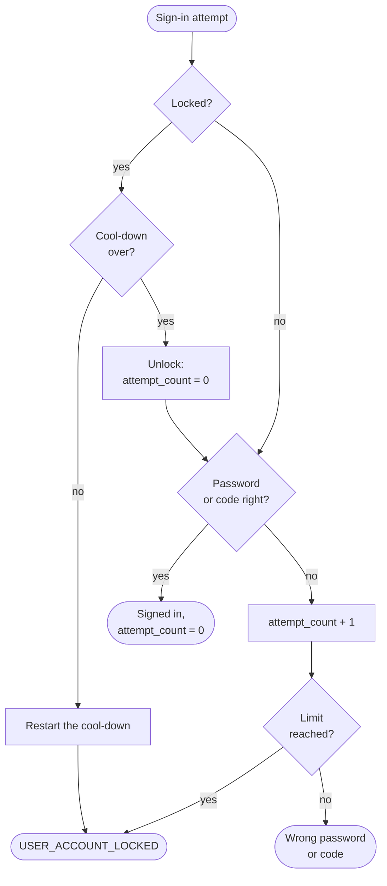
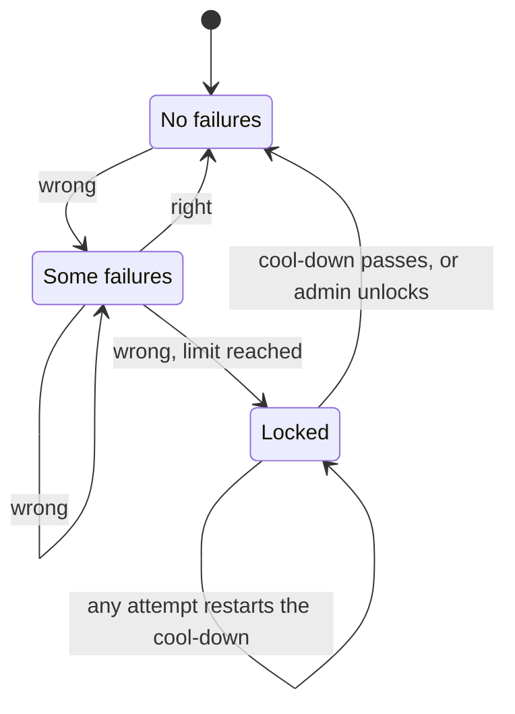

All configurable settings for DMART. Bound to the strongly-typed `DmartSettings` record and loaded from a `config.env` dotenv file and/or environment variables. Values are read **once at boot** and validated before the server starts — there is no hot reload and no file watcher.

## Loading Order

Sources are layered with a strict precedence (later wins): `appsettings.json` < `config.env` < environment variables (`Dmart__Xxx`).

The `config.env` file is located with a first-match-wins lookup:

1. The path in the `BACKEND_ENV` (or `DMART_ENV`) environment variable — used for dev/CI, e.g. a repo-local file

2. `~/.dmart/config.env` — per-user install

3. `/etc/dmart/config.env` — system-wide RPM/DEB install

A cwd-relative `./config.env` is _not_ looked up implicitly. Because the file may carry `JWT_SECRET` and `DATABASE_PASSWORD`, DMART refuses to read it when it is world-writable, and warns at every start when it is world-readable.

**Strict validation.** Configuration is bound and validated at startup (`ValidateOnStart`). Any **unknown key in `config.env` is rejected** and aborts startup — there is no silent fallthrough for typos. (Environment variables are not checked this way.) Keys of settings that no longer exist — `REDIS_HOST`/`PORT`/`PASSWORD`/`CONNECTION`, `ACTIVE_DATA_DB`, `WEBSITE_URL` and `WEBSITE_DIR` — are unknown keys and stop the boot. `ALLOW_PASSWORD_RESET_RESEND_AFTER` is ignored with a warning. `MANAGEMENT_SPACE` is retired: the management space is always `management`. `MANAGEMENT_SPACE="management"` still starts, with a warning to remove the line; any other value refuses to start.

**Frontends read the server's values.** The `config.json` DMART serves cxb and catalog carries `OTP_LENGTH`, `ALLOW_OTP_RESEND_AFTER`, `OTP_TOKEN_TTL`, `MAX_UPLOAD_SIZE_MB`, `DEFAULT_QUERY_LIMIT`, `MAX_QUERY_LIMIT`, `UI_LIST_LIMIT` and whether the password rule is custom, with its hint. A frontend DMART does not serve can read the same from `GET /public/client-config`. The `backend_timeout` in that `config.json` is at least `REQUEST_TIMEOUT` + 5 seconds, so the server's own timeout answer arrives before the frontend gives up.

## General Configuration

| Setting | Description | Default |
|---|---|---|
| `APP_URL` | Public base URL of the server, put in front of the short links `/managed/shortening/…` hands out. Empty makes them host-relative. | `""` |
| `MAX_QUERY_LIMIT` | Hard cap on the number of records returned by a query. A `limit` of `-1` asks for it. | `10000` |
| `DEFAULT_QUERY_LIMIT` | Page size of a query that omits `limit`: the managed and public query routes, CSV, export, Parquet export and the MCP tools (which stop at 50). Above `MAX_QUERY_LIMIT` it is cut to the cap, with a startup warning. | `10` |
| `UI_LIST_LIMIT` | How many items cxb and catalog ask for when they load a whole list rather than a page: spaces, a space's folders, the schema, workflow, role, group and permission pickers, notifications and comments. Never above `MAX_QUERY_LIMIT`. | `1000` |
| `QUERY_TOTAL_CAP` | Largest exact `total` a query computes. Above it, `total` is the cap and `total_is_lower_bound` is `true`. 0 = unlimited. | `100000` |
| `RETRIEVE_TOTAL_DEFAULT` | Whether a query that omits `retrieve_total` is counted. A skipped count reports `total` as `-1`. `/public/query` counts only when asked. | `true` |
| `ENABLE_SMART_SEARCH` | Plain words in a search match whole and partial words in entry values, with spelling correction, best match first. False keeps the plain substring match. | `true` |
| `SEARCH_TEXT_INDEX_BATCH_SIZE` / `SEARCH_TEXT_INDEX_PAUSE_MS` | Pace of the background pass that fills the search text of older rows: rows per batch (1–10000), and a pause between batches in milliseconds (0–60000). Each row filled is rewritten in every index on `entries`; a pause spreads that write load over longer. | `500` / `0` |
| `UNIQUENESS_MAX_PROBES` | Most searches one uniqueness rule may run for a single write; past it the write is refused | `1000` |
| `EVENTS_LOG_MAX_BYTES` | Size at which a space's `events.jsonl` rolls over (one previous file is kept). 0 = never. | `52428800` (50 MiB) |
| `URL_SHORTER_EXPIRES` | Short-link expiration (seconds) | `3600` |
| `REQUEST_TIMEOUT` | Seconds a request may run before DMART stops it and answers 504. WebSockets, `/mcp`, and zip import and export (`/managed/import`, `/managed/export`) run without it. | `35` |
| `MAX_UPLOAD_SIZE_MB` | Largest file, in MB (1–500), accepted by the routes that take one: `resource_with_payload` (managed and public), `resources_from_csv`, `import` and public `attach`. The file is held in memory while it is stored, and must arrive within `REQUEST_TIMEOUT`. Every other request stays capped at 50 MB, or at this limit when it is lower. Keep the reverse proxy's body limit at least this high. | `50` |
| `JQ_TIMEOUT` | Timeout (seconds) for the `jq` subprocess used by join sub-queries carrying a `jq_filter` | `2` |
| `JQ_MAX_CONCURRENCY` | How many `jq` subprocesses may run at once, process-wide | `4` |
| `JQ_QUEUE_TIMEOUT_SECONDS` | Seconds a request waits for a free `jq` slot before it fails | `5` |

**Outbound calls** have timeouts of their own, each 1–3600 seconds: `SMTP_TIMEOUT`, `SMS_TIMEOUT`, `OAUTH_TIMEOUT` and `EMBEDDING_TIMEOUT`, listed with their services below. Startup warns when one of them, times the calls a request makes in a row (up to three for a social sign-in), is not shorter than `REQUEST_TIMEOUT`: the request's own deadline would cut it off first, and the client would get a bare timeout instead of the call's error.

## Server & Network

| Setting | Description | Default |
|---|---|---|
| `LISTENING_HOST` | Hostname/IP the Kestrel server binds to | `"0.0.0.0"` |
| `LISTENING_PORT` | Port the server listens on (HTTP + WebSocket share this port) | `8282` |
| `CXB_URL` | URL path prefix for the embedded CXB admin SPA. Set to `/` to serve it at the root. | `"/cxb"` |
| `CAT_URL` | URL path prefix for the embedded Catalog SPA | `"/cat"` |
| `ALLOWED_CORS_ORIGINS` | Comma-separated origins allowed to make cross-site requests. Empty allows only the same-host origin. | `""` |
| `TRUSTED_PROXIES` | Comma-separated IPs/CIDRs whose `X-Forwarded-For` is trusted (for real client IP behind nginx/an LB). Loopback is always trusted. | `""` |
| `FORWARDED_FOR_HOP_COUNT` | Number of proxy hops in front of DMART | `1` |
| `OTLP_ENDPOINT` | OpenTelemetry collector endpoint for metrics/traces. Empty disables observability entirely. | `""` |

With `ASPNETCORE_URLS` set in the environment, that names the listen address instead of `LISTENING_HOST` and `LISTENING_PORT`. `dmart selfcheck`, and `dmart cli` given no URL, reach the server at `LISTENING_HOST`:`LISTENING_PORT` from the same `config.env`, reading a wildcard host such as `0.0.0.0` as `127.0.0.1`.

## Database & Storage

**DMART keeps all runtime data in one SQL database: PostgreSQL (via Npgsql) or SQLite.** PostgreSQL is the full tier. SQLite is a reduced tier for a single node, the edge, development and CI, and the default for the RPM, DEB and APK packages and the container. There is no Redis and no filesystem runtime store; all caches are in-process.

| Setting | Description | Default |
|---|---|---|
| `DATABASE_DRIVER` | `postgresql` (or `postgres`) or `sqlite`; any other value stops startup. Unset, DMART picks PostgreSQL when `POSTGRES_CONNECTION` or `DATABASE_PASSWORD` is set or another `DATABASE_*` connection setting differs from its default, and SQLite otherwise; the startup log says which and why. | `""` (inferred) |
| `SQLITE_PATH` | The SQLite database file, used only on SQLite. Relative paths resolve against the working directory; the packages use `/var/lib/dmart/dmart.db`. Keep it on a local disk, not NFS. | `"dmart.db"` |
| `AUTH_CACHE_TTL` | Seconds the per-request user and session lookups are cached. 0 = check the database on every request. | `5` |
| `AUTHZ_CACHE_TTL` | Seconds a user's resolved permissions are cached. The node that changes them evicts at once; this bounds how stale other replicas can be. 0 = no TTL. | `60` |

On PostgreSQL, provide a full connection string with `POSTGRES_CONNECTION`, or leave it unset and let DMART assemble one from the individual `DATABASE_*` components below.

### PostgreSQL Connection

| Setting | Description | Default |
|---|---|---|
| `POSTGRES_CONNECTION` | Full Npgsql connection string. When set, the component settings below are ignored. | `""` (unset) |
| `DATABASE_HOST` | Database hostname | `"localhost"` |
| `DATABASE_PORT` | Database port | `5432` |
| `DATABASE_USERNAME` | Database username | `"dmart"` |
| `DATABASE_PASSWORD` | Database password | `""` |
| `DATABASE_NAME` | Database name | `"dmart"` |
| `DATABASE_POOL_SIZE` | Connection pool size. The pool opens at most this plus `DATABASE_MAX_OVERFLOW` connections. | `10` |
| `DATABASE_MAX_OVERFLOW` | Connections allowed beyond `DATABASE_POOL_SIZE` | `10` |
| `DATABASE_POOL_TIMEOUT` | Seconds to wait for a connection (Npgsql `Timeout`) | `30` |
| `DATABASE_POOL_RECYCLE` | Seconds an idle pooled connection is kept before it is closed (Npgsql `Connection Idle Lifetime`) | `1800` |
| `DATABASE_KEEPALIVE` | Seconds of socket inactivity before a keepalive probe is sent. 0 disables. | `30` |
| `DATABASE_MAX_AUTO_PREPARE` | How many of the most-reused statements Npgsql prepares per connection. 0 disables. Ignored with `POSTGRES_CONNECTION`. | `200` |

### Spaces Folder (import/export only)

The on-disk `spaces/` + `.dm/meta.*.json` layout is a transfer/backup format used only by `import`, `export` and `seed` — never as a live store. `SPACES_FOLDER` defaults empty. When set, it is where `dmart seed` copies the bundled sample spaces, and the root of an optional append-only audit trail: each space's events go to `<SPACES_FOLDER>/<space>/.dm/events.jsonl` (rolled over at `EVENTS_LOG_MAX_BYTES`), which `events` queries read. Empty, no audit trail is written.

## Security & Authentication

Authentication is JWT Bearer (HS256, symmetric key from `JWT_SECRET`) with Argon2id password hashing. With `ENABLE_MCP=true` DMART also runs an OAuth 2.1 authorization server for MCP clients, and with `OIDC_ISSUER` set, an OpenID Connect provider that signs its tokens with its own RSA key. DMART's own tokens are always HS256; that is not configurable.

### JWT & Sessions

| Setting | Description | Default |
|---|---|---|
| `JWT_SECRET` | Symmetric signing key: at least 32 bytes and 10 distinct characters (e.g. `openssl rand -hex 32`). **Required — the server refuses to start on the placeholder value.** | `"change-me…"` |
| `JWT_ISSUER` | Expected `iss` claim | `"dmart"` |
| `JWT_AUDIENCE` | Expected `aud` claim | `"dmart"` |
| `JWT_ACCESS_EXPIRES` | Access-token lifetime (seconds) | `2592000` (30d) |
| `JWT_REFRESH_DAYS` | Refresh-token lifetime (days) | `30` |
| `JWT_REQUIRE_TOKEN_USE` | Reject JWTs lacking the `token_use` claim (access vs refresh separation) | `false` |
| `MAX_SESSIONS_PER_USER` | Max concurrent sessions per user; past it the oldest sessions end | `5` |
| `SESSION_INACTIVITY_TTL` | Idle seconds before a JWT is rejected and its session deleted (0 = disabled) | `0` |
| `SESSION_MAX_LIFETIME_SECONDS` | Hard cap on the refresh-token chain from original login (0 = disabled) | `0` |
| `LOGOUT_ON_PWD_CHANGE` | Invalidate all sessions on password change | `true` |
| `CSRF_PROTECT_COOKIE_AUTH` | Gate cookie-borne auth against cross-site requests (bearer-header callers unaffected) | `true` |

### Brute-force & Rate Limiting

| Setting | Description | Default |
|---|---|---|
| `MAX_FAILED_LOGIN_ATTEMPTS` | Wrong passwords and codes before an account is auto-locked (0 = never lock) | `5` |
| `LOCKOUT_COOLDOWN_SECONDS` | Seconds with no sign-in attempt before a locked account unlocks (0 = locked until an admin unlocks) | `900` |
| `AUTH_RATE_LIMIT_PER_MINUTE` | Per-address cap per 60s (HTTP 429 beyond it) on every route that takes a credential or sends a code — sign-in, codes, password reset, registration, social sign-in, `/oauth/*`, the OIDC sign-in form — plus `/public/submit` and anonymous uploads. The LDAP face allows as many failed binds per address. At least 1. | `10` |
| `PUBLIC_RATE_LIMIT_PER_MINUTE` | Per-address cap on all `/public` calls per 60s. Behind a proxy it needs `TRUSTED_PROXIES`, or every visitor shares one bucket. 0 disables. | `600` |
| `MAX_OTP_VERIFY_ATTEMPTS` | Wrong guesses allowed against one OTP code before it is invalidated. 0 means 5: no code takes unlimited guesses. | `5` |
| `LOCK_PERIOD` | Seconds a `PUT /managed/lock` stays held before another user can take it | `300` |
| `REPAIR_LEGACY_LOCKOUTS_ON_START` | At startup, release the account locks an older release wrote as `is_active=false`. A no-op once repaired. | `true` |

These limits are server-wide. They apply the same way to web, mobile and admin accounts; bot accounts are never locked by `MAX_FAILED_LOGIN_ATTEMPTS`, though their failures are still counted.

#### One sign-in attempt

*Locked* means `attempt_count` has reached `MAX_FAILED_LOGIN_ATTEMPTS`. *Cool-down over* means no attempt for more than `LOCKOUT_COOLDOWN_SECONDS`. A wrong code also uses up one of that code's own `MAX_OTP_VERIFY_ATTEMPTS`. Wrong passwords at the login, OIDC and MCP sign-in forms, wrong codes at login and password reset, a wrong current password on a profile change or at `/user/validate_password`, a wrong current password when an account changes its own email or phone, and failed LDAP binds all add to the same counter.

#### The account over time

The cool-down counts from the **last** attempt, not from when the lock started, so every attempt while locked starts it again, even one with the correct password. With the defaults:

| Time | What happens | Result |
|---|---|---|
| 10:00–10:02 | 5 wrong passwords | The 5th locks the account |
| 10:10 | The correct password | Refused: still locked, and the 15 minutes now run to 10:25 |
| 10:26 | The correct password | Unlocked and signed in |

A lock does not sign the user out: access tokens already issued keep working until they expire, but refreshing them at `/oauth/token` is refused. An admin unlocks an account early with a user update carrying `unlock: true`, which is what the "clear on save" box in CXB and the catalog sends. An `attempt_count` sent in an update is ignored, so a client that posts a user record back can neither clear a lock nor lower the counter. Nobody unlocks their own account this way, and unlocking an admin account takes a global admin or the admin that owns it.

### Registration, OTP & Profiles

| Setting | Description | Default |
|---|---|---|
| `IS_REGISTRABLE` | Allow self-registration via `POST /user/create`, and the accounts `ENABLE_OTP_IMPLICIT_REGISTRATION` creates | `false` |
| `IS_OTP_FOR_CREATE_REQUIRED` | Require a verified OTP for account creation. Off, self-registration marks any email or phone it is given as verified without proof, which startup warns about. | `true` |
| `OTP_TOKEN_TTL` | One-time-password time-to-live (seconds) | `300` |
| `OTP_LENGTH` | Digits in a one-time code, 4–9. Each digit fewer makes a code ten times easier to guess, so startup warns below 6. | `6` |
| `ALLOW_OTP_RESEND_AFTER` | Minimum seconds between codes sent to one destination, counted separately for password reset and for every other purpose. A request inside it answers success and sends nothing. Replaces the retired `ALLOW_PASSWORD_RESET_RESEND_AFTER`. | `60` |
| `MAX_OTP_REQUESTS_PER_DAY` | Cap on codes sent to one destination in a rolling 24 hours, counted the same two ways (0 = no cap) | `10` |
| `OTP_HISTORY_RETENTION_DAYS` | Days used and expired codes are kept before they are purged. 0 = never purged. | `2` |
| `REGISTRATION_ENABLED_CHANNELS` | Channels self-registration accepts: `email` and/or `msisdn`. Empty closes self-registration. | `"email,msisdn"` |
| `ENABLE_OTP_IMPLICIT_REGISTRATION` | Let a code sign-in with an unknown email or phone create the account instead of failing, under the same gates as `/user/create` (`IS_REGISTRABLE` and the channel) | `false` |
| `REGEX_CONFIG_PATH` | JSON file overriding the `email` and `msisdn` patterns and the password rule (`password`, with the `password_hint` a refused password is told). Empty = `~/.dmart/regex.json`. The built-in rule is 8–64 characters with a digit and an uppercase letter. | `""` |
| `USER_CREATE_DEFAULT_ROLE` | Single role assigned to every self-created user (self-service create ignores roles in the body) | `""` (none) |
| `USER_CREATE_DEFAULT_GROUP` | Single group assigned to every self-created user | `""` (none) |
| `USER_PROFILE_PAYLOAD_PROTECTED_FIELDS` | CSV of payload fields users cannot update via `POST /user/profile` | `""` |
| `ALLOWED_SUBMIT_MODELS` | CSV of `space.schema` pairs allowed for `/public/submit` and anonymous uploads, matched exactly, case included (empty = none) | `""` |
| `USER_DELETION_MODE` | `soft` keeps a deleted user's row, marked deleted and stripped of contacts and password; `hard` deletes it with the user's entries, attachments, sessions and locks | `"soft"` |

### Admin Accounts

Accounts of type `admin` sign in with their password and a one-time code, both checked: once the password checks out, the server sends the code. An admin resets its password by code only while another admin has set `force_password_change` on the account.

| Setting | Description | Default |
|---|---|---|
| `ADMIN_IP_ALLOWLIST` | IPs and CIDR ranges admin accounts may sign in and work from, checked at sign-in and on every request. Empty = no address limit. Behind a proxy it needs `TRUSTED_PROXIES`. An entry that does not parse stops startup. | `""` |
| `ADMIN_USER_TYPE` | Type the built-in `dmart` account is held to at every start: `web` or `admin`. As `admin` it signs in with its password and a code, so it needs an email or phone the server can send to; becoming one ends its sessions. Setting `web` again and restarting is the way back in when codes stop arriving. | `"web"` |

### Password Hashing

These set how new hashes are made. A stored hash keeps its own parameters, so changing them never invalidates a password.

| Setting | Description | Default |
|---|---|---|
| `PASSWORD_HASH_MEMORY_KB` / `PASSWORD_HASH_ITERATIONS` / `PASSWORD_HASH_PARALLELISM` | Argon2id cost (OWASP's recommended settings) | `19456` / `2` / `1` |
| `PASSWORD_HASH_MEMORY_BUDGET_MB` | Ceiling on the hashing memory in use at once; hashes past it wait. 0 = half the memory available to the process. | `0` |
| `PASSWORD_HASH_QUEUE_TIMEOUT_SECONDS` | How long a hash waits for budget before the request gets a 503 with `Retry-After` | `30` |
| `PASSWORD_REHASH_ON_LOGIN` | After a successful login, rehash a password stored with other parameters | `true` |
| `MAX_PASSWORD_RECORDS_PER_REQUEST` | Most records carrying a password in one `/managed/request`. 0 disables. | `50` |

### Admin Bootstrap

| Setting | Description | Default |
|---|---|---|
| `ADMIN_EMAIL` | Email seeded for the `dmart` admin on first boot only | `""` |
| `ADMIN_PASSWORD` | First-boot admin password. Intentionally omitted from `config.env`; the recommended flow is `dmart passwd dmart`, which prompts for the password. Honoured via `Dmart__AdminPassword` if provided. | `""` (unset) |

## Email & Notifications

Email and SMS each have an on/off switch, `IS_SMTP_ENABLED` and `IS_SMPP_ENABLED`. Left unset, a channel is on exactly when it has a real gateway. A channel that is off sends nothing, mocked or not, and logs no code, while the request still succeeds, so a code sent over it reaches nobody. Startup names a gateway or a mock that an off channel ignores.

### SMTP

| Setting | Description | Default |
|---|---|---|
| `IS_SMTP_ENABLED` | Email on (`true`) or off (`false`). Unset, email is on exactly when `MAIL_HOST` is set. | `""` (follows `MAIL_HOST`) |
| `MAIL_HOST` | SMTP server host. With email switched on and no host, nothing is sent and a code is logged only at `debug` level. | `""` |
| `MAIL_PORT` | SMTP port | `587` |
| `MAIL_USERNAME` | SMTP username | `""` |
| `MAIL_PASSWORD` | SMTP password | `""` |
| `MAIL_USE_TLS` | Use TLS for the SMTP connection | `true` |
| `MAIL_FROM_ADDRESS` | From email address. Required, and must be a valid address, while email is really sent (on, not mocked, with a `MAIL_HOST`): the server refuses to start without it. | `""` |
| `MAIL_FROM_NAME` | From name | `""` |
| `SMTP_TIMEOUT` | Seconds one email send (connect, TLS, sign-in, transfer) may take | `15` |
| `MOCK_SMTP_API` | Send no email (dev/test) while email is on. Each code is still random, and is written to the server log at `warning` level. A mock is not a mail server, so without a `MAIL_HOST` it needs `IS_SMTP_ENABLED=true`. | `false` |

### SMS Gateway

| Setting | Description | Default |
|---|---|---|
| `IS_SMPP_ENABLED` | SMS on (`true`) or off (`false`). Unset, SMS is on exactly when `SEND_SMS_OTP_API` or `SEND_SMS_API` is set. | `""` (follows the endpoints) |
| `SEND_SMS_OTP_API` | POST endpoint for OTP SMS delivery. With SMS switched on and no endpoint, nothing is sent and a code is logged only at `debug` level. | `""` |
| `SEND_SMS_API` | POST endpoint for general SMS delivery | `""` |
| `SMS_SENDER` | Optional sender ID / from-name inlined into the SMS request body | `""` |
| `SMPP_AUTH_KEY` | Value of the `auth-key` header sent to the SMS gateway. Blank, no SMS is sent. | `""` |
| `SMS_TIMEOUT` | Seconds a call to either SMS endpoint may take before the send counts as failed | `15` |
| `MOCK_SMPP_API` | Send no SMS (dev/test) while SMS is on. Each code is still random, and is written to the server log at `warning` level. A mock is not a gateway, so without an SMS endpoint it needs `IS_SMPP_ENABLED=true`. | `false` |
| `MOCK_OTP_FIXED` | Make every code sent over a mocked channel the fixed `MOCK_OTP_CODE`. Test servers only: anyone who knows an account's email or phone can then sign in as it. The server refuses to start with it on and no code, and warns at every start while it is in force. | `false` |
| `MOCK_OTP_CODE` | The fixed code, `OTP_LENGTH` digits long; used only with `MOCK_OTP_FIXED=true` | `""` |

## Logging

| Setting | Description | Default |
|---|---|---|
| `LOG_FORMAT` | `"text"` (human-readable) or `"json"` (structured JSON lines). Unset, it is `json` under systemd. With `LOG_FILE` set, output is always JSON. | `"text"` |
| `LOG_LEVEL` | `trace`, `debug`, `information`, `warning`, `error`, `critical`, `none` | `"information"` |
| `LOG_FILE` | Log file path. Empty = stdout only (container/journald friendly). Set, the file gets every log line, and each request's access line carries its request and response bodies (JSON, up to 32 KB each) with secrets masked. | `""` |
| `LOG_MAX_BYTES` | Max file size before rotation. 0 disables rotation. | `1073741824` (1 GB) |
| `LOG_BACKUP_COUNT` | Rotated archive retention (< 0 unlimited, 0 truncate, > 0 keep N) | `-1` |

## Third-Party Integrations

### OAuth / Social Login

Leaving a provider’s `CLIENT_ID` blank disables it cleanly — its endpoints return a "provider not configured" error instead of attempting an outbound call. Social sign-in never creates an account: it reaches an existing one — by its `<provider>_<id>` shortname, by a provider id linked at an earlier sign-in, or the first time by a verified email — and is refused when none matches.

| Setting | Description | Default |
|---|---|---|
| `GOOGLE_CLIENT_ID` / `GOOGLE_CLIENT_SECRET` / `GOOGLE_OAUTH_CALLBACK` | Google OAuth credentials + redirect URI | `""` |
| `FACEBOOK_CLIENT_ID` / `FACEBOOK_CLIENT_SECRET` / `FACEBOOK_OAUTH_CALLBACK` | Facebook OAuth credentials + redirect URI | `""` |
| `FACEBOOK_GRAPH_VERSION` | Graph API version every Facebook call and the login dialog use. Meta retires each version two years after its release. | `"v26.0"` |
| `FACEBOOK_LINKS_BY_EMAIL` | Let the email Facebook returns link the DMART account that carries it. Off by default, since Facebook marks no address as verified the way Google and Apple do: Facebook then reaches only an account already linked to it, or its `facebook_<id>` shortname. | `false` |
| `APPLE_CLIENT_ID` / `APPLE_TEAM_ID` / `APPLE_KEY_ID` / `APPLE_P8_PRIVATE_KEY` / `APPLE_OAUTH_CALLBACK` | Apple Sign In. The mobile id-token flow needs only `APPLE_CLIENT_ID`; the web callback needs all five. The client secret is a short-lived ES256 JWT that DMART mints on the fly from the .p8 key. | `""` |
| `OAUTH_TIMEOUT` | Seconds each outbound call to a provider may take. A sign-in makes up to three. | `10` |

### Embeddings (semantic search, opt-in)

When the `pgvector` extension is installed _and_ `EMBEDDING_API_URL` is set, DMART embeds every entry on create/update and exposes `POST /managed/semantic-search` plus the `dmart_semantic_search` MCP tool. The endpoint is OpenAI-compatible.

| Setting | Description | Default |
|---|---|---|
| `EMBEDDING_API_URL` | Embeddings endpoint. Empty keeps semantic search off. | `""` |
| `EMBEDDING_API_KEY` | Bearer token for the embeddings endpoint | `""` |
| `EMBEDDING_MODEL` | Model name sent in the request body | `"text-embedding-3-small"` |
| `EMBEDDING_TIMEOUT` | Seconds one embedding call may take. A semantic search that runs out fails; a write still succeeds, leaving the entry unembedded. | `10` |

### Directory: LDAP, Replicas and OpenID Connect

DMART can serve its users as a read-only LDAP directory, keep a replica of another instance's users, and act as an OpenID Connect provider. All three are off by default.

| Setting | Description | Default |
|---|---|---|
| `LDAP_PORT` / `LDAPS_PORT` | Plain LDAP (with StartTLS once a certificate is set) and implicit-TLS ports. 0 = off. | `0` / `0` |
| `LDAP_HOST` | Address the LDAP listeners bind to | `"127.0.0.1"` |
| `LDAP_TLS_CERT_FILE` / `LDAP_TLS_KEY_FILE` | PEM certificate chain and key; re-read when they change on disk | `""` |
| `LDAP_TRUSTED_PEERS` | Addresses of the deployment's own directory clients: exempt from the failed-bind limit, and may bind over cleartext | `"127.0.0.0/8,::1"` |
| `LDAP_BASE_DN` | Base of the tree: users under `ou=people`, groups under `ou=groups` | `"dc=dmart"` |
| `LDAP_SERVICE_ACCOUNTS` | Bot users that may bind as `cn=<name>,ou=services` and read the whole directory | `""` |
| `LDAP_EXTRA_USER_OBJECT_CLASSES` | `objectClass` values added to every user entry | `""` |
| `LDAP_SIZE_LIMIT` / `LDAP_MAX_SCAN` | Most entries an unpaged search returns / most rows a search on an unindexed attribute examines | `500` / `100000` |
| `USER_SERVICES` | Services a user can be granted (e.g. `mail,matrix`). Empty accepts any lowercase name. | `""` |
| `USER_MAIL_DOMAINS` | Mail domains a user's mailbox and aliases must be in. Empty accepts any. | `""` |
| `USER_SERVICE_GRANTERS` | `service:role` pairs naming who may grant each service. A service with no pair is global-admin only. | `""` |
| `DIRECTORY_FEED_READERS` | On a primary: bot users that may read `/managed/directory-feed`, password hashes included. Empty turns the feed off. | `""` |
| `DIRECTORY_REPLICA_OF` | On a replica: the primary's base URL. Empty = not a replica. | `""` |
| `DIRECTORY_REPLICA_SHORTNAME` / `DIRECTORY_REPLICA_PASSWORD` | The bot account the replica signs in to the primary as | `""` |
| `DIRECTORY_REPLICA_INTERVAL_SECONDS` | Seconds between polls of the primary | `30` |
| `DIRECTORY_REPLICA_MAX_STALENESS_HOURS` | Hours a replica keeps answering binds after its last good sync. 0 = no limit. | `24` |
| `OIDC_ISSUER` | Public base URL of the OpenID Connect provider, `https` unless it is a loopback address. Empty = off. | `""` |
| `OIDC_SIGNING_KEY_FILE` | PEM RSA key that signs ID and access tokens; created on first start when missing | `""` |
| `OIDC_CLIENTS_FILE` | JSON list of relying parties; re-read when it changes | `""` |
| `OIDC_TOKEN_SECONDS` | Lifetime of ID and access tokens, 60–86400 | `3600` |

### Channel Authentication

| Setting | Description | Default |
|---|---|---|
| `ENABLE_CHANNEL_AUTH` | Gate requests on the `x-channel-key` header | `false` |
| `CHANNELS_CONFIG_PATH` | Path to the channels JSON file (empty = `~/.dmart/channels.json`) | `""` |

## Miscellaneous

| Setting | Description | Default |
|---|---|---|
| `ENFORCE_FOLDER_CONTENT_POLICY` | Enforce a folder’s content-policy arrays on create/update/move. False = dry-run (violations warn-logged but allowed). | `true` |
| `ENABLE_INNER_JOIN_PUSHDOWN` | Push eligible inner joins into SQL as correlated EXISTS semi-joins. False forces the in-memory fallback. | `true` |
| `ENABLE_MCP` | Expose the Model Context Protocol surface: `/mcp`, the OAuth 2.1 authorization server (`/oauth/*`) and its `/.well-known/oauth-*` discovery documents. False leaves all of them unmapped (`INVALID_ROUTE`, HTTP 422). | `false` |
| `IMPORT_MAX_ENTRIES` | Reject zip imports declaring more than this many entries (decompression-bomb guard). 0 disables. | `500000` |
| `IMPORT_MAX_UNCOMPRESSED_BYTES` | Reject zip imports whose declared uncompressed size exceeds this. 0 disables. | `2147483648` (2 GiB) |
| `PARQUET_ROW_GROUP_ROWS` | Rows per row group in a Parquet export | `50000` |
| `PARQUET_ATTACHMENT_PAGE_SIZE` / `PARQUET_HISTORY_PAGE_SIZE` | Attachments / history rows fetched per page during a Parquet export | `500` / `10000` |
| `PARQUET_BULK_BATCH_SIZE` | Rows per bulk batch when restoring a Parquet export | `10000` |
