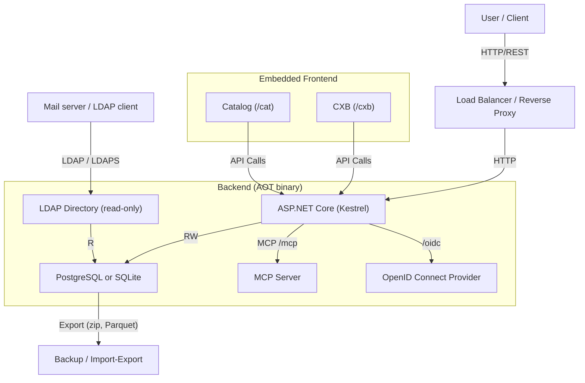
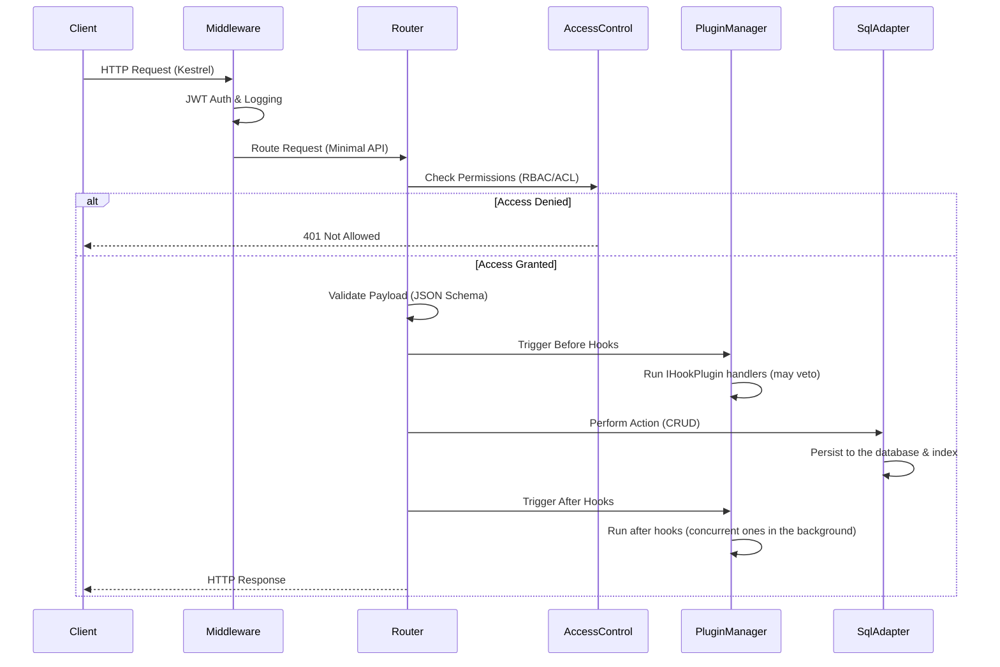

## 1. Introduction

DMART (Data Mart) is a Data-as-a-Service (DaaS) platform designed to act as a streamlined, low-code information inventory system. It treats data assets as commodities, allowing for structured, unstructured, and binary data management. Optimized for small to medium data footprints (<=300 million primary entries), it uses a SQL database for data longevity and ACID compliance.

## 2. Architecture

DMART follows a microservices-friendly architecture with clear separation between the API layer, data processing, and storage.



### Backend Stack

- **Language & Runtime:** C# on .NET 10, compiled ahead of time with **Native AOT** into a single self-contained binary (about 70 MB; the fully static build about 77 MB) — no runtime install required. JSON is source-generated (System.Text.Json), and the same binary bundles both the server and the CLI client.

- **Web Framework:** ASP.NET Core Minimal APIs on the **Kestrel** HTTP server, built with the slim/AOT host (`WebApplication.CreateSlimBuilder`). Endpoints are route groups (`MapGroup`), not MVC controllers. Swagger/OpenAPI is served at `/docs`.

- **Data Persistence:** one SQL database is the single source of truth for all runtime data: **PostgreSQL** (via Npgsql) for the full tier, or **SQLite** for a single node, the edge and development — ACID compliant with relational integrity. There is no Redis and no filesystem runtime store; caches are in-process only.

- **Authentication:** JWT Bearer (HS256, Argon2id-hashed passwords), sign-in with a password or a one-time code by email or SMS, and Google, Facebook and Apple sign-in. Administrator accounts sign in with a password **and** a one-time code, and can be limited to listed addresses (`ADMIN_IP_ALLOWLIST`). Self-registration is off unless an instance enables it (`IS_REGISTRABLE=true`).

- **Identity for other systems:** DMART can also be an OAuth 2.1 authorization server for MCP clients (`ENABLE_MCP=true`), an OpenID Connect provider with single sign-on (`OIDC_ISSUER`), and a read-only LDAPv3 directory of its users and groups (`LDAP_PORT`, with StartTLS or LDAPS). A **directory replica** on another host keeps a read-only copy of the users and groups, password hashes included, and answers LDAP binds on its own while the primary is down. `dmart import-ldif` moves an existing LDAP directory into DMART's users.

- **Interoperability:** Built-in MCP server at `/mcp` (Streamable HTTP; off by default, enable with `ENABLE_MCP=true`) and WebSocket endpoints for realtime updates.

### Frontend Stack

DMART ships two **Svelte 5 + Vite** single-page apps that are **embedded directly into the .NET binary** and served by ASP.NET middleware — no separate frontend deployment:

- **CXB (`/cxb`):** the Customer eXperience Builder — the primary administrative interface.

- **Catalog (`/cat`):** a user-facing app for browsing and publishing entries, with threaded comments and reactions, messaging, polls, surveys and notifications.

- **Under the hood:** Svelte 5, @roxi/routify v3, Vite, Tailwind CSS with Flowbite, and Svelte stores for state.

## 3. Data Model

DMART uses an **Entry-oriented** data model rather than a document-oriented one. Every entity shares a common set of Meta fields and is told apart by its `resource_type`.

### Resource Hierarchy

- **Space:** Top-level container defining configuration like languages, indexing, and visibility.

- **Subpath:** Logical folder structure within a space (e.g., `/content/posts`).

- **Entry:** Atomic unit of information with UUID, Shortname, Meta, Payload, and Attachments.

### Key Data Structures

The C# models are sealed records (`Entry`, `Attachment`, `User`, `Space`, `Role`, `Permission`, `Group`, …), not a class hierarchy.

- **Meta:** the fields every entry shares (uuid, shortname, slug, acl, owner, timestamps, …).

- **Record:** Flat representation for API I/O.

- **Payload:** Content type, schema reference, and body.

- **Attachment:** a resource bound to a parent entry, stored in its own table: media, comment, reaction, relationship, and more.

- **DataAsset:** an attachment (`data_asset`) holding a data file, with content type **CSV**, **JSONL**, **SQLite** or **Parquet**. DMART stores and serves the file's bytes and does not read them. Here `sqlite` is a content type, not to be confused with the SQLite database backend.

- **Ticket:** an entry with workflow state, a reporter, and collaborators.

## 4. Key Features

### 4.1 Storage & Data Longevity

Data is stored in normalized SQL tables, on PostgreSQL or SQLite, ensuring ACID compliance and standard relational integrity. The database is the sole runtime store; the on-disk `spaces/` + `.dm/` layout is used only as a portable import/export, seed, and migration format (zip round-trips), never as a live data store.

### 4.2 Advanced Search & Querying

The `/query` endpoint supports a rich query language that is compiled to SQL. On PostgreSQL, search uses trigram indexes (`pg_trgm` + GIN on jsonb) and full-text indexes, with optional **pgvector** semantic search for cosine-similarity matching (given an embedding API); on SQLite, FTS5 indexes. See [Query & Search](/query-search).

- **Filtering:** By space, subpath, resource type, schema, and specific shortnames.

- **Full-text Search:** plain words match whole and partial words in entry values, in any of their forms, with spelling correction, best match first. Arabic is handled natively: diacritics and letter variants are ignored, and Arabic typed on an English keyboard layout is still found.

- **Aggregation:** Grouping and reducing data (counts, sums).

- **Sorting & Pagination:** `limit`, `offset`, `sort_by`.

- **Specialized Queries:** `history`, `events`, `tags`, `counters`, `random`.

### 4.3 Access Control (RBAC + ACL)

Security enforced via a comprehensive `AccessControl` module (see [Access Control](/access-control)):

- **Permission Scope:** Action type, subpath, resource type, conditions, field-level restrictions, and row filters that narrow a grant to matching records — applied to listings, reads by name and writes alike. A write through a filtered grant reaches only the records its filter covers, and may not leave a record outside it.

- **ACLs:** Per-instance access overrides on individual entries. A deny hides the record from listings, counts and exports, not only from a direct read.

- **Realtime & Events:** WebSocket notifications and the events feed reach only callers who may read the changed record.

### 4.4 Workflows & Tickets

Ticketing system with state management and a `/progress-ticket` API for workflow transitions. See [Tickets & Workflows](/tickets).

### 4.5 Data Import/Export

- **ZIP:** Export a whole space, or one folder of it, preserving folder structure, and import it into PostgreSQL or SQLite.

- **Parquet:** `dmart export --parquet` writes a columnar archive of a space or folder, of every space as a full backup (`--all`), or of only what changed since an earlier export (`--since`); `dmart import --parquet` restores it.

- **CSV Export:** Stream query results as CSV (`/csv` endpoint).

- **CSV Import:** Batch-create resources from CSV uploads (`/resources_from_csv`).

### 4.6 Plugin System

Event-driven plugin architecture built around two C# interfaces: `IApiPlugin` (new endpoints mounted at `/{shortname}`) and `IHookPlugin` (before/after action interceptors). Beyond managed C# plugins, DMART also loads **subprocess plugins** from `~/.dmart/plugins` — crash-safe executables speaking JSON-lines over stdin/stdout — enabling extensions written in any language. A subprocess plugin can call back into DMART mid-request to read and write entries, run queries, send email or broadcast on a channel. See [Plugins](/plugins).

## Request Flow



## 5. API Structure

REST-like and resource-oriented. Key routers:

**`/managed`**: Core content management (CRUD, Query, Import/Export).

- `/request`: Unified endpoint for batch operations.

- `/query`: Main search endpoint.

- `/entry`: Single entry metadata and payload.

- `/payload`: Raw content/media retrieval.

- `/import` / `/export`: Bulk data operations.

- `/health/{type}/{space}`: the data health checks `dmart check` runs.

- **`/user`**: Authentication and profile management.

- **`/public`**: Anonymous access: public reads, plus form submissions and uploads into the spaces and schemas an instance allows (`ALLOWED_SUBMIT_MODELS`). Anything created anonymously starts inactive.

- **`/qr`**: QR code endpoints (mapped, not implemented yet; they answer 501).

- **`/info`**: System information, manifest and metrics, for global admins (except `/info/me`).

- **`/health/live`**, **`/health/ready`**: Liveness and readiness probes. Readiness checks the database and, on a directory replica, that its copy is synced.

- **`/ws`**: WebSocket channel subscriptions for realtime updates.

- **`/mcp`**: Model Context Protocol server (Streamable HTTP) exposing DMART tools to AI clients, paired with the OAuth 2.1 Authorization Server for client onboarding. Requires `ENABLE_MCP=true`; off by default.

- **`/oidc`**: OpenID Connect provider, with discovery at `/.well-known/openid-configuration`. Requires `OIDC_ISSUER`; off by default.

- **`/docs`**: Swagger UI and OpenAPI schema (`/docs/openapi.json`).

## 6. Data Asset Management

DMART stores data files, and moves its own data in and out in tabular formats. It does not read, query or convert the contents of a stored file.

- **Data-asset attachments:** a `data_asset` attachment, uploaded through `/managed/resource_with_payload`, holds a CSV, JSONL, SQLite or Parquet file. Its content type comes from the upload's MIME type or file extension (`csv`; `jsonl` or `ndjson`; `sqlite` or `db`; `parquet`). DMART stores the bytes as they are and serves them back. `sqlite` here is a content type, not the SQLite database backend.

- **The `csv`, `jsonl`, `sqlite` and `parquet` resource types** cannot hold such a file: an upload for any of them must be JSON, and anything else is refused with `INVALID_DATA`. Use a `data_asset` attachment.

- **Entries as data:** entries go out as CSV (`/managed/csv`, `dmart cli export csv`) and come back from CSV (`/managed/resources_from_csv`), and whole spaces go out and back as Parquet archives (`dmart export --parquet`, `dmart import --parquet`). See [4.5 Data Import/Export](#45-data-importexport).

## 7. Deployment

- **Single Binary:** Native-AOT publish produces one self-contained `dmart` executable (about 70 MB; 77 MB for the fully static build). The static musl build has no runtime dependency at all — copy and run; the glibc tarballs ship `libe_sqlite3.so` and `libargon2.so.1` beside it. The embedded admin UIs and sample seed data ship inside it, and the same binary doubles as the [CLI](/cli) (`seed`, `import`, `export`, `migrate`, `check`, `selfcheck`, and an interactive client).

- **Packages:** RPM (Fedora and RHEL 9), DEB and APK (Alpine) packages from signed package repositories, plus tarballs for Linux on x86-64 and arm64 (glibc, and fully static musl). Zips for Windows x64 and macOS arm64 are built only while the csdmart repository is public. The tarballs and zips are on the repository's releases page, which is not public for now; see [Installation](/installation). Every release file is checksummed, signed and carries build provenance; see [Verifying a release](/installation#verifying-a-release).

- **Containerized:** a single-process Alpine image (`ghcr.io/edraj/csdmart`) that listens on port 8000, on SQLite by default; point it at an external PostgreSQL for the full tier. See [The container](/installation#the-container).

- **Config:** Environment variables / `config.env`, bound and validated once at startup (strict unknown-key rejection, no hot reload).

- **External dependency:** none on SQLite (the default for the RPM, DEB and APK packages and the container); a PostgreSQL instance for the full tier — no Redis, no separate search cluster required.

- **Health & Operations:** `/health/live` and `/health/ready` for load balancers and orchestrators. `dmart selfcheck` smoke-tests a running server (readiness, sign-in, CRUD, query), and `dmart selfcheck --ready-only --wait <seconds>` waits for a restarted node before you move on to the next. `dmart check` finds stored content the server cannot read or serve: orphaned attachments, unknown content types, media whose bytes do not match their type, missing folders, payloads that break their schema. On the server's own host, `dmart cli` signs in without a password, from the server's configuration, and sends the token it mints only to that host's own server.

### Installing and upgrading

How to install dmart from the package repositories, the container image, a release file or source, and how to verify a release, is on [Installation](/installation). What to do for a new release, including the notes for each one, is on [Upgrading](/upgrading).

### Running several nodes

Several dmart processes may share one PostgreSQL database, for example behind a load balancer. SQLite is single-node.

- **Taking turns:** PostgreSQL advisory locks let one process at a time run schema initialization, the search-text fill and the `query_policies` rewrite after an upgrade. A node that starts while another is initializing waits, and logs `waiting for another dmart to finish schema initialization` once a minute; `dmart migrate` waits the same way.
- **Upgrades:** upgrade every node that shares the database together. A node of an earlier release does not take its turn, and runs the search-text fill alongside the others.
- **Startup:** a database that cannot be reached yet is retried for about a minute (after 1, 2, 4 and 8 seconds, then every 10). If schema initialization still fails, dmart stops. The packaged unit restarts it; a unit or supervisor of your own needs `Restart=on-failure` too.
- **After a rollback:** after rolling back and upgrading again, or restoring a database taken before the upgrade, delete the `query_policies_v2` row from `maintenance_runs`, or run [`dmart update_query_policies --all-tables`](/cli#12-update_query_policies).

Each process keeps some state to itself:

| State | What it means behind a load balancer |
|---|---|
| WebSocket connections | a notification reaches only the clients connected to the node that handled the write |
| MCP sessions, and MCP OAuth client registrations and codes | keep each MCP client on one node: sticky sessions for `/mcp` and `/oauth/*` |
| OIDC authorization codes (60 seconds) | route `/oidc/*` to one node |
| rate limiters | each node counts only its own requests |
| sign-in and permission caches | a change made through another node applies here within `AUTH_CACHE_TTL` (5 s) and `AUTHZ_CACHE_TTL` (60 s); see [Settings](/settings) |

### Small devices and diagnostics

On a small board, set two .NET runtime variables in the process's environment (for the packaged service, `Environment=` lines in a `systemctl edit dmart` drop-in), not in `config.env`:

```bash
DOTNET_gcServer=0                # workstation GC: server GC sizes its heaps per core
DOTNET_GCHeapHardLimit=8000000   # 128 MiB, in bare hex
```

- **Bare hex:** a `0x`-prefixed `DOTNET_GCHeapHardLimit` is ignored without a word. Check `gc_heap_hard_limit_bytes` in `GET /info/metrics`, where 0 means no limit.
- **What the limit bounds:** the managed heap only. Argon2 password hashing allocates native memory, which `PASSWORD_HASH_MEMORY_BUDGET_MB` bounds instead (see [Settings](/settings)).
- **Where memory goes:** `GET /info/metrics` (admin only; `?format=prometheus` for a scraper) reports both `gc_heap_bytes` and `process_working_set_bytes`. A working set that grows while the heap stays flat is native memory; a heap that grows with it is managed.
- **Startup log:** the first lines name the dmart version and the database driver, and say whether the driver was set or inferred, e.g. `database driver: sqlite (inferred — no PostgreSQL connection configured)`.
- **Port in use:** dmart prints `Error: Port <port> is already in use.` and exits with status 1.
- **Permissions after an import:** a `dmart import` or a direct SQL edit of users, roles or permissions does not clear the running server's permission cache, which then serves the old grants for up to `AUTHZ_CACHE_TTL` seconds. `GET /managed/reload-security-data` (global admin) clears it at once.
